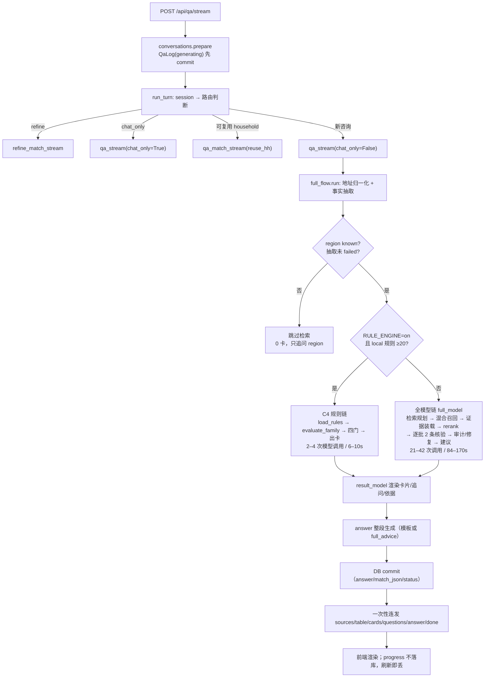
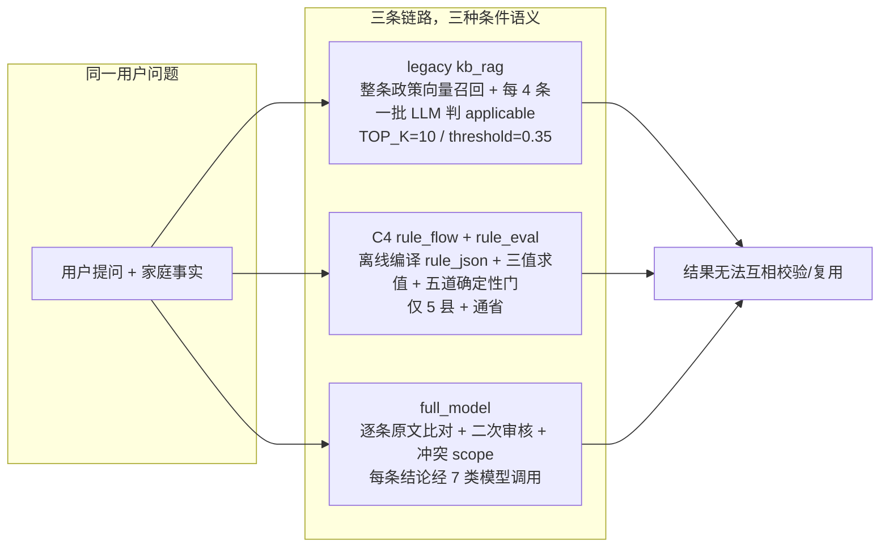
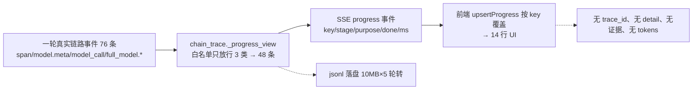
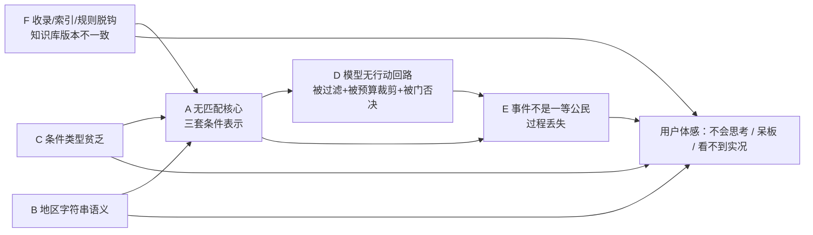
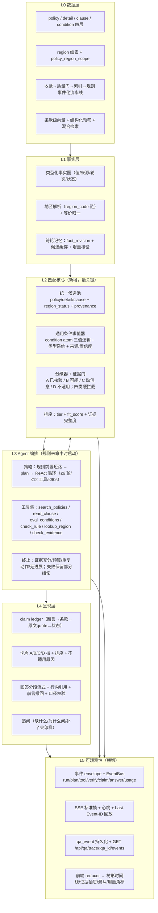
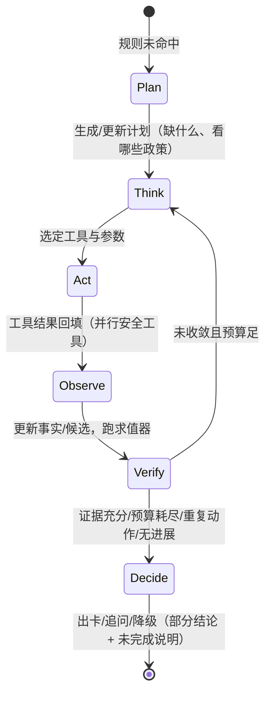

# 00 · 总览与重新设计：从「三条硬链」到「会思考、看得见的匹配系统」

> 项目：/home/adminroot/smart-help；基线：git tag `baseline-20261106`（commit `0d20ef1`）
> 本轮性质：**只读扫描 + 重新分析 + 重新设计**，未改任何生产代码/数据/配置。
> 证据来源：01–05 五份专题（源码 file:line、chain_trace jsonl、Kingbase 只读 SELECT、前端 ask.html）+ 本文件交叉验证。
> 数据快照：qa_log 503 行（complete 481 / interrupted 22）；Kingbase policy_db_mig20261021 70 表；向量 10424 行；policy_rule 453 条；trace 84 个 jsonl。

---

## 1 一句话结论

1. **系统不是"AI 不够强"，而是缺一个真正的匹配核心**：同一件事（判断某政策是否适用于某户）被三套互不兼容的条件表示各做一遍——legacy 向量+LLM 判 applicable、C4 离线规则+确定性三值求值、full_model 逐条原文比对+二次审核（01 §1）。三条链路的结果无法互相校验，用户体感"同一问题换个县/换个说法就换一套逻辑"。
2. **"先匹配区域"不是一处代码，而是一层系统性缺陷**：地区语义有三套实现（facts 字符串相等、retrieval SQL LIKE 白名单、kg_retrieval 子串启发式），且地区过滤发生在模型之前——真实 trace 一轮 `unique_candidates=153 → region_dropped=150 → eligible=3`（02 §3.5；evidence_loader.py:59-116）。**召回不是瓶颈，证据装载才是**。
3. **"硬性条件多、呆板"的数据根因是条件没有结构化**：82 个字段里 45 个是 boolean（55%），只有 12 个带枚举；`cond_tri_state` 只认 lab/health/age/pov 四个维度，其余一律"待核实"（kg_retrieval.py:407-449）；规则 453 条里 396 条 status=partial（02 §3.1）。能判的四个维度里还有"0-100 岁""无限制"这类噪声编码。
4. **"模型参与少"首先是被过滤和预算裁剪，其次才是没给智能体结构**：每轮最多核 10–12 条来源、每批 2 条（full_settings.py、deploy/web.env），18 个 trace 共 664 次模型调用/5030.6s 里，`conflict_scope` 一项占 26.7%、`reason` 占 23.4%（03 §3）；单轮 qa529 42 次调用/170.8s/0 卡。模型做的是"事后解释与自我审查"，不是"看事实、选政策、拿证据、再决定"。
5. **"看不到真实实况"是协议级缺失**：每轮真实产生 76 个链路事件，SSE 只转发 48 条，前端思考面板最终渲染 14 行中文标签（04 §3.3）。`chain_trace._progress_view` 只放行 3 类事件（chain_trace.py:46-68）；没有 trace_id 贯通（qa_log 无该列，models.py:103-118）；answer 在流水线跑完后一次性下发（conversations.py:520-542）。
6. **"收录不全/知识库原理可疑"的主因是三条时间线脱钩**：入库不触发向量化、向量化是人工 cursor 脚本、规则编译靠流量懒触发或 60s 轮询；向量/政策/规则 max(时间戳) 分别是 2026-11-05 / 10-12 / 11-06（02 §3.3、R2）；`_load_vectors` 静默排除 291 行（10424→10132）且不计数不告警。
7. **目标不是把智枢抄过来，而是搭三层缺件**：①一个统一的匹配核心（统一候选池 + 通用条件求值 + 分级 + 证据门）；②一个限定范围的 ReAct 编排器（只在规则未命中时启动，模型提议、机器裁决、硬预算）；③一条事件一等公民的观测协议（envelope + 全量事件 + 回放 + 前端时间线）。三者叠加才能同时满足"会思考、智能匹配、实时实况、零误放行"。
8. **实施必须分阶段**：M0（可观测性 + 地区软过滤 + 预算止血，1–2 周，低风险）→ M1（统一匹配核心 v1）→ M2（Agent 编排 v1）→ M3（数据层四层 schema 与收录流水线）。每阶段都有开关、验收指标与回退路径，先不动生产代码，待用户批准后实施。

---

## 2 现状架构

### 2.1 一条问答的真实生命周期（以家庭匹配为例）



### 2.2 三套条件表示并存（问题的结构性根源）



三者的差异不是实现细节，而是**本体论差异**：legacy 认为"政策是一段可向量检索的文本"，C4 认为"政策是一条可编译的布尔表达式"，full_model 认为"政策是一条需要逐条对照原文的规则"。三种假设各自产生一批硬门与补丁，最终表现为用户看到的"硬性条件多"。

### 2.3 关键代码位置（跨专题索引）

| 环节 | 位置 | 现状要点 |
|---|---|---|
| 路由与链路选择 | `src/policy_core/full_flow.py:99-200` | RULE_ENGINE 灰度 :146-156；region 必须 known 才检索 :158 |
| 规则链 | `src/policy_core/rule_flow.py:306-322`、`rule_eval.py:219-389` | local<20 回退慢链；四门 + decide 三值；出卡口径固定 |
| 全模型链 | `src/policy_core/reasoning.py:1373-1467`、`full_runtime.py` | 每批 2 条、7 类调用、预算 36/180（生产 env 96/420） |
| 检索 | `src/policy_core/retrieval.py:35-301`、`evidence_loader.py:59-116` | 向量 top40×6 方向 + 词面 LIKE；地区硬过滤在前 |
| 事实状态机 | `src/policy_core/facts.py:30-96` | 4 状态 known/unknown/conflict/needs_revalidation；region 字符串相等 |
| 知识库检索 | `src/kb_rag.py:304-366,572-664`、`kg_retrieval.py:246-349,407-449` | 向量装载静默丢 291 行；legacy 判定；地区/条件启发式 |
| 生成 | `src/policy_core/full_advice.py:49-85`、`result_model.py:107,209` | 四段式≤400 字；lite 失败回退固定句；模板/审校四模式 |
| SSE | `src/conversations.py:420-588`、`chain_trace.py:46-113` | 10 种 type；白名单 3 类；0.25s 轮询；无 id/event/心跳 |
| 前端 | `src/static/ask.html:513-535,1287-1460` | 一行最新动作 + 展开列表；历史不重建思考面板 |
| 部署 | `deploy/foreground.py:105-112,171` | gunicorn 1 worker × 2 threads |
| 数据入库 | `src/policy_ingest.py:7-105`、`reindex_vectors_2560.py:22-119`、`compile_rules.py:27-226` | 三个独立人工/懒触发段，无事务联动 |

### 2.4 数据与运行基线（2026-11-06 实查）

| 资产 | 数值 | 备注 |
|---|---|---|
| Kingbase 表 | 70 张，21 张运行期在用，49 张复制/快照 | kg2_/kg3new_/kg4a_/kg4b_ + 多批 20261012 快照 |
| policy / detail | 3337 行 / 9403 行 | 1831 个不同政策名，45% 同名异编号；明细 region 仅 109 个值 |
| 向量 | policy_vector_qwen3 10424×2560d | `_load_vectors` 实际装载 10132（静默排除 291：过期 284/未生效 6/停用 1） |
| 规则 | policy_rule 453 条（吉安131/万安87/莲花79/新建59/于都58/通省39） | partial 396 条（87%）；README 记 336 条/4 县，与库已漂移 |
| 数据字典 | fields.json 82 字段 | 45 boolean（55%）、12 带枚举、2 带 implies_true |
| 证据包 | bundle.json 34MB（2026-10-16 构建，9390 行） | 与 policy_detail 9403 行漂移 13 行 |
| 问答日志 | auth 库 qa_log 503 行（481 complete/22 interrupted） | policy 库 qa_log 仅 60 行历史遗留 |
| 模型调用 | 18 个 trace 聚合 664 次 / 5030.6s | conflict_scope 120 次/1342.2s(26.7%)；reason 99 次/1177.4s(23.4%) |
| 单轮实测 | qa528 21 次/133.9s；qa529 42 次/170.8s；qa530 26 次/110.7s | 三轮 matched 卡=0；qa529 conflict_scope 14 次/208.1s(48.4%) |
| 事件 | 真实一轮 76 条链路事件 | SSE 转发 48 条，前端渲染 14 行（trace 199f07a2，48s） |

---

## 3 机制细节（跨专题统一视图）

### 3.1 谁决定"怎么匹配"：四道硬开关

| # | 开关 | 代码位置 | 当前行为 | 后果 |
|---|---|---|---|---|
| 1 | 地址/地区是否可解析 | `full_flow.py:113-158`、`geo.py` | region 非 known 或抽取 failed → 直接跳过检索 | 0 卡、2 个追问；地区值变体判 conflict 也走这里 |
| 2 | 是否走 C4 规则链 | `full_flow.py:146-156`、`rule_flow.py:306-322` | 有本地规则且 ≥20 条 → C4；否则入队并回退 | 5 县秒级、其余县 110–170s；新建区首个用户走慢链 |
| 3 | 候选是否被保留 | `evidence_loader.py:59-116` | status/版本/日期/地区/per_policy=2；地区 False 即丢 | 153→3；地区冲突直接归零 |
| 4 | 单轮核验多少 | `full_settings.py:11-32`、`deploy/web.env` | max_sources 10（默认 12）、batch 2、max_calls 96/deadline 420（默认 36/180） | 每轮上限封死；预算撞墙后核验不完整→0 卡 |

**关键事实**：模型从来没有得到"我要看哪些政策"的决定权。检索计划（intent）由模型产出，但候选池在 evidence_loader 被确定性 SQL 砍到个位数，模型只能对这 3 条做文章（03 §6.1 归因）。这是"模型参与少"的第一层原因，比"没有 agent loop"更靠前。

### 3.2 检索：召回充足，过滤致命

真实一轮（2026-11-06T22:23，chain_trace）：

```text
retrieval_plan count=4
retrieved_chunks=160  source_keyword_hits=12  unique_candidates=153
evidence_load: dropped={region:150, region_unconfirmed_kept:3}  eligible=3  selected=3
rerank: local_cross_encoder 3 → 3；lexical_rerank positive=2
```

10 次 evidence_load 抽样：region 丢弃 9/62/93/101/121/138/147/151 条，eligible 仅 2–29 条。地区过滤是**唯一一个把 90%+ 候选一次性清零的环节**，且发生在 rerank 与模型之前。另：词面召回排序 key 里 `-keyword_score` 在最前（retrieval.py:141），长尾政策易被关键词命中挤掉；rerank 有 4s 本地预算，超时静默回退 LLM（qa529/530/531 实测 ReadTimeout）。

### 3.3 裁决：模型提议 + 确定性门

全模型链每批 2 条来源的调用链约 5+N 次：`reason`（逐条核验）→ `binding_repair`（绑定修复）→ `route_repair` → `conflict_scope`（口径冲突）→ `scope_audit` → `reason_audit` → `reason_repair` → `branches_match`。模型输出 verdict 后，还要过：
- `validate_decisions`（reasoning.py:750）
- 名称门 22 个泛词 + 3/2 字 gram（reasoning.py:1336-1358）
- 类目一致性门 8 类（reasoning.py:1265-1334）
- 特指物项门 11 词、险种域门 8 词（:1505-1530）
- `primary_gate.validate_primary_reference`（:850）
- 规则链另有 domain/completeness/structural/audience 四门（rule_eval.py:38-331）

这些门的共同问题：**它们是在"条件类型不够表达"时打的补丁**，只能靠字符串包含/词表否决，无法表达"年龄 62 岁 vs 仅限残疾儿童"这种真正需要语义判断的冲突（audit P0-3 案例），却会误杀同义改写的合法匹配（S-ZB-069 被名称门杀两次）。

### 3.4 生成：四种模式，没有一种以"证据账本"为中心

| 模式 | 位置 | 特点 | 问题 |
|---|---|---|---|
| 规则路径 | `rule_flow.py:265-303` | 100% 模板拼装 | 无模型参与，句式固定 |
| 全模型 lite | `full_advice.py:49-85` | 单次生成 ≤400 字，失败回退固定句 | 无逐条引用、无行号；400 字截断 |
| 写作+审校 | `full_advice.py` 完整模式 | draft + audit + claims 校验 | 2–4 次调用，成本高 |
| 咨询 | `kb_rag.py:1016-1043` | Top6 原文片段 2–5 句 | 无 rerank、无政策级聚合、可能全来自同一政策 |

回答不区分"已核验/可能/待补充"的信息层级；卡片只出"已满足部分条件"档，导致要么 0 卡、要么信息量不足。

### 3.5 可观测性：76 → 48 → 14



丢失的 28 条包括：model.meta（tokens/重试）、full_model.reasoning/retrieval/rerank/evidence_load/result、request_start/route/trace_summary。而 qa_log.match_json 里其实已落库 coverage 23 键、diagnostics.calls、decision_audit、facts 29 条（qa605，28,280 字节），历史回放却只渲染 sources/table_rows/cards/questions/answer 5 类。**内部资产并不缺，缺的是"事件化 + 出口 + 回放"。**

### 3.6 LLM 调用图谱（18 traces，664 次/5030.6s）

| purpose | 次数 | 总耗时(s) | 占比 | 性质 |
|---|---|---|---|---|
| conflict_scope | 120 | 1342.2 | 26.7% | 口径冲突判定（可程序化大部分） |
| reason | 99 | 1177.4 | 23.4% | 逐条核验（核心） |
| scope_audit | 58 | 444.9 | 8.8% | 核验后审计 |
| reason_audit | 105 | 427.9 | 8.5% | 二次审核（可并入 reason） |
| binding_repair | 30 | 267.6 | 5.3% | JSON 绑定修复（契约问题） |
| reason_repair | 20 | 237.9 | 4.7% | 复核修复 |
| fact_extract | 28 | 202.2 | 4.0% | 事实抽取（核心） |
| retrieval_plan | 32 | 163.6 | 3.3% | 检索规划（核心） |
| fact_audit | 23 | 153.3 | 3.0% | 抽取审计 |
| branches_match | 36 | 98.4 | 2.0% | 政策分支 |
| advice | 31 | 82.3 | 1.6% | 回答生成 |
| question_bind | 21 | 70.6 | 1.4% | 追问组织 |
| rerank | 11 | 60.5 | 1.2% | 模型重排 |

结论：**真正产生匹配价值的调用（reason/fact_extract/retrieval_plan）≈30%，其余 70% 花在自我审查、修复、冲突解释上**；而自我审查又受预算挤压，后半段直接放弃核验。P0 立刻可省：conflict_scope 先程序分类（可求值/歧义/来源缺），只对歧义项调模型，预计 −60% 该用途耗时。

---

## 4 问题与根因（统一根因模型）

> 根因按机制归类，不按个案。每条给证据链与用户可感知影响；个案仅作证据。

### 4.1 根因 A · 没有匹配核心：三套条件表示 + 三个裁决策略

- 证据：01 §1（三链路）；`rule_eval.py:332`（规则三值）、`reasoning.py:1373-1467`（模型逐条）、`kb_rag.py:572-664`（legacy LLM 判 applicable）。
- 机制后果：同一个政策在不同链路得到不同粒度/不同口径的结论；规则链出的卡与全模型链出的卡结构相同但证据强度不同，用户无法分辨；缓存/评估/审计无法复用。
- 用户体感："换一个县/换一种问法，答案逻辑就变了"；"同一政策有时说符合、有时说没查到"。

### 4.2 根因 B · 地区不是一等公民：三套字符串语义 + 过滤先于理解

- 证据：`facts.py:30-48` 字符串相等（"莲花县" vs "莲花县琴亭镇" → conflict）；`retrieval.py:102` 地区 LIKE 白名单；`kg_retrieval.py:246-349` 子串/后缀启发式；`evidence_loader.py:59-116` 地区 False 即丢；`full_flow.py:113-158` conflict → 跳过检索。
- 机制后果：①地区值变体判冲突→0 检索→0 卡（qa526，4 calls/11.5s/0 卡/2 问）；②政策级与明细级地区矛盾时无法裁决；③上级/省级政策适用关系靠默认值兜底（config.py:35）；④93% 候选被砍且不告诉用户原因。
- 用户体感："为什么只匹配我所在县？市里/省里的政策不能用吗？"——这就是"先匹配区域"的投诉本源。

### 4.3 根因 C · 条件类型系统贫乏：硬门是补丁，不是能力

- 证据：fields.json 82 字段/45 boolean/12 枚举；`policy.conditions` 是机器拼接串（"劳动力年龄:0-100" 835 行）；`policy_detail.conditions` 全自由文本；`extra` 仅 4 个半结构化键；`cond_tri_state` 只认 4 维（kg_retrieval.py:407-449）；规则 396/453 partial。
- 机制后果：真正需要类型的地方（金额区间、参保月数、学生阶段、残疾等级、成员关系）没有类型，只能用"boolean 字段 + 词表门 + 模型自由文本"近似；于是每出现一个 bad case 就加一道门（8 条类目门/22 词名称门/11 词物项门/8 词险种门/15+ 错误码），门只增不减，系统越来越呆板。
- 用户体感："全是硬性条件""明显相关的政策却匹配不上""62 岁给我推残疾儿童康复救助"。

### 4.4 根因 D · LLM 没有"行动—观察"回路：只有固定槽位的生成

- 证据：无 planner/tool_call/reflection 实现（src 全文仅 3 处注释命中）；请求体无 tools/tool_choice（kb_rag.py:435-449）；反思是固定次数 repair；检索无循环；temperature 恒 0；跨轮记忆仅 facts + 最近 6 轮原文 + 内容哈希缓存。
- 机制后果：模型看不到"我选的政策长什么样、条文原文是什么、用户事实对应哪一条"，只能在给定候选里做一次性判断；判断被后置门否决后无法换策略（qa529 conflict_scope_rejected 14 次）；预算耗尽后只能降级为 0 卡。
- 用户体感："模型像个填表机/模板机，不做真正的分析"。

### 4.5 根因 E · 事件不是一等公民：链路是日志，不是产品数据

- 证据：`chain_trace.py:46-68` 白名单 3 类；`conversations.py:582-588` 只有 `data:`；无 trace_id 列；progress 不落库；answer 整段下发；error 清空全部内容；1 worker×2 threads。
- 机制后果：内部真实过程（检索漏斗/逐条判定/门禁原因/tokens）无法到达用户与客服；刷新/断线即丢；排查只能 grep jsonl；前端无法做"每步可展开"。
- 用户体感："只看到 14 个词在转，看不到它在想什么、查到了什么、为什么拒了。"

### 4.6 根因 F · 收录/索引/规则三条时间线脱钩

- 证据：入库不触发向量化（policy_ingest.py:82-105）；reindex 人工 cursor 脚本（reindex_vectors_2560.py:35-119）；规则编译懒触发/60s worker；向量/政策/规则时间线 11-05/10-12/11-06；bundle 9390 vs DB 9403；`_load_vectors` 静默丢 291 行；70 表 49 张冗余；`doc_text` 13 行内文编号与 policy_code 不符、1024 行旧格式、53 行 detail_id 悬空。
- 机制后果：新政策"入库即搜不到/判不了"；过期政策静默消失；依据可能指向别的政策/别的县；质量指标不可度量。
- 用户体感："政策库不全""明明有的政策查不到""依据里写的不是我问的那条"。

### 4.7 根因之间的因果链



### 4.8 用一个真实案例串起来（qa529 + 62 岁案例）

1. 用户地区写法与政策库地区值不完全一致 → facts 判 conflict（B）→ full_flow 跳过检索 → 0 卡（qa526 同型，11.5s）。
2. 即使地区 known，153 候选被 region 砍到 3（B）。
3. 模型对 3 条做 reason，产生 14 次 conflict_scope（A/D），每次 14.9s，占总时长 48.4%。
4. 模型结论被 name_gate/category_gate/primary_gate 否决（C），其中一次误杀同义改写（S-ZB-069）。
5. 42 次调用撞预算（生产 96/420 但每批 5+N 次 → 后半段放弃），最终 0 卡。
6. 用户只看到 14 行标签、看不到"150 条因地区被丢""模型判了什么""哪道门拒了"（E）。
7. 62 岁推"残疾儿童康复救助"是同一链条的另一端：类目门靠字符串包含而非类型化 audience 判定（C）。

---

## 5 与目标形态的差距

### 5.1 对照表

| 维度 | 现状（证据） | 目标形态 | 差距性质 |
|---|---|---|---|
| 会思考 | 固定函数链 + 固定槽位模型调用（kb_rag.qa_stream） | plan→think→act→observe→verify 的限定 ReAct，硬预算 | 运行时缺失 |
| 模型参与 | 只做抽取/核验/渲染；候选被上游砍到个位数 | 模型决定检索策略、读哪条条款、补哪个事实；裁决仍归机器 | 编排缺失 |
| 匹配智能 | 三套条件表示 + 五道门 + 只出"已满足" | 统一条件原子 + 三值求值 + 分级卡片（已核验/可能/缺信息/不适用） | 表示层缺失 |
| 地区语义 | 三套字符串匹配 + 硬过滤前置 | 行政区划服务 + scope 关系 + 软过滤（保留+标注+降权） | 数据模型缺失 |
| 知识库 | 合成卡片切片、四层混杂、索引滞后 | policy/detail/clause/condition 四层 + 条款级向量 + 事件化流水线 | 数据层缺失 |
| 实时实况 | 76→48→14；无 trace_id；无回放 | 全量 envelope 事件 + SSE 标准帧 + 持久化回放 + 树形时间线 | 协议层缺失 |
| 回答样式 | 模板/400 字摘要；无逐条引用 | claim ledger + 分段流式 + 行内引用 + 下一步路径 + 口径校验 | 生成层缺失 |
| 可评估性 | 8 案例回归；无漏斗/质量指标 | 40+ 金标案例 + FP 回归套件 + 检索/匹配/事件质量指标看板 | 工程化缺失 |

### 5.2 智枢给出的"最小可信闭环"（05 §9）

1. **事件词汇表 + 事件直推 SSE**：先把"模型在想什么、调了什么、拿到什么"变成细粒度事件；成本最低、见效最快。
2. **ReAct 循环 + 硬预算**：规则引擎未命中后启动，工具只读、三重预算兜底、答案按"未撤回段"拼装。
3. **证据门 + 原文引用载荷**：出卡前机器校验"每条已满足断言都有可逐字定位的原文"，不过闸就降级——这是政策域与通用知识管理之间**必须做的适配层**，也是"零误放行"的保底。

> 注意：智枢的通用假设（证据够就给完整答案、允许模型归纳、上下文 32K 工具预算）**不能照抄**。政策域必须"证据不够就不给结论、模型不碰资格结论、工具预算 4–6K"（05 §7）。

---

## 6 目标架构（重新设计）

### 6.0 设计原则（五条，按优先级）

1. **证据优先**：任何对用户可见的"已满足/已核验"断言，必须绑定本轮检索到的条款原文（逐字子串可定位）；否则一律降级为"待核实/待补齐"。这条是 FP=0 的机器保底，不依赖模型自觉。
2. **模型提议、机器裁决**：模型可以提议候选、提议条件原子、提议解释与措辞；但"政策是否适用于本户"的最终状态由通用条件求值器 + 分级器产出，模型不能直接写 verdict、不能直接出卡。
3. **软硬分层**：地区/人群/条件这些"业务语义"默认是软信号（保留候选、标注理由、参与排序）；只有四类安全/合规问题做硬拦截（见 6.4.5）。硬门从"语义判断"退化为"证据与安全底线"。
4. **事件一等公民**：内部每个可验证动作都在发生瞬间产出一条带 envelope 的事件；SSE 只是事件的一种传输，DB/JSONL 是同一事件的持久化；前端只做事件的排列组合。
5. **可灰度、可回退、可度量**：每一层改动都有 env 开关、双发兼容期、回退路径与验收指标；没有指标的改造不算完成。

### 6.1 分层总图



### 6.2 L0 数据层：四层 schema + 地区语义 + 收录事件化

**四层模型**（细化 02 §6.1）：

| 层 | 表 | 关键字段 | 解决的问题 |
|---|---|---|---|
| L1 政策 | `policy`（改造） | policy_code(唯一)、name_norm、doc_ref、level、status、effective/expire | 实体归一：同名同文号合并为同一政策的不同版本/地区实现 |
| L2 适用域 | `policy_detail`（改造） | detail_id、policy_id、region_code[]、audience[]、benefit、process、source_ref | 地区从字符串改外键数组；多县不再拼"、" |
| L3 条款 | `policy_clause`（新） | clause_id、detail_id、clause_type（对象/条件/标准/材料/流程/禁用）、text、order_no、source_page/para | 每个向量行=一个条款，解决切片错位与"依据指向别的政策" |
| L4 条件 | `policy_condition`（新） | condition_id、clause_id、subject、field、op、value、unit、period、confidence、review_status | 条件 DSL 供求值器/编译器/预筛共用 |

**地区语义层**：`region(region_code, name, aliases[], level, parent_code)` + `policy_region_scope(policy_id/detail_id, region_code, scope_type∈{explicit,inherit,reference,national})`。把 573 个 policy.regions 值、109 个 detail.region 值全部映射；"上级政策适用下级"由 scope 关系表达，不再用 `DEFAULT_POLICY_REGIONS` 兜底。

**收录事件化流水线**：上传 → 规范化/实体识别 → 去重合并 → 条款切分 → 条件抽取 → 质量门（硬不变量+人工复核队列）→ 事务写四层 → 发 `policy.changed` 事件 → 增量向量化（按 clause）+ 增量规则编译（按 policy_code）→ 索引版本=政策版本。核心质量门：名称非占位、地区 100% 映射、每明细≥1 条款、条款条件抽取率、重复率、索引滞后 ≤5min。

**检索 v2**：结构化预筛（region/audience/status）→ clause 级向量 + BM25 + KG 扩展 → 统一候选合并 → rerank（带资格预判特征）→ 证据包。每阶段发漏斗事件（before/after/by_reason），前端可见。

### 6.3 L1 事实层：类型化事实图

现状问题：facts 只有 known/unknown/conflict 三值语义 + 字符串等价，无法表达"值变体""上下界""多值集合""来源可靠度"。设计：

```text
fact = {
  field, subject(member_id|household), value | values[] | range{lo,hi},
  type: bool|enum|number|range|date|set|relation,
  source: user|document|model_extract|rule_derive,
  confidence, turn_id, evidence_quote,
  status: known|unknown|ambiguous|conflict|not_applicable,
  aliases/equivalence: computed by type (age range, region code, enum synonyms)
}
```

- 地区字段用 `region_code` 链 + 原始字符串，等价由地区服务判定（不再字符串相等）。
- "不限制"用 wildcard/null 表达，不再编码成 `0-100` 这种噪声值。
- 事实更新按 `fact_revision` 编号；候选缓存/核验结果按 revision 失效，支撑跨轮增量。

### 6.4 L2 匹配核心：统一候选池 + 通用条件求值 + 分级 + 证据门

#### 6.4.1 统一候选池 schema

所有链路（legacy/C4/full_model/咨询）都归一为同一种候选结构，供同一求值器与同一账本处理：

```text
candidate = {
  policy_code, detail_id, clause_id?, name, level, status, cur_version,
  region_scope: {codes[], scope_type},
  region_status: applicable|parent_applicable|reference|unknown|explicit_other,
  audience: [audience_atom...],
  conditions: [condition_atom...],
  retrieval: {channels[], scores{}, rank, provenance},
  evidence: [{clause_id, article_no, quote, source_row}],
  rule_available: bool
}
```

#### 6.4.2 条件原子与三值求值（核心中的核心）

```text
condition_atom = {
  condition_id, subject: member|household|policy,
  field, op: eq|ne|in|range|contains|exists|implies|count_gte,
  value(s), unit, period,
  source: rule|structured|llm_proposal|user,
  evidence_clause_id, confidence,
  state: satisfied|violated|unknown|not_applicable,
  evaluated_by: evaluator, reason
}
```

- 只有求值器能写 `state`；LLM 只能产出 `llm_proposal` 原子（必须带 clause 引文），后端做**逐字子串校验**，通过才入池，否则记 `binding_rejected` 事件（这就是 03 文档建议的"保留 validate/gate"）。
- 三值逻辑：AND（任一 violated→violated；全 satisfied→satisfied；否则 unknown）；OR 对偶；NOT 取反；unknown 全程传播。**"未知"不再等于"不适用"，也不再被压成"待核实"一句话。**
- 求值器直接复用并升级 `engine.py` 的三值求值（01 §6.1 已鉴定可复用），把类型系统/来源/证据加进去。
- 规则链（C4）保留为**快速路径**：`policy_rule.rule_json` 编译成原子集合，进同一求值器；规则不足时不再整链回退，而是"规则原子 + 结构化/模型补原子"混合求值。

#### 6.4.3 地区适用性判定（软硬分界）

```text
resolve(user_address) -> {province, city, county, township, raw, confidence}
applicable(scope, user_region):
  1. scope=national 或 scope 含省级 → applicable / parent_applicable
  2. scope 含用户 county 或市级祖先 → applicable
  3. scope 为其他县，且 scope_type=explicit → explicit_other（不进卡，进漏斗）
  4. scope 为其他县，scope_type=reference（政策原文写"参照执行"）→ reference（可进"可参照了解"，不进 A/B 卡）
  5. 无法解析用户地区 → unknown（保留全部候选，卡片最高只能到 B/C，追问地区）
```

- **硬拦截只剩 `explicit_other`**；其余保留候选、标注 `region_status`、按适用性降权。任何被丢候选都要带 reason 进事件。
- 地区未解析不再是"跳过检索"，而是"照常检索 + region 追问 + 卡片降档"；地区值变体由 `region_code` 等价消解，不再判 conflict。

#### 6.4.4 匹配分级与卡片档位

| 档 | 判定（机器） | 卡片文案（口径不变） | 用途 |
|---|---|---|---|
| A 已核验 | region applicable + audience 无违反 + ≥1 实质条件 satisfied 且有 quote + 无实质条件 violated + 证据绑定完整 | "已满足 M 项条件，政策依据待补齐" + 逐条依据 | 高置信推荐 |
| B 可能符合 | region applicable + audience 未违反 + 关键条件 unknown | "可能符合（非资格结论），需核实 N 项" | 解决"只出已证→0 卡"与召回体验 |
| C 需补充信息 | 缺关键字段（身份/年龄/参保/学籍等） | "补齐这 N 项即可判断" | 追问驱动 |
| D 不适用 | audience/region 明确违反（数据驱动），或状态/有效期不符 | 不出卡，进"为什么没有"清单 + 原因 | 透明化拒绝 |

- 排序：`tier 优先（A>B>C）→ fit_score（语义相关/地区贴合/audience 覆盖）→ 证据完整度 → 名称去重`。**不再按 rerank 包顺序直接出卡**（现状 build_rows 顺序出卡，无最终 fit 排序）。
- 62 岁 vs 残疾儿童案例：由 audience 原子 `field=member_relation/age` 求值 violated → D，原因可解释；名称门退化为检索排序提示，不再做最终否决。

#### 6.4.5 硬拦截只保留四类（替代现有 5 门 + 15+ 错误码）

1. **证据绑定**：任何"已满足/已核验"断言无本轮 clause quote → 降级为 unknown/待补齐。
2. **安全与合规**：禁止资格结论（答案/卡片出现"符合/不符合/可以领取/不能领取"等资格词且无免责语境）→ 重写或降级。
3. **政策有效性**：status=停用、已过期、未生效 → 不出卡（可进漏斗/原因）。
4. **属地越界**：region_status=explicit_other → 不出卡（但必须进"为什么没有"清单）。

其余现有门（domain/completeness/structural/audience/name/category/primary_gate）全部转为**扣分 + 标注 + 可解释原因**，并作为 A 档的必要条件之一（例如 audience 有 violation 则不能 A），而不是直接 0 卡。

#### 6.4.6 证据门与账本

```text
claim = {claim_id, text, kind: satisfied|missing|possible|not_applicable,
         policy_code, condition_ids[], evidence[{clause_id, article_no, quote, source}],
         verified_by: evaluator, verifier_version}
```

- 所有卡片字段与回答句子都从 claim 派生；最终答案由 claims 拼装，不再"先生成文本再事后校验"。
- 出卡前 gate：A 档 claim 必须有 evidence；quote 必须是 clause.text 的逐字子串；否则 `gate.blocked` 事件 + 降档。

### 6.5 L3 Agent 编排：规则前置 + 限定 ReAct

#### 6.5.1 何时走哪条路

```text
1. 抽取/地区解析完成（不因地区缺失而中断）
2. 规则快路：本地规则可用 → 规则原子 + 求值器 → 若 A/B 卡数≥1 且无关键 unknown → 直接呈现（仍发全量事件）
3. 否则进入 Agent 循环（一次问答最多一次；跨轮复用候选缓存与事实）
4. 循环内确定性求值器始终可用；模型提议、求值器裁决
```

#### 6.5.2 循环状态机



- **Think 事件**：模型输出的规划/推理文本（若本地模型有 reasoning 通道则透传，否则由计划 JSON 结构化渲染），作为 `thinking.delta` 事件。
- **Act**：工具调用用**JSON 协议模拟**（prompt 约束 + 解析 + repair），不依赖 llama-server 原生 `tools` 字段（现状请求体只有 model/messages/temperature，kb_rag.py:435-449）。
- **Observe**：工具结果统一 `{ok, display_name, hint, duration_ms, data, error}`；超预算用"头 1/4 + 尾 3/4 + 请缩小范围"压缩标记，不静默截断。
- **Verify**：每轮把候选/事实交给求值器，产出 atom 状态与 claim 增量；模型不得写状态。

#### 6.5.3 工具集（只读，先 6 个）

| 工具 | 输入 | 输出 | 底层复用 |
|---|---|---|---|
| `search_policies` | region/audience/facts/关键词/k | 候选列表 + provenance + 漏斗 | retrieval.retrieve + evidence_loader（软过滤版） |
| `read_clause` | policy_code/detail_id/clause_type | 条款原文 + article_no + source | policy_clause（M3 前用 bundle/policy_detail） |
| `eval_conditions` | policy_code + member_facts | atom 状态 + 原因 | 新求值器 |
| `check_rule` | policy_code | 规则可用性/覆盖率 | rule_store/rule_eval |
| `lookup_region` | 地址/名称 | region_code 链 + 别名 + 适用域 | 新地区服务 |
| `check_evidence` | policy_code + quote | 逐字子串校验结果 | clause.text |

工具描述与中文展示名由服务端给出（display_name + hint），前端不拿英文工具名做展示（对齐智枢 act.go:164-184 的做法）。禁止工具：任何写库、外部网络、执行脚本。

#### 6.5.4 预算与终止（硬约束）

| 约束 | 值 | 说明 |
|---|---|---|
| 最大轮次 | 6 | 超过 → 用已有 claim 收尾 |
| 工具调用 | ≤12 | 同一工具+同参数重复 2 次 → 强制换法/收尾 |
| wall-clock | ≤90s（P95 目标 60s） | 到点抢救式收尾 |
| 模型调用 | ≤12 次 | 单轮总预算，含 think/verify |
| 上下文 | 证据/工具结果 ≤4–6K token | 本地模型 ctx 65536÷4=16384，安全余量 |
| 无进展判定 | 候选集与事实集连续 2 轮不变 | → 收尾并说明"还缺什么" |

终止时永远输出：已核验 claim（如果有）+ 未完成说明 + 下一步（补齐/线下核实），绝不整段失败；对应智枢的"有工具结果时抢救式合成答案"（05 §2.4）。

#### 6.5.5 Agent 与确定性门的关系（红线）

- 模型不能：下资格结论、绕过求值器直接出卡、修改 facts 的 known 状态、编造 clause/quote、调用禁止工具。
- 求值器不能：凭空补事实（unknown 就是 unknown）、把"未知"当"不适用"、把 LLM proposal 当 evidence。
- 规则快路保留：C4 规则链命中时零 LLM 裁决（仅抽取），这是智枢没有的优势，不能为了"agent 化"退化掉。

### 6.6 L4 呈现层：回答样式与引用

#### 6.6.1 卡片结构（统一）

```text
[政策名] [编号] [档位 A/B/C/D] [点名核验 chip]
为什么与您相关：region_status + audience 命中摘要 + 检索依据
已满足（M 项）：逐条 condition + 引用 [1][2]
待补齐（N 项）：字段名 + 为什么需要 + 怎么补
政策依据：article_no + quote（可展开原文）
申领/经办：流程 + 联系单位
下一步核实：需线下确认的点
[免责：部分满足不等于完整资格；结论以经办机构正式核定为准。]
```

#### 6.6.2 回答生成（claim ledger 驱动）

- 生成顺序：先定 claims（机器产出）→ 模型只负责"把 claims 写成自然语言"（可选，规则路径可模板化）→ 口径校验器逐句检查 → 通过则流式输出。
- 三段式（不出现固定小标题）：①与本户相关的政策 N 条（A 档 X 条/B 档 Y 条/C 档 Z 条）②逐条说明（引用编号行内标注）③下一步（补什么/去哪办/带什么）+ 免责。
- 长度：300–600 字；A 档多时按档位截断并给"其余 N 条"入口，不硬压 400 字。
- 流式：按 segment 下发，每段带 `segment_id`；被后续事实证伪的段标 `superseded` 且不进入持久化正文（对齐智枢 H4）。
- 口径校验器（机器，不是 prompt）：资格词表、无引用断言、"未知→确定"跃迁、金额/数字与 claim 不一致 → 重写一次，仍失败则降级为确定性模板。
- 跨轮：结论未变给简报（沿用 result_signature 思路）；事实变化只讲 diff（新增/移除/升降档）。

#### 6.6.3 追问

- 每个追问必须带：缺的字段、为什么问（阻塞哪几条政策）、补了会怎样（可能升到哪档）、是否必答。
- 规则路径与 Agent 路径共用同一 question schema；最多 4 个/轮，按阻塞政策数排序。

### 6.7 L5 可观测性：事件协议 v1

#### 6.7.1 envelope（统一外壳）

```json
{"trace_id":"…","turn_id":"qa605","seq":17,"step_id":"model:reason:3",
 "parent_step_id":"stage:verify","ts":"2026-11-06T22:23:12.417+0800",
 "phase":"verification","kind":"verify.policy","status":"ok",
 "title":"逐条核验政策条件（第3批）","detail":{},"evidence":[],
 "metrics":{"duration_ms":9220,"model":"qwen3.6-35b","purpose":"core_full_reason",
            "prompt_tokens":5825,"completion_tokens":449,"retries":0},
 "error":null,"version":"evt-v1","exposure":"user"}
```

#### 6.7.2 事件清单（20 类，取代 3 类白名单）

| phase | kind | 默认曝光 | 前端呈现 |
|---|---|---|---|
| 生命周期 | run.started / run.finished / run.cancelled | user | 头部状态 + 总耗时 |
| 意图 | intent.classified | summary | 一行"识别为：资格咨询" |
| 规划 | plan.updated | user | 计划卡（第 r/6 轮、缺什么、下一步） |
| 思考 | thinking.delta | user | 可折叠思考卡（逐块） |
| 事实 | fact.extracted / fact.updated / fact.unclear | summary | 事实清单（可展开） |
| 地区 | region.resolved | summary | "已识别：江西省/吉安市/吉安县" |
| 检索 | retrieval.planned / retrieval.finished | user | 检索方向 + 漏斗（候选/过滤/可核验） |
| 候选 | candidate.retrieved / candidate.filtered / candidate.dropped | summary | 候选抽屉（含 region/门禁原因） |
| 工具 | tool.called / tool.finished / tool.failed | user | 工具卡（参数/结果/耗时，可展开 data） |
| 核验 | verify.policy / verify.finished | user | 逐条政策判定明细（atom 列表） |
| 门禁 | gate.blocked | user | 红色"被拦截"+原因（哪条 claim/哪道门） |
| 断言 | claim.made | summary | claim 账本（与答案引用对应） |
| 决策 | decision.made | user | "出卡 2 / 追问 3 / 不适用 1" |
| 回答 | answer.delta / answer.segment_final | user | 正文流式 + 段落完成 |
| 用量 | usage.updated | summary | 角标：第 r 轮·N 次调用·tokens·秒 |
| 错误 | error | user | 高亮步骤 + 已完成保留 + 可重试 |
| 心跳 | heartbeat | debug | 保活（不入 UI） |
| 收尾 | run.done | user | 摘要"分析 N 步·耗时 Ns·trace_id" |
| 兼容 | 旧 10 种 type | user | 双发期保留 |

#### 6.7.3 传输、持久化、回放

- SSE 帧：`id: <seq>` / `event: <kind>` / `data: <envelope>` / `retry: 3000`；每 15s 注释心跳 `: ping`。
- 断线：内存 ring buffer 4096 事件 + 持久化事件表；重连带 `Last-Event-ID`，被淘汰回 `replay_gap` 并从 DB 回放。
- 持久化：`qa_log` 增 `trace_id`（models.py:103-118 现状无此列）；`qa_event(trace_id,seq,ts,phase,kind,status,payload jsonb)`；JSONL 保留为审计副本；保留 90 天。
- 回放 API：`GET /api/qa/trace/<qa_id>/events?after_seq=`，需登录且仅本人（管理端另授权）。
- 脱敏：不落 prompt/completion 原文；detail 只结构化摘要（字段/编号/verdict/条数/≤120 字片段）；姓名/证件/电话打码；错误只给中文文案 + code，堆栈留服务端。

#### 6.7.4 前端形态（ask.html 演进）

- 默认一行"正在进行：逐条核验政策条件（第 3 批）"；展开为树：阶段 → 模型调用/检索/核验 → 子步骤。
- 每步卡片：标题/状态/耗时/tokens/重试；点开 detail/evidence/metrics。
- 证据抽屉：政策编号/条款/quote；条件明细分"已满足/不满足/未知"。
- 检索漏斗：候选 N → 地区/门禁过滤（按原因）→ 可核验 M → 出卡 K。
- 正文 token/句流式 + 光标 + 可中断；用量角标；失败态高亮步骤、保留已完成、可从该步重试。
- 历史回放：用 trace_id 拉事件重建时间线（与实时同一套 reducer）；无 trace 的旧记录标 `trace_missing`。

### 6.8 横切：缓存、并行、预算

- **跨轮缓存**：候选池/检索结果按 `fact_revision + schema/prompt revision` 失效；事实未变则复用候选、只增量核验（现状每轮全量重检索，47.2→8.7→8.4s 的缓存效应说明可复用）。
- **并行**：多政策/多成员核验并行（现状 batch=2 串行）；工具调用并行（只读安全）；并发上限固定，结果按原顺序回填。
- **预算**：单轮总调用预算从 96/420（生产）收敛到 `≤12 calls / ≤90s`（Agent 路径）或 `≤4 calls / ≤15s`（规则快路）；任何超预算必须产出"部分结论 + 未完成说明"。
- **降级**：llama-server 不可用 → 规则路径 + 检索摘要；rerank 超时 → 词法降级并标 `degraded`；bundle 失效 → 只用 DB 文本并标 `evidence_incomplete`。

---

## 7 改造路线图

### 7.1 阶段划分（总表）

| 阶段 | 周期 | 主题 | 主要改动 | 验收指标 | 风险/开关 |
|---|---|---|---|---|---|
| **M0** | 1–2 周 | 可观测性 + 止血 | envelope+SSE v2+qa_log.trace_id+回放+前端时间线；地区软过滤 v0；conflict_scope 程序分类；单轮预算收敛 | 每轮 user 级事件 ≥20 条、刷新可回放；地区冲突轮不再 0 卡（至少 B/C 或明确原因）；典型轮 P50 ≤60s；FP=0 | 低；`SSE_EVENTS_V2`、`REGION_SOFT_FILTER` |
| **M1** | 2–4 周 | 统一匹配核心 v1 | condition atom + 求值器（升级 engine.py）；full_model 改 propose→evaluate→grade；规则链产同一原子；A/B/C/D 档；硬门重分类；候选缓存+并行核验 | qa528/529/530 类轮次 A/B 卡 ≥1；62 岁儿童政策 → D 且原因可解释；调用数 ↓50%；P50 ≤30s；FP=0；36 个决策点逐条标注 hard/soft | 中；`MATCH_CORE_V2`、`CARD_TIER` |
| **M2** | 3–6 周 | Agent 编排 v1 | PolicyReasoner（plan/think/act/observe/verify，≤6 轮/≤12 工具/≤90s）；6 工具；thinking/tool/claim 事件；answer 分段流式+superseded | 未命中规则的新县问题 ≤6 步收敛；P95 ≤60s；≤12 calls；每条"已满足"有 quote；失败保留部分结果；时间线可回放 | 中高；`AGENT_LOOP`、`ANSWER_STREAM_V2` |
| **M3** | 6–10 周 | 数据层与收录 | region 维表+policy_region_scope；policy_clause/policy_condition 抽取（批量+复核队列）；收录→索引→编译事件化；质量看板；规则按需编译 SLA | region 映射 100%；clause 覆盖 ≥90% 明细；条件解析率 ≥60%；索引滞后 ≤5min；规则 complete ≥80%；重复率下降 | 中；双写+回滚脚本；`DATA_LAYER_V2` |

> M0 与 M1 可部分并行（M0 的事件层是 M1/M2 的观测基础）；M2 依赖 M1 的求值器与分级；M3 是数据底座，不阻塞前三阶段，但决定长期效果。

### 7.2 M0 详细（建议先做）

1. **事件层**：`chain_trace._emit` 产出 envelope（新增 `events.py` 注册表：kind→phase/exposure/title 生成）；`_progress_view` 白名单改为"登记事件默认透传 + exposure 分级"；`conversations.run_turn` 改事件直推（去掉 0.25s 抽样，或保留轮询但每轮 drain 全部）；SSE 标准帧 + 心跳 + ring buffer；`qa_log` 增 trace_id 并回填可回填记录；`GET /api/qa/trace/<qa_id>/events`。
2. **前端**：事件 reducer（phase/kind 归并成树）+ 步骤卡片 + 证据抽屉 + 漏斗 + 用量角标；历史回放；失败态保留已完成；`SSE_EVENTS_V2` 开关。
3. **地区软过滤 v0**：`region_status` 五值 + 只 drop `explicit_other`；`region_unconfirmed_kept` 扩展为 unknown 保留；事件输出 `candidate.dropped{reason}`；facts 层对 region 值做等价归一（先用别名表/后缀规范化，M3 换成 region_code）。
4. **conflict_scope 程序分类**：可求值冲突（同字段两个可解析值）→ 求值器裁决；来源缺失 → 标 `source_missing`；只有语义歧义才调模型。
5. **预算收敛**：生产 env `FULL_MODEL_MAX_CALLS/DEADLINE` 从 96/420 调到 24/60（先灰度），并在撞预算时输出部分结果而不是 0 卡。

**M0 验收**：随便抽一轮，前端时间线可展开到"检索漏斗 + 每条政策核验明细 + tokens"；刷新后能回放；地区冲突不再 0 卡；qa528/529/530 同型问题 P50 ≤60s；回归 8 案例 FP=0。

### 7.3 M1 详细（匹配核心）

1. 新建 `src/policy_core/conditions.py`：atom schema + 类型系统 + 三值求值（复用/升级 `engine.py`）；单测覆盖 AND/OR/NOT/unknown 传播、类型比较、地区/集合。
2. 新建 `src/policy_core/region.py`：行政区解析、别名等价、scope 适用性判定、`region_status`。
3. 新建 `src/policy_core/grader.py`：A/B/C/D 分级、四类硬拦截、排序、claim 生成。
4. 改造 `reasoning.py`：模型输出从"verdict"改为"condition atom 提议 + quote"；移除后置语义门（转评分/标注）；保留 validate/binding/primary_gate 的证据校验部分。
5. 改造 `rule_eval.py`：五门转为评分/标注；`decide` 产出 atom 状态供 grader 用；规则链与全模型链共用 grader。
6. 改造 `evidence_loader.py`/`retrieval.py`：软过滤、漏斗事件、候选缓存、并行核验入口。
7. 改造 `result_model.py`：卡片 A/B/C/D 档 + D 档"为什么没有"清单 + 排序。
8. 改造 `full_flow.py`：编排入口：抽取→规则快路→grader；未达阈值转 M2 的 agent（M1 阶段先走"全模型+grader"过渡）。

**M1 验收**：36 个决策点逐条给出 hard/soft/remove 分类表（新增 `06-decision-matrix.md`）；qa528/529/530 同型轮次 A/B 卡 ≥1；62 岁儿童政策 D 档原因正确；名称门不再杀 S-ZB-069 同义改写；调用数/耗时下降 ≥50%；FP=0 回归全绿。

### 7.4 M2 详细（Agent）

1. `src/policy_core/agent.py`：状态机 + 计划 + 预算 + 终止 + 抢救式收尾；`tools.py` 六个工具（只读）。
2. 工具协议：prompt 内 JSON 协议 + 解析 + repair；工具结果统一 schema；超预算压缩标记。
3. 事件：thinking/tool/plan/claim/gate；答案分段流式 + superseded；口径校验器。
4. 与规则链关系：规则命中走快路（零裁决 LLM）；未命中才启动 agent；开关 `AGENT_LOOP` 可一键回退到 M1 的"全模型+grader"。
5. 记忆：fact_revision + 候选缓存 + 最近轮次摘要；跨轮"结论未变给简报"。

**M2 验收**：新县/新政策问题 ≤6 步收敛、P95 ≤60s、≤12 calls；每条"已满足"有可逐字定位 quote；失败保留部分结论；前端能回放每一步（含工具参数与结果）；规则快路仍 ≤15s。

### 7.5 M3 详细（数据层）

按 02 §6：四层 schema 迁移、region 维表与 scope、clause/condition 抽取与复核、收录事件化、质量看板、规则按需编译 SLA。先做 `region`（M0 的别名表可平滑升级）+ `policy_clause`（先对高频/高价值政策），再全量。

### 7.6 验收指标总表（基线 → 目标）

| 指标 | 基线（实测） | M0 目标 | M1/M2 目标 | M3 目标 |
|---|---|---|---|---|
| 单轮耗时 P50 | 规则 6–10s / 全模型 110–170s | ≤60s | ≤30s | ≤30s |
| 单轮模型调用 | 21–42 次 | ≤24 次 | ≤12 次 | ≤8 次（规则覆盖提升） |
| 出卡轮次占比 | 多轮 0 卡（qa528/529/530） | 0 卡→B/C 或明确原因 | A/B ≥1 或明确 D+C 追问 | 同左且更稳 |
| 地区丢弃可见性 | 不可见（仅 coverage） | 事件可见（by_reason） | 软过滤 + 排序 | region_code 精确 |
| 事件可见性 | 76→48→14 | user 级 ≥20 条 + 回放 | 全事件树 + 证据 | 全事件 + 质量看板 |
| 答案依据 | 无逐条引用 | 引用编号 | claim→quote 逐条 | 条款级定位 |
| 规则覆盖 | 5 县 + 通省，partial 87% | 同左 | 按需编译 SLA | complete ≥80% |
| 索引一致性 | 三条时间线不同步 | 告警 | 告警 + 增量触发 | 索引版本=政策版本 |
| FP（误放行） | 0（靠保守） | 0 | 0（证据门） | 0 |

### 7.7 可复用 / 必须替换 / 新建（文件级）

**可复用**：`chain_trace._emit/jsonl`（事件总线雏形）、`TraceMiddleware`（trace_id）、`conversations` 订阅/轮询骨架、`engine.py` 三值求值、`facts.py` 状态机+归一层、`primary_gate.validate_fact`（引文回链）、`retrieval` 混合召回+重排器、`result_model` 卡片/签名/免责、`full_questions` 追问护栏、`full_facts` 抽取+audit、`compile_rules` text_hash、`reindex_vectors_2560` cursor/维度断言、`local_evidence` bundle 校验、`ask.html` 面板/预览抽屉。

**必须替换**：三链路条件表示（→统一候选池+求值器+分级）、region 三套字符串实现（→地区服务+软过滤）、五道语义门（→评分/标注+四类硬拦截）、`_progress_view` 白名单与手写 SSE（→envelope+标准帧）、answer 整段下发（→分段流式+superseded）、`_load_vectors` 静默过滤（→事件+告警）、`policy_detail.region` 字符串（→region_code）、合成卡片 doc_text（→clause 文本）、人工 reindex（→事件化流水线）。

**新建**：`conditions.py`、`region.py`、`grader.py`、`agent.py`、`tools.py`、`events.py`、`answer_segments.py`；DB：`policy_clause`、`policy_condition`、`region`、`policy_region_scope`、`qa_event`；`qa_log.trace_id` 列；前端 `qa-timeline.js`（或 ask.html 内模块化 reducer）。

---

## 8 风险与红线

| 风险 | 说明 | 缓解 |
|---|---|---|
| 放宽地区/门 → 误放行（FP>0） | 用户底线是"不能错出资格" | 只放宽候选可见；卡片仍需证据绑定；explicit_other 仍硬拦截；A 档需 quote+violated=0；40+ FP 回归套件 |
| 答案口径漂移 | "可能符合"被用户读成"符合" | 档位文案与免责固定；口径校验器；UI 用颜色/图标区分档位；A 档文案保持现有口径 |
| Agent 烧钱/超时 | 6 轮×12 工具可能比现链更慢 | 硬预算+无进展检测+规则前置；灰度 10%→50%→100%；P95 监控与自动回退开关 |
| 本地模型工具调用能力不足 | llama-server 无原生 tools 字段 | JSON 协议+repair；工具数量少、schema 简单；失败回退固定流程 |
| 事件量放大 | 每轮数百事件 → SSE/存储压力 | exposure 分级（user/summary/debug）+ 聚合 + detail≤4KB + 采样；ring buffer 4096 |
| 数据迁移双写不一致 | 四层 schema 与旧表并行 | 双写+影子读+对账脚本；`DATA_LAYER_V2` 开关；回滚保留旧表 |
| 切片/条款错位继续污染 | doc_text 合成卡片与 13 行编号不符 | M3 前先做证据绑定校验（quote 必须来自 clause/原文）；无法定位的降级为 unknown |
| 1 worker×2 threads | 第 2 条 SSE 挤占其它 API | M0 评估调 threads（4–8）或独立 SSE worker；压测后定 |
| 隐私 | 事件 detail 可能带用户原文 | 统一脱敏器 + 单测禁止敏感键；trace API 鉴权 |
| 回退 | 任何阶段出问题 | 每阶段 env 开关 + 双发兼容期 + 旧链路保留一个发布周期 |

**红线（任何阶段不得违反）**：
1. 不输出资格结论；卡片口径固定"已满足部分条件、政策依据待补齐"（"可能符合"档也必须带非资格结论声明）。
2. "已满足/已核验"必须有本轮 clause quote，逐字可定位。
3. unknown 不得补全、不得当 not_applicable；模型不得改 fact 状态。
4. 规则命中时裁决保持零 LLM（可保留抽取/生成，不保留资格裁决）。
5. 任何阶段保留 `RULE_ENGINE=off` 式一键回退；生产变更先灰度。
6. 不破坏审计：用户原话、决策审计、失败原因继续落库。

---

## 9 待用户决策的问题（实施前需要拍板）

1. **优先级**：是否同意先做 M0（1–2 周：可观测性 + 地区软过滤 + 预算止血），再进 M1 匹配核心？还是直接启动 M1（见效慢、但更根本）？建议 M0 与 M1 前半段并行。
2. **卡片档位**：是否接受新增"B 可能符合（非资格结论）/C 需补充信息"两档？这是解决"只出已证→0 卡"和"看不到相关度"的关键，但会改变现有 UI 语义。
3. **Agent 化范围**：是否接受"规则前置短路 + 仅未命中时限定 ReAct（≤6 轮/≤12 工具/≤90s）"，而不是把全链都交给模型自由循环？
4. **数据层节奏**：M3 先做 region + clause（高价值、低风险）再全量 condition 抽取？还是先全量四层迁移？
5. **回答样式**：接受"300–600 字、逐条引用、三段式（相关/依据/下一步）"的新样式，还是保留 400 字以内摘要优先？
6. **本轮交付**：以上分析文档是否足够？下一轮是否可以按 M0 开始实施（需批准）？如批准，是否先只做"事件层 + 地区软过滤 + conflict_scope 程序化"三项？

---

## 附录 A · 文档索引与证据来源

| 文档 | 内容 | 关键证据 |
|---|---|---|
| 01-matching-current.md | 匹配机制三条链路/36 决策点/五门/地区三实现 | rule_eval.py:219-389、reasoning.py:1265-1358、evidence_loader.py:59-116 |
| 02-kb-data-current.md | 70 表/收录流水线/检索原理/R1-R12 | Kingbase 只读 SELECT、reindex_vectors_2560.py、kb_rag.py:304-366 |
| 03-llm-answer-current.md | LLM 调用图谱 664 次/5030.6s、prompt 资产、回答四模式 | chain_trace jsonl 84 文件、full_advice.py、full_settings.py |
| 04-sse-observability-current.md | 76→48→14、10 种 type、目标事件协议草案 | chain_trace.py:46-113、conversations.py:420-588、ask.html:513-535 |
| 05-zhishu-reference.md | 智枢 ReAct/事件总线/回放/前端时间线/移植约束 | ZhiSuRag-main internal/agent、event、stream、frontend |

本文件是上述五份的综合与重新设计；所有数字以 2026-11-06 22:33–23:25 的只读快照为准。

## 附录 B · 关键常量速查

| 常量 | 值 | 位置 |
|---|---|---|
| RULE_ENGINE / POLICY_MATCH_MODE | on / full_model | deploy/web.env |
| 规则最少条数 | 20 | rule_worker.py:25 |
| top_k / max_intents / max_candidates / per_policy_limit | 40 / 6 / 36 / 2 | full_settings.py:11-32、evidence_loader.py:78,99 |
| max_sources_per_turn（生产/默认） | 10 / 12 | deploy/web.env、full_settings.py |
| batch_size / max_rounds | 2 / 4 | full_settings.py:23、full_settings.py |
| max_calls / deadline（默认） | 36 / 180 | full_settings.py |
| max_calls / deadline（生产） | 96 / 420 | deploy/web.env |
| CHUNK_SIZE / OVERLAP / TOP_K | 450 / 100 / 10 | kb_rag.py:28-30 |
| 向量维度 / 模型 | 2560 / qwen3-embedding-4b | reindex_vectors_2560.py:24-26 |
| 相似度阈值 | max(floor, median+0.05)，咨询 floor=0.35，full_model 传 0 | kb_rag.py:355-366、retrieval.py:121 |
| DEFAULT_POLICY_REGIONS | {'C':'全国','S':'江西省全省'} | config.py:35 |
| gunicorn | 1 worker × 2 threads | deploy/foreground.py:171 |
| 本地模型 ctx | 65536 ÷4 parallel = 16384 | README.md |
| 证据包 | bundle.json 34MB，9390 行，2026-10-16 | src/data/policy_evidence/bundle.json |
| 回归入口 | src/eval_run.py（8 案例） | — |

---

（完 · 本轮只读分析，未修改生产代码；待用户确认方向后进入实施。）
