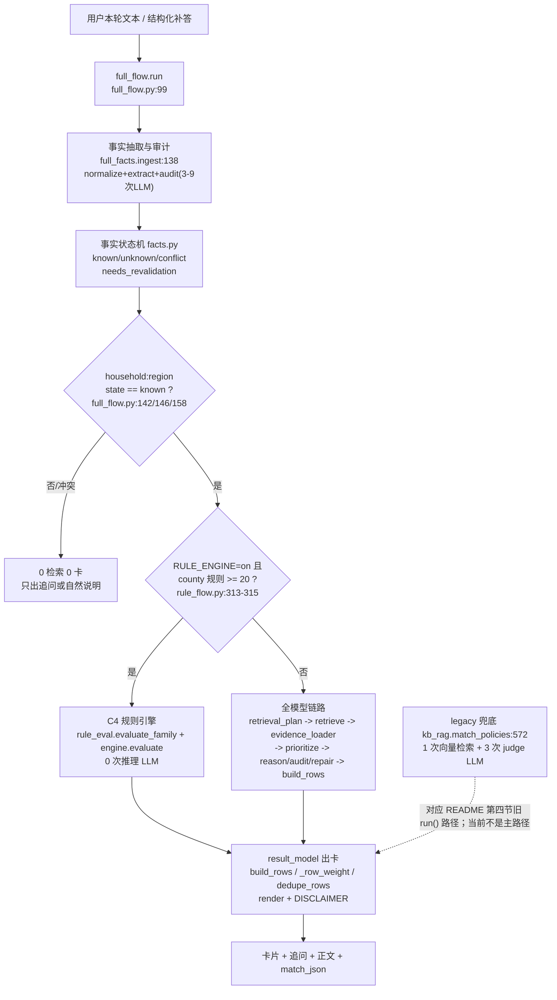
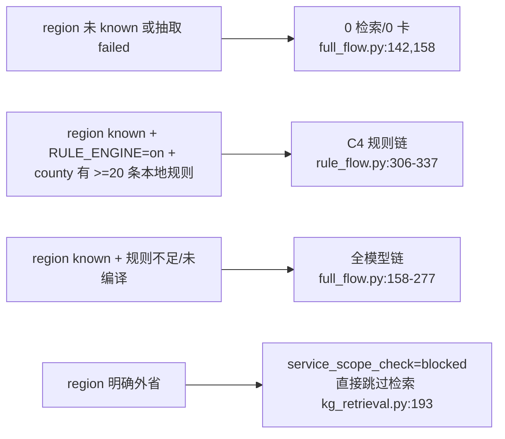
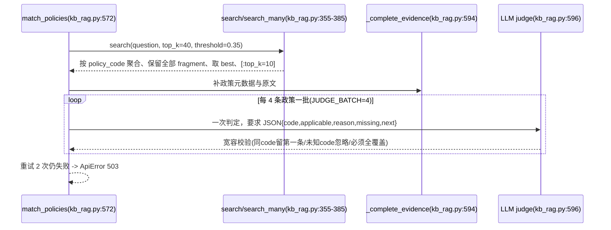
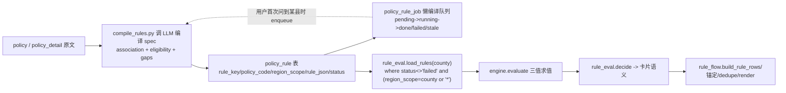
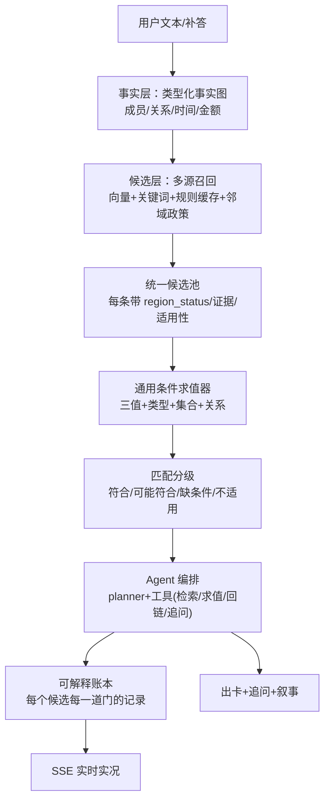

# 01 匹配机制现状：三条链路、决策点、硬条件与根因

> 只读扫描结论。基线 git tag = baseline-20261106 (commit 0d20ef1)。
> 证据形式：文件:行号 / 真实 chain_trace 日志（runtime/logs/chain_trace-128154.jsonl 记录 2026-11-06 08:42-08:55 的 qa526/528/529/530/531；chain_trace-361755.jsonl 记录 22:21-22:24 修复后四轮）/ policy_rule 表结构与 README/audit 的统计值。
> 本轮未修改任何生产代码、未写库、未重启服务。

## 1. 一句话结论

1. **三条链路不是同一机制的三档，而是三套互不兼容的条件表示**：legacy 只做「整条政策向量召回 + 每 4 条一批 LLM 判 applicable」（`kb_rag.py:30、:32、:572-664`）；C4 只做「离线编译 spec + 确定性三值求值」（`rule_eval.py:332`、`engine.py:113`）；全模型只做「逐条原文比对 + 二次审核」（`reasoning.py:1373`、`:1469`）。三者对「条件」的数据结构、判定主体、可解释粒度都不同，结果无法互相校验或复用。
2. **路径由覆盖率硬开关决定，不是由问题难度决定**：只有「RULE_ENGINE=on + 家庭地区 known + 抽取未 failed + 该县 local 规则 ≥ 20 条」才走 C4（`full_flow.py:146`、`rule_flow.py:313-315`）；规则库只覆盖 4 个 region、336 条（莲花 79 / 万安 87 / 吉安约 129 / 全省 39，README 与 audit 对吉安 129 vs 131 记数不一致），新建区等 0 条县必然落到全模型：实测 21-42 次 LLM、108.6-170.5s、0-1 张卡。
3. **模型只被允许「比对原文」，不允许「决定该看哪些政策」**：地区过滤发生在 evidence_loader 的确定性 SQL 之前（`evidence_loader.py:59-116`），qa529/530/531 三问分别硬砍掉 region 92/83/90 条候选，模型从未看到这些政策；剩余 30-43 条里每轮最多核 12 条（`full_settings.py:23` FULL_MODEL_MAX_SOURCES_PER_TURN 默认 12）、每批 2 条（batch_size=2）。「模型参与少」首先是被过滤与预算裁剪的结果，其次才是能力问题。
4. **硬条件多不是条件本身多，而是「条件类型系统贫乏 + 防御性补丁只增不减」**：fields.json 82 字段中 45 个 boolean、仅 12 个带 values 枚举、2 个带 implies_true，没有金额/时间窗/成员关系类型；为守「零误放行」，模型输出前后又叠了类目门（8 条）、名称门（22 个泛词 + 3/2 字 gram）、特指物项门（12 词）、险种域门（7 词）与 primary_gate 的 15+ 错误码（`reasoning.py:1265-1358`、`result_model.py:107`）。
5. **「区域优先」是系统性问题而非单点 bug**：同一地区语义有三套实现——kg_retrieval 的节点/子串匹配（`kg_retrieval.py:246-291`）、retrieval 的 SQL LIKE 白名单（`retrieval.py:102`）、facts.record 的字符串等价（`facts.py:34-48`）。值变体（「莲花县」vs「莲花县琴亭镇」）被判 conflict 后，`full_flow.py:142` 取到 state=conflict → `:158` 条件不成立 → 本轮 0 检索 0 卡，而 `questions.py:61` 又把 region 塞回追问、`:106` 排在追问序列最前 → qa526 实测 4 次调用 11.5s、0 卡、2 个追问。

## 2. 现状架构

### 2.1 三条链路总图

### 2.2 关键代码位置表

| 模块 | 文件:行号 | 职责 | 当前是否活跃 |
|---|---|---|---|
| 链路编排 | full_flow.py:99-283 | 抽取、事实、C4 闸门、全模型阶段、出卡、SSE 事件 | 活跃（唯一入口） |
| 事实抽取 | full_facts.py:138-394 | 切句、抽取、validate_fact、成员修复、audit、omission 补录 | 活跃 |
| 事实状态机 | facts.py:16-424 | record/归一/冲突/派生/结构化补答 apply | 活跃 |
| C4 入口 | rule_flow.py:306-358 | 县判定、规则装载、<20 回退、锚定、出卡、诊断 | 活跃（灰度） |
| C4 求值 | rule_eval.py:38-440 | 4 道门 + decide + 合并 + load_rules | 活跃 |
| 三值引擎 | engine.py:4-170 | 类型化三值求值、集合语义、策略级 decide | 活跃（仅 C4 使用） |
| 规则存储 | rule_store.py:1-228 | policy_rule / policy_rule_job 读写、懒编译队列 | 活跃 |
| 规则编译 | compile_rules.py / rule_worker.py | 政策原文 → spec 离线编译、后台消费队列 | 后台 |
| 检索规划 | retrieval.py:35-114 | 意图规划、SQL 关键词召回、地区 LIKE 白名单 | 活跃 |
| 证据装载 | evidence_loader.py:59-116 | 地区过滤、日期、版本、分支上限、region_dropped | 活跃 |
| 重排 | retrieval.py:146-301 | 本地 cross-encoder、LLM 兜底、词面 IDF、分档回转、锚定 | 活跃 |
| 逐条推理 | reasoning.py:736-1560 | 批次、route graph、审核、修复、门、build_rows | 活跃 |
| 核心对象复核 | primary_gate.py:64-479 | 对象短语回链校验、分支协议 | 活跃 |
| 追问决策 | full_questions.py:100-351 | 6 道护栏 + 确定性 planner 兜底 | 活跃 |
| 追问规划（旧） | questions.py:50-120 | 确定性缺项规划、region 强制项 | 活跃（兜底） |
| 出卡 | result_model.py:1-209 | 排序、去重、卡片、正文、签名、免责 | 活跃 |
| 建议生成 | full_advice.py:39-136 | 单次自然语言（verified_lite）或模板兜底 | 活跃 |
| legacy | kb_rag.py:30-664 | 向量检索 + LLM 逐政策判定 | 代码在，主路径不用 |

### 2.3 链路选择是四级硬开关（不存在中间态）

- 开关常量：`full_flow.py:146` 读 os.environ RULE_ENGINE 默认 on；`rule_flow.py:315` len(local) < 20；`kg_retrieval.py:193` blocked。
- 没有「规则先用、缺项交给模型补」的混合态；C4 一旦进入就完全不跑 reason，全模型一旦进入就完全不跑 rule_eval。这就是「两套系统」而不是「一套系统两种速度」的根源。

## 3. 机制细节

### 3.1 legacy 兜底链路（`kb_rag.match_policies`）

调用图：

| 环节 | 常量/实现 | 证据 |
|---|---|---|
| 召回条数 | TOP_K=10 | kb_rag.py:30 |
| 判定批大小 | JUDGE_BATCH=4（注释：本地 3B 单批上限，4 条完整、8/12 条只判出 3-4 条） | kb_rag.py:32 |
| 初筛阈值 | threshold=0.35 + 自适应 _robust_cutoff=max(threshold, median+0.05) | kb_rag.py:355、:578 |
| 切片数 | search 取 top_k*4=40 个切片 | kb_rag.py:578 |
| 判定主体 | 整条政策 + 完整原文，逐条 LLM 给 applicable(bool) | kb_rag.py:596-664 |
| 地区过滤 | **无**。地区只作为文本字段展示 | kb_rag.py:550 |
| 每轮 LLM 次数 | 3 次 judge + 1 次建议 = 4 次 LLM（另有 1 次向量检索） | kb_rag.py:572-664、:596 |
| 失败语义 | 判定覆盖不全即抛 503，不给部分结果 | kb_rag.py:596-664 |

结论：legacy 的「条件」是「整条政策文本 vs 家庭描述」的一次性语义判断，没有逐成员事实、没有条件求值、没有地区适用性。它目前只在旧 run() 管道被调用，README 说的「21 次调用 84-153s」属于旧管道（含改写/多轮），当前主链已改走 full_flow，legacy 仅作兜底与对照存在。

### 3.2 C4 规则引擎链路

规则从哪来（离线 → 表 → 运行时）：

| 环节 | 关键实现 | 证据 |
|---|---|---|
| 规则可见性 | SQL 只认 region_scope=county 或 '*'；'*' 是省级/全国通配 | rule_eval.py:391-440、rule_store.py:load_rules |
| 规则数量阈值 | 本地规则 < 20 条 → rules_not_ready + enqueue，回退全模型 | rule_flow.py:313-322 |
| 县名抽取 | geo.normalize_address().county，兜底正则 [一-龥]{2,3}(县/区) 去尾字 | rule_flow.py:19-33 |
| 三值 | True/False/None；all 中 False 优先、any 中 True 优先；study_stage 用集合语义 | engine.py:52-112 |
| 值合法性 | 只有 state=known 且 valid_value 才算 known，否则 None + missing | engine.py:52-112 |
| 策略级状态 | policy_incomplete / direction_unconfirmed / not_applicable / matched / facts_missing | engine.py:113-123 |
| 判定门序 | conflicts → 方向未否定 → 至少 1 个已证资格原子 → strong(≥2 或只差身份) → tier A/B | rule_eval.py:219-254 |
| 置信分层 | association 为 True → tier A；方向未知但 strong → tier B；否则不出卡 | rule_eval.py:242-247 |
| 四道后置门 | structural_gate(特指物项/险种域) → completeness_gate(教育/年龄/岗位) → audience_gate(16 类人群词) → domain_gate(8 个同域词表) | rule_eval.py:38、:96、:130、:309、:332-390 |
| 卡片合并 | 同成员 + 名称包含或 SequenceMatcher>=0.82 → 合并保留已证最多 | rule_eval.py:263-288 |
| 追问 | 卡片缺项 + details 缺项，按阻塞政策数排序，boolean 固定四选项 | rule_flow.py:189-263 |
| 每轮 LLM 次数 | 仅抽取阶段 3-4 次（normalize/verify/extract/audit）+ 0-1 次 question_bind；reasoning 0 次 | audit_20261106 第5.3节；chain_trace 361755 |

规则链的真实吞吐：莲花 6.6s 出 1 卡 + 3 问；于都 6.5s 0 卡 3 问（audit_20261106 第5.3节）。代价是「规则没编译到 = 能力不存在」：新建区 0 条 → 永远走全模型。

### 3.3 全模型链路

阶段表：

| # | 阶段 | 代码 | LLM 调用 | 确定性门/限制 |
|---|---|---|---|---|
| 1 | 事实抽取 | full_facts.ingest:138-394 | normalize 1 + verify 1 + extract 1 + audit 1（+member_repair 0-1 + omission 0-8） | validate_fact 20+ 校验；region 居住证据闸；protected 词表；否定/反转否定 |
| 2 | 检索规划 | retrieval.plan:35-80 | 1 次 core_full_retrieval_plan | max_intents=6；keywords 2-12 汉字、≤4 个；全否定/仅 region 方向丢弃；未参保强制占槽 |
| 3 | 向量+关键词召回 | retrieval.retrieve:117-144 | 0 | top_k=40；词面 source_keyword_hits limit=12；region LIKE 白名单 |
| 4 | 证据装载 | evidence_loader.load:59-116 | 0 | inactive/stale/date/region/branch 过滤；per_policy_limit 默认 2；region_dropped 上限 6 |
| 5 | 重排 | retrieval.prioritize:273；_prioritize_uncached:180 | 0（本地 cross-encoder 4s 预算）或 1（LLM 兜底） | 失败静默 backend=llm_fallback；0.4/0.6 IDF 融合；前 8 条按 cat1 分组回转；锚定提至 min(3,len) |
| 6 | 截断 | full_flow.py:179-180 | 0 | max_candidates=36 |
| 7 | 逐条推理 | reasoning.reason:1373-1468 | reason + reason_audit + conflict_scope + scope_audit + reason_repair + binding_repair + branches_match | batch=source_batch_size=2；worker=4；room() minimum 15/80/60；max_calls=36；每轮最多 12 条 |
| 8 | 事实补充 | full_flow.py:185-195 | 0-1 次抽取 | 仅当 facts 变化且 remaining>32 |
| 9 | 出卡 | reasoning.build_rows:1469-1560 | 0 | 类目门/名称门/特指物项门/险种域门；status 三态；按 (code,member_no) 只留第一张 |
| 10 | 去重与排序 | full_flow.py:198；result_model.py:60-89 | 0 | _row_weight 四元组；同名同成员保留证据更完整 |
| 11 | 追问 | full_questions.decide_questions:100 | 1（模型决定）+0-1（bind_requirements） | 6 道护栏；最多 3 问；措辞取冻结字典 |
| 12 | 建议 | full_advice.generate:39-136 | 1（evidence_summary 分支） | 黑名单正则 + 400 字按句截断；失败回落模板 |

reasoning 的批次/门机制（回答「模型参与为什么少」的关键）：

- 批次：`full_settings.py:23` source_batch_size=2、max_sources_per_turn=12、max_calls=36；`reasoning.py:1413-1417` room()：canonical_questions+evidence_summary 时 minimum=15，否则 80/60，且 calls<max_calls-8 才续投。qa529 有 35 条 eligible，单轮只核 12 条（实际上 12/2=6 批上下）。
- 每批不是 1 次调用：正常是 reason + reason_audit；被拒的路线再走 conflict_scope（qa529 14 次）、scope_audit（1 次）、branches_match（1 次）、reason_repair（4 次）、binding_repair（6 次）——「审模型」的开销是「用模型」的 2-3 倍。
- 门（LLM 之后、出卡之前，确定性）：
  - 类目门 `reasoning.py:1482-1487`（定义 `:1265-1334`）：8 条（儿童→age>=18、学生→enrolled False、残疾→disabled False、孕妇→pregnant False、女性→sex 以男开头、孤儿→member_orphan False 等），用字符串包含 + 前字排除「非/不」；命中记 category_scope_mismatch 转审核。
  - 名称前置门 `reasoning.py:1492-1501`（定义 `:1336-1358`）：3 字优先退 2 字 gram，22 个泛词（补贴/补助/通知/办法/政策/实施/细则/…/做好/开展）；证据文本与政策名 gram 零重叠 → name_gate_rejected。
  - 特指物项门 `reasoning.py:1505-1535`：12 个物项词（轮椅/机动车/农机/器械/辅具/器具/设备/车辆/船舶/渔船/机械/工具）出现在政策名/目标却不在事实文本 → 拒（special_object_missing `:1532-1534`）。
  - 险种域门 `reasoning.py:1523-1535`：7 个险种词（养老保险/医疗保险/社保/医保/失业保险/工伤保险/生育保险）出现在政策名/目标却不在事实文本 → 拒（_DOMAIN `:1525`，dom[:2] 前缀兜底 `:1528`）。
  - primary_gate `primary_gate.py:64-194`：对象短语必须回链原文（禁止 title/parent_target/parent_conditions/scope_category 冒充条件证明），15+ 错误码。

### 3.4 决策点清单（硬编码、确定性优先）

> 说明：类型列 D=确定性、L=LLM、M=混合；「出错后果」均为 11-06 生产实测或代码语义。

| # | 位置 | 判定条件（常量/正则/阈值） | 类型 | 出错后果 | 是否应改软约束 |
|---|---|---|---|---|---|
| 1 | kb_rag.py:30,32,578 | TOP_K=10、JUDGE_BATCH=4、threshold=0.35、取 top_k*4 切片 | D | 召回天花板低，靠 4 条/批 LLM 补 | 是（并入统一候选池） |
| 2 | kb_rag.py:355 | _robust_cutoff=max(0.35, median+0.05) | D | 分布平导致阈值失效 | 保留为召回校准 |
| 3 | kb_rag.py:596 | judge 必须全覆盖 expected，否则重试 2 次后 503 | D | 一次模型失手整轮无结果 | 改为部分结果+遥测 |
| 4 | full_flow.py:146 | RULE_ENGINE=on 且 region known 且 extraction!=failed | D | 抽取失败即 0 卡 | 是（失败也应可检索） |
| 5 | full_flow.py:158 | region.state=='known' | D | conflict/unknown 直接 0 检索 | 是（软过滤/标注保留） |
| 6 | rule_flow.py:315 | 本地规则 < 20 条 → rules_not_ready | D | 新县永远 110-170s 全模型 | 是（规则=加速缓存） |
| 7 | rule_eval.py:391 | region_scope=county 或 '*' | D | 未编译县只有 39 条省级 | 是（跨县共享 spec） |
| 8 | rule_eval.py:219-247 | conflicts→无卡；方向未否定；≥1 已证；strong≥2 或只差身份；tier A/B | D | 证据不足一律不出卡 | 是（置信分级+待核验态） |
| 9 | rule_eval.py:38 | domain_gate：无同域已证原子则拒（16 类词表） | D | 新表述/新政策词表外→误拒 | 是（软打分） |
| 10 | rule_eval.py:96 | completeness_gate：教育词无教育字段/年龄无上界/岗位无年龄窗 | D | 规则缺字段即拒 | 是（转待补事实） |
| 11 | rule_eval.py:130 | structural_gate：特指物项/保险险种未证 | D | 泛化政策被误放或误拒 | 是 |
| 12 | rule_eval.py:309 | audience_gate：16 类人群词与字段冲突/未知 | D | 人群词映射错→误拒 | 是（模型+回链校验） |
| 13 | rule_eval.py:263 | 同成员+名称包含/0.82 相似 → 合并 | D | 过度合并丢分支 | 保留（可解释合并） |
| 14 | rule_flow.py:46-79 | 锚定 LCS≥3 且非 30 停用词 | D | 点名政策被误提/漏提 | 保留 |
| 15 | retrieval.py:35-80 | max_intents=6；keywords 2-12 汉字≤4；全否定/仅 region 丢 | D | 方向少则召回窄 | 是（动态预算） |
| 16 | retrieval.py:82-114 | source_keyword_hits：region LIKE 白名单 + 5 字段 LIKE + 关键词分 Σlen² + limit 12 | D | 与 region_judge 语义不一致 | 是（统一地区模型） |
| 17 | evidence_loader.py:59-110 | region False 丢弃；None 保留；branch≤2；date/version/status 过滤 | D | 模型看不到被丢政策；县级细则被截 | 是（软过滤+告知） |
| 18 | retrieval.py:146-169 | 本地 cross-encoder 仅 localhost、4s 预算、失败静默 llm_fallback | D | P1-7：无用户可见提示 | 是（显式降级+遥测） |
| 19 | full_flow.py:179 | max_candidates=36 | D | 大候选集被截断 | 可保留 |
| 20 | reasoning.py:1413 | room() minimum 15/80/60；max_calls=36；batch=2 | D | 35 条要 4-5 轮 | 是（并行/增量） |
| 21 | reasoning.py:1265 | 8 条类目规则字符串包含 | D | 「62 岁」匹配儿童政策（audit P0-3） | 是（类型化事实+模型判） |
| 22 | reasoning.py:1336 | name gate：3/2 字 gram + 22 泛词 | D | 同义改写误杀（S-ZB-069 两次） | 是（软提示不硬拒） |
| 23 | reasoning.py:1505 | 12 特指物项词 | D | 泛化政策误放/误拒 | 是 |
| 24 | reasoning.py:1525 | 7 险种词 | D | 同上 | 是 |
| 25 | reasoning.py:1469-1560 | status 三态 → 是否出卡；按 (code,member) 只留第一张 | D | 多成员同政策信息丢失 | 是（成员维度保留） |
| 26 | primary_gate.py:64-194 | 对象证据必须回链，禁止 title/parent/scope_category | M | 合法对象被拒→0 卡 | 保留（防误放行核心） |
| 27 | full_questions.py:146-184 | 6 道追问护栏、最多 3 问、同集合即 stalled | M | 追问僵局/轮数耗尽 | 是（策略学习） |
| 28 | full_advice.py:39-136 | 黑名单正则 + 400 字截断 + 失败模板 | M | 建议千篇一律（模板兜底） | 是（多轮自然表达） |
| 29 | result_model.py:60-89 | _row_weight=(已证数, -缺项数, 有依据, X 前缀) | D | 仅用于去重，不用于排序 | 是（显式排序分） |
| 30 | result_model.py:10-26 | DISCLAIMER 仅首轮；round 幂等 | D | 后续轮无免责句 | 保留 |
| 31 | kg_retrieval.py:193-233 | service_scope_check：明确外省 blocked | D | 需精确省名 | 保留 |
| 32 | kg_retrieval.py:246-291 | 全国/全省/节点/子串四段匹配 | D | 与 LIKE 白名单不一致 | 是（统一） |
| 33 | facts.py:34-48 | 等价=canon 相等；行政区后缀+包含关系；保留更长 | D | 「县」vs「县+镇」判冲突 | 是（结构化行政区） |
| 34 | full_facts.py:23-120 | validate_fact 20+ 规则（引文逐字、语境、类型、范围） | D | 严→漏抽；松→误抽 | 保留（回链是安全底线） |
| 35 | geo.py:54-110 | 11 市+区县表；只识别江西省；居住≠户籍 | D | 地址表述多样即 unknown | 是（行政区服务） |
| 36 | result_model.py:107 | 15 个 REJECT_REASON_ZH 错误码 | D | 用户只看到错误码中文 | 是（可解释叙事） |

### 3.5 区域优先逻辑专项（P0-2）

现状语义模型（三套实现并存）：

| 层 | 实现 | 输入 | 判定 | 证据 |
|---|---|---|---|---|
| 政策侧 | catalog.applicable_region:76 | 政策 regions + 明细 region | 两者都空→None；否则 region_judge | catalog.py:76-83 |
| 判定 | kg_retrieval.region_judge:307 | 政策级 scope（空则按 level 默认：C→全国、S→江西省全省） | 适用/不适/冲突/地区待细化 | kg_retrieval.py:307-350 |
| 匹配 | kg_retrieval._region_apply:246 | scope 字符串 + 109 个 REGION 节点 + 家庭 region | 全国→适用；全省→比省；节点精确/后缀/前缀；子串启发 | kg_retrieval.py:246-291 |
| 召回过滤 | retrieval.source_keyword_hits:82 | SQL LIKE：county 或 NULL/''/江西省/全省/全国/国家/省级/'%全省%'/'%全国%'/'江西省'开头 | 命中即入候选 | retrieval.py:82-114 |
| 证据过滤 | evidence_loader.load:59 | applicable_region 结果 | False 丢弃、None 保留并计数 | evidence_loader.py:59-116 |
| 事实记录 | facts.record:50 | 字符串 + admin suffix + 包含关系 | 等价→保留更具体；不等价→conflict | facts.py:34-87 |

11-06 修复后的变化（必须写清，避免把旧结论当现状）：

- retrieval.py:102 由「精确 IN」改为「county OR NULL/''/江西省/全省/全国/国家/省级 OR LIKE '%全省%' OR LIKE '%全国%' OR region='江西省'」→ 属地/省级政策能召回（audit 第5.7节）。
- evidence_loader.py:91-98：scope=False 丢弃并记 region_dropped（:91-95）；scope=None（地区未确认）不再丢弃，计 region_unconfirmed_kept（:98），交由审核阶段标注。region_dropped 用 _name_family:46 过滤已加载同名家族（:111-112），最多 6 条随 stats 返回（:114），0 卡时由 result_model._empty_search_notes:125-146 陈述。
- facts.py:34-48 增加行政区等价层（canon 相等；双方行政后缀且包含关系→等价，保留更长）。冲突自愈：conflict 状态下新值与任一候选等价→known + resolved_from='conflict'（:56-67）。
- 仍未修的结构性缺陷：
  1. county/city/全省三级没有统一数据结构，仍是字符串 + LIKE + 正则三处各自为政；「新建区」在 rule_flow._county 可能被兜底正则削成「新建」，而 policy_rule.region_scope 记的是「新建区」→ 县不匹配 → rules_not_ready。
  2. region 冲突的连锁：facts.py:77-79 判 conflict（value=None）→ full_flow.py:142/158 跳过检索 → questions.py:61 把 region 塞回候选、:106 排序靠前 → 每轮重问（qa526 实测 2 问，user 已给过地区）。这是「老链路地区优先」最典型的结构性问题：一个表示层冲突被放大成整轮能力归零。
  3. 地区过滤发生在模型之前，且被丢弃的往往是邻县同名政策（qa529 的 X-ZB-620 分宜县、X-ZB-411 蓉江新区、X-ZB-027…），模型无法判断「本市其他县同类政策是否可参考」，用户也看不到「为什么没有」。
  4. service_scope_check 只看 hh['region']（kg_retrieval.py:193 注释），不扫全文；家庭成员在省外务工/居住的表述不参与判定，反向也可能漏判。

### 3.6 事实状态机

fields.json 实测统计：

| 维度 | 数值 | 含义 |
|---|---|---|
| 字段总数 | 82 | type=dict 的字段定义 |
| scope | household 32 / member 50 | 户级/成员级 |
| type | string 21 / number 16 / boolean 45 | 布尔占 55% → 三值可覆盖大半 |
| values 枚举 | 12 个字段有 | 其余字符串无受控词表 |
| implies_true | 2 个字段 | 三值传播仅 2 条 |

状态：代码里事实状态是 4 个，不是任务描述里的「三值+n.a.」：

- known / unknown：`facts.py:50-87`；unknown 时 value=None，仍保留 sources。
- conflict：仅当「prior known + 新值非空 + 非 correcting + origin!='derived' + 不等价」才产生，value=None、choices=[旧,新]（`:77-79`）；新值与某候选等价则自愈（`:56-67`）。
- needs_revalidation：schema_id 变化时（`facts.py:88-96`），清 value、清 asked。
- 「n.a.」不在事实层：只在 engine.decide 的政策级 status=not_applicable（`engine.py:113-123`）。这是两套语义——事实「不知道」不等于政策「不适用」，当前未被显式区分，是「呆板」的语义根因之一。

归一化缺失点（现状只做通用启发）：

- 只在 `facts.py:28-48` 有 canon + 行政区后缀；姓名/枚举/(数值+单位)/(时间区间)/关系（配偶、同一户口本）都没有类型化归一层。
- full_facts.validate_fact 是「抽得对不对」的校验，不是「值等价」的归一；两处判断分裂。
- 跨轮复用：st 存 policy_core.facts + asked + pending + round（`facts.py:16-24`）；全模型 generation 缓存跨轮复用（`reasoning.py:1373-1392`，deps 未变即复用，361755 实测后三轮 3-4 次调用），但不是事实层的「已核验结论复用」——每轮仍重跑 retrieval_plan（plan_key 含 sha256(text)，`full_flow.py:169-171`，文本变即 miss）。
- 被推翻机制：只有 conflict（值冲突）与 needs_revalidation（schema 变）两种；没有「用户否定/更正上一轮判断」的一等公民——correcting=True 只在结构化补答 apply 中使用（`facts.py:393-423`）。

### 3.7 排序与出卡口径

| 环节 | 规则 | 证据 |
|---|---|---|
| 候选顺序 | 向量+词面融合 → rerank → 属性锚定提权 → cat1 分档回转前 8 | retrieval.py:141、:207-269 |
| 规则链排序 | 点名政策置顶（rows.sort key 0/1），组内保持原序 | rule_flow.py:327-333 |
| 全模型排序 | build_rows 按 packs 顺序（即 rerank 顺序）出卡，无最终 fit 排序 | reasoning.py:1469-1560 |
| 去重 | 同名同成员保留 _row_weight 更大；同 code 不同 detail 保留（不同适用分支） | result_model.py:66-89 |
| 权重 | (已证原子数, -缺项数, 有依据 1/0, X 前缀 1/0) | result_model.py:60-64 |
| 多成员 | build_rows 按 (code, member_no) 去重只留第一张 → 一个政策多人符合在卡片层不可见 | reasoning.py:1555-1560 |
| 卡片口径 | 只出「部分支持/事实缺失/政策不完整」，禁用资格结论；首轮免责句 | result_model.py:7-8、:10-26 |
| 正文 | 有卡：逐行结论+已确认≤3+仍需核对≤3；无卡：检索事实陈述（region_dropped 前 3） | result_model.py:125-183 |
| 稳定性 | result_signature=sha256(rows[code,detail_id,member,decision]+questions[key])，同签名且非「继续」→ render_repeat | result_model.py:185-209 |
| 建议 | 1 次自然语言（verified_lite，黑名单+400 字），失败回落模板（verified_template） | full_advice.py:39-136 |

关键结论：**排序只反映「检索/重排的相关性」，不反映「这户符合条件的可能性」**。_row_weight 只在去重时使用；tier A/B 不出现在卡片排序里；同一政策多成员被截成一张。用户感知到的「卡片顺序不像为我排的」由此而来。

## 4. 问题与根因（机制级）

### 4.1 为什么「匹配不智能」

1. **没有通用条件求值层贯穿全模型链**：项目其实已有类型化三值引擎（`engine.py:4-170`），但它只吃 compile_rules 产出的 spec，全模型链的模型决策不走它，而是走「模型自己写 route graph + 二次审核」。同一批政策，C4 用求值器、全模型用 LLM 审 LLM——两条链的「思考方式」不同，结果不可比。
2. **条件类型系统贫乏**：45/82 是 boolean，12 个枚举，2 个 implies_true；没有金额/时间窗/关系/证据强度类型。真实政策条件（人均收入<标准、残疾等级≥2、同一户口本、连续参保 12 个月）无法表达，只能退化为 boolean 或干脆不判 → 大量条件被降级成「未知」，再被「≥1 已证 + 不许冲突」的口径挡在卡外。
3. **模型看到的世界是被裁剪的**：region 硬过滤（-83~-92 条/轮）+ branch 上限 2 + max_candidates 36 + 每轮 12 条 → 模型永远在 30-43 条里工作，且不知道被丢了什么；「智能」的上限是候选池的上限。
4. **门只增不减**：每次 P0 修复加一道硬门（类目门/名称门/物项门/险种域门/primary_gate），没有任何机制评估「多道门叠加后的净收益」。qa529 单轮 conflict_scope_rejected 14 次、name_gate_rejected 2 次，大量模型工作被后置门否决。
5. **语义判断被字符串包含替代**：类目门用「儿童」in 政策文本 + age>=18；名称门用 3/2 字 gram 重叠；险种域用 7 个词。这些是「防误放行」的有效补丁，但不是理解，遇到同义改写/否定/上下位词就误杀或误放。

### 4.2 为什么「模型参与少」（量化）

| 链路 | 每轮 LLM 调用 | 实测耗时 | 模型实际决定什么 | 证据 |
|---|---|---|---|---|
| legacy | 3 judge + 1 建议 = 4 次 LLM（另有 1 次向量检索） | 未在当前主路径实测 | 整条政策 applicable(bool) | kb_rag.py:30-32、:572-664 |
| C4 规则 | 抽取 3-4（normalize/verify/extract/audit）+ 0-1 question_bind + 1 advice | 6.5-6.6s | 只抽事实；资格判定 100% 确定性 | audit 第5.3节 |
| 全模型·0 卡 | 21-42 | 110.5-170.5s | 逐条条件比对、对象复核、审核修复 | traces 78eb4112/94a6af9f/04cf6045/a356fa8e |
| 全模型·有卡 | 26（qa531） | 108.6s | 同上 | trace a356fa8e |
| 全模型·缓存命中 | 3-14 | 8.4-47.2s | 只做 plan/question/advice | trace 361755 四轮 |

- 每轮 12 条上限、batch=2、max_calls=36（full_settings.py:17-31）：35 条候选需要 4-5 轮×2 分钟。模型「做得少」的直接原因是配置的并发/批次预算，而不是模型能力。
- 单条政策平均 LLM 成本：qa529 42 次 / 35 条 ≈ 1.2 次/条；其中审核+修复类（audit 7 + conflict_scope 14 + repair 10 + scope_audit 1 + branches_match 1 = 33 次）占 79%，真正「reason」只有 5 次。**模型 79% 的调用在自我审查，不是在理解政策。**
- 事实抽取几乎每轮重跑：text 变即 plan_key 变（full_flow.py:169-171），且 reasoning 缓存只在同一 generation 内复用（reasoning.py:1373-1392）。

### 4.3 为什么「硬条件多、呆板」

1. **规则是离线一次性产物**：compile_rules 把政策原文编译成 spec 存表，运行时只能按 spec 求值；政策更新/表述变化要重编译，且只编译了 4 个 region。规则未覆盖 = 该县没有「规则能力」，直接掉到慢链（rule_flow.py:313-315 的 20 条阈值）。
2. **二元开关**：要么全规则（快但覆盖窄），要么全模型（慢但「通用」），没有「规则先给候选+模型补条件」的混合态。
3. **零误放行的硬约束转成门的堆叠**：README 的 FP=0 约束使得每次误放行都加硬门；门在 LLM 前后都做硬过滤，无置信分级、无「建议人工核验」中间态。
4. **出卡门槛是「方向成立 + 至少一个已证 + 无冲突 + 条件类型命中」**（rule_eval.py:219-247），大量真实家庭处于「部分满足但条件没问到」——这些恰恰是用户最需要看到的（「你可能符合，缺 X、Y」），现在被挡在卡外，只进追问。
5. **地区冲突直接归零**：一个表示层问题（县 vs 县+镇）导致整轮 0 检索（见 3.5），用户感觉「说了地区还反复问、问了又没结果」。

### 4.4 真实链路失败模式（来自 trace，不是推测）

| 模式 | 证据 | 机制归因 |
|---|---|---|
| 0 卡慢链 | qa528 21 次/133.7s；qa529 42 次/170.5s；qa530 26 次/110.5s | 地区硬过滤 + 逐条审模型 + 0 卡时仍全套跑完 |
| rerank 静默降级 | qa529/530/531 三问 backend=llm_fallback error=ReadTimeout | retrieval.py:180-234 无失败可见性 |
| 模型工作被后置门否决 | qa529 conflict_scope_rejected 14 次（unknown_fact_in_route_test / unbound_conflict_logic_atom / invalid_atom） | 协议过严 + 修复链成本高 |
| 名称门误杀 | qa530/531 name_gate_rejected S-ZB-069 ×2 | 3/2 字 gram + 泛词硬拒 |
| 地区表示冲突归零 | qa526 0 卡 2 问 11.5s；questions.py:61 重问 region | facts.record 冲突 → full_flow 跳过检索 |
| 修复后缓存效应 | 361755：47.2s(14)→8.7s(4)→8.4s(3)，后续轮无 reason 调用 | reasoning generation 缓存生效，但换话题/换户即失效 |

## 5. 与目标形态的差距

| 目标 | 现状 | 差距 |
|---|---|---|
| 会思考的智能体 | 模型只做「原文比对 + 自我审核」；无工具调用、无多轮探索、无候选池视野、无记忆化结论 | 缺 planner/tool 层；模型不决定检索什么、看不到被过滤政策、不能主动补条件 |
| 可解释的实时实况 | 只有 region_dropped 前 3、rejected 15 码、reasoning 阶段 progress；模型为什么拒/为什么没看到政策不可见 | 缺少「决策账本」：每个候选的保留/丢弃/拒绝理由、每道门的命中记录 |
| 智能匹配 | 硬门 + 布尔条件 + 单轮覆盖率；匹配=「已证条件数」，不是「符合可能性」 | 缺通用条件求值 + 概率/分级匹配 + 软约束排序 |
| 回答样式 | 卡片 16 列 + 模板正文（verified_lite 仍是四段固定结构） | 缺解释性叙事、缺「缺什么能变符合」的路径、缺多轮对话式收敛 |

## 6. 改造切入点

### 6.1 可复用资产（不建议重写）

| 资产 | 位置 | 复用方式 |
|---|---|---|
| 三值求值引擎 | engine.py:4-170 | 升级为通用条件求值层：加金额/时间/关系/集合/证据强度类型；C4 与全模型共用 |
| 事实状态机 + 归一层 | facts.py:16-96 | 扩成类型化等价（行政区/单位/时间/枚举同义）；冲突自动消解+保留候选 |
| 回链校验 | primary_gate.py、full_facts.validate_fact | 保留为「证据绑定」安全底线，但错误码要转成可解释叙事 |
| 规则编译产物 | policy_rule / compile_rules.py | 降级为「加速缓存/先验候选」，不再是独立链路；未覆盖县用省级 spec + 模型补 |
| 重排器 | retrieval.py:146-301 | 保留本地 cross-encoder + IDF 融合，换成可学习/可解释打分 |
| 出卡器与签名 | result_model.py | 保留卡片协议、DISCLAIMER、result_signature；增加排序分与成员维度 |
| 追问护栏 | full_questions.py:100-205 | 保留 6 道护栏作为安全边界；把「问不问」升级为策略（收益/成本） |
| 事实抽取 + audit | full_facts.py:138-394 | 保留（质量已较高），补跨轮增量抽取与来源级缓存 |

### 6.2 必须替换/降级的部分

| 现状 | 问题 | 替代 |
|---|---|---|
| 三条链路各自的条件表示 | 结果不可比、维护三份 | 统一「候选池 + 通用条件求值 + 分级」一条主链；legacy 与 C4 都降为候选来源 |
| region 三套实现 | 语义不一致、冲突归零 | 一个行政区服务：结构化解析（省/市/县/乡）+ 适用性判定（适用/可能适用/不适用）+ 软过滤保留候选并标注理由 |
| 地区硬过滤先行 | 模型看不到政策 | 保留候选 + region_status 标注，让模型判断「邻县/市级政策是否可参考」 |
| LLM 后置硬门（类目/名称/物项/险种） | 误杀同义、叠加不可评估 | 改为「软提示 + 排序扣分 + 可解释标注」，硬门只保留证据绑定与安全底线 |
| 每轮全量重检索/重抽取 | 35 条要 4-5 轮 | 跨轮候选缓存（按 fact_revision 失效）+ 增量核验 + 并行批次 |
| 出卡口径「只出已证」 | 用户看不到「可能符合」 | 增加「待核验/可能符合」卡片档位（明确非资格结论），按符合可能性排序 |
| 建议模板 | 千篇一律 | 多轮生成 + 引用行号级依据 + 「补齐 X 可进入核验」路径 |

### 6.3 目标架构草图

### 6.4 风险与验证口径

| 风险 | 说明 | 缓解 |
|---|---|---|
| 放宽地区过滤 → 误放行 | FP=0 是硬约束 | 只放宽到「候选可见」，出卡仍需证据绑定；region 只影响排序/标注 |
| 放开硬门 → 卡片噪声 | 当前门是 11-06 修出来的 | 门改为扣分而非否决，A/B 用「规则基线不判全模型回归」的口径（audit 教训） |
| 统一条件求值器 → 规则质量暴露 | 规则 spec 本身有缺口（gaps） | gaps 显式化：policy_incomplete 卡片标注「政策条款缺失」，不再静默丢 |
| 缓存/增量 → 事实被推翻不刷新 | fact_revision 已存在 | 缓存键含 fact_revision+schema_id+prompt revision；推翻时定向失效 |
| 性能预算 | 180s deadline、max_calls=36 | 候选池分级：先粗排 36→12，再按需扩；审核与推理并行 |

### 6.5 优先级建议（P0 → P2）

1. P0：地区语义统一 + 软过滤（消除 0 卡归零与每轮重问）；这一步收益最大、风险最低。
2. P0：全模型链复用 engine.evaluate 做「条件求值预演」，模型只补未知条件——把「79% 调用在自我审查」降下来。
3. P1：出卡增加「可能符合/待核验」档位 + 按符合可能性排序（_row_weight 升级为排序分）。
4. P1：跨轮候选缓存 + 增量核验 + 并行批次，把 110-170s 压到 30s 内。
5. P2：硬门软化成「提示+扣分+账本」，保留 primary_gate 证据绑定作为安全底线。
6. P2：建议生成升级为「多轮 + 依据行号 + 补齐路径」，替换模板兜底。

## 附录 A：证据索引

| 证据 | 位置 |
|---|---|
| 真实链路 trace（11-06 08:42-08:55） | runtime/logs/chain_trace-128154.jsonl（trace 10a2e444/78eb4112/94a6af9f/04cf6045/a356fa8e） |
| 修复后 trace（11-06 22:21-22:24） | runtime/logs/chain_trace-361755.jsonl（e92c7838/199f07a2/5b84722d/0d1366ed） |
| 缺陷审计与修复记录 | audit_20261106.md（第5.1-5.8节、qa526-531） |
| 运行架构与数据流 | README.md 第四节/第五节 |
| 规则数 336（莲花79/万安87/吉安129/全省39） | README + audit（两处吉安 129/131 不一致，未直连 DB 复核：本机 python3 无 sqlalchemy） |
