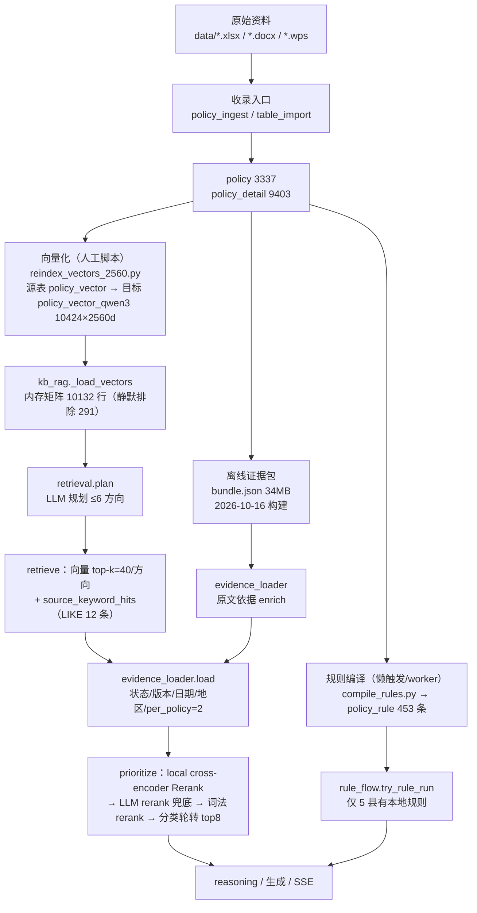
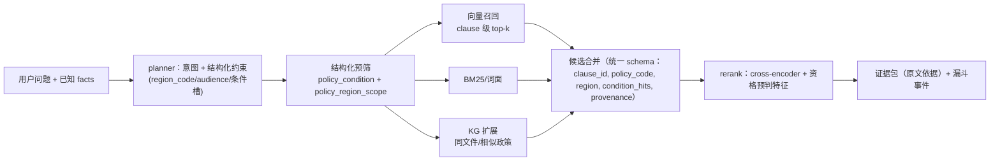
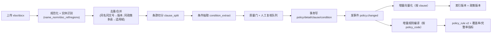

# 02 · 政策收录、数据资产与知识库匹配原理（现状基线）

> 项目：/home/adminroot/smart-help；基线：git tag `baseline-20261106`（commit 0d20ef1）
> 本轮定位：**只读扫描 + 重新分析 + 重新设计**，不改任何生产代码/数据/配置。
> 取证方式：Kingbase `policy_db_mig20261021` 只读 SELECT（psycopg2，2026-11-06 22:40–23:20）；SQLite `data/policy_db/smart_policy.db` 只读；`src/data/policy_evidence/bundle.json` 只读摘要；`runtime/logs/chain_trace-*.jsonl` 84 个文件；关键模块精读（行号以基线 tag 为准）。
> 关联文档：01-matching-current（匹配决策链）、03-llm-answer-current（生成）、04-sse-observability-current（可观测）、05-zhishu-reference（目标参考）。

---

## 1. 一句话结论

1. **知识库不是"检索不到"，而是"召回到了却被地区过滤器砍掉"**：生产 full_model 一轮典型 trace 为 `unique_candidates=153 → region 丢弃 150 → eligible=3`，最终只把 3 条政策交给排序与审核；根因是 `policy_detail.region` 精确到县的字符串匹配 + 政策级/明细级地区语义不一致。
2. **"收录不全"的主要形态不是少收，而是重复收、错位收、向量滞后**：`policy` 3337 行只有 1831 个不同政策名（1506 行同名校异编号，产业奖补 52 条、先诊疗后付费 45 条）；向量表 10424 行中 291 行被 `_load_vectors` 的日期/状态条件静默排除；向量索引 max(updated_at)=2026-11-05，政策表 max=2026-10-12，规则 max(compiled_at)=2026-11-06，三条时间线互不同步。
3. **"匹配呆板"的数据根因是条件没有结构化**：`policy.conditions`/`policy_detail.conditions` 全是自由文本，`extra` JSON 仅有 lab/health/age/pov 等 6 个半结构化键；`kg_retrieval.cond_tri_state` 只认这 4 个维度，其余条件一律置 `unparsed=True → 待核实`，因此绝大多数命中都停在"待核实"。
4. **规则引擎只覆盖 5 个县**：`policy_rule` 453 条、254 个政策编号、region_scope 只有 吉安/万安/莲花/新建/于都/* 6 个取值（131/87/79/59/58/39），其中 396 条 status=partial（完整仅 55 条）；其余 100+ 县全部回退到 110–170s 的 full_model 慢链路，同一问题在不同县"思考深度"不同。
5. **收录—向量化—规则编译三段落之间没有事务/事件联动**：入库 `write_details` 不触发 `reindex_vectors_2560`，`reindex` 是人工脚本 + cursor；规则编译由流量懒触发或 `rule_worker --watch` 每 60s 轮询。新政策"入库即搜不到/判不了"是结构性缺陷，不是偶发。
6. **可追溯性只到"整份证据包"级别**：`bundle.json`（2026-10-16 构建）是原文依据唯一来源，但已与 DB 漂移（bundle rows 9390 vs Kingbase `policy_detail` 9403）；DB 侧没有稳定的"政策→条款→原文定位"三层指针，`policy_detail.source_row` 是唯一行号线索。

---

## 2. 现状架构

### 2.1 数据与检索全链路（生产实际路径）

### 2.2 关键代码位置

| 环节 | 文件:行号 | 作用 |
|---|---|---|
| 文档解析/入库 | `src/policy_ingest.py:7-105` | document_text→prepare 质量门→write_details |
| 批量表格导入 | `src/table_import.py:6-70` | xlsx/csv 按 名称+文号+编号 分组后识别 |
| 2560 维向量重建 | `src/reindex_vectors_2560.py:22-119` | 源 policy_vector → 目标 policy_vector_qwen3，cursor 断点 |
| 切片预算 | `src/vector_safety.py:47-111` | 480 token 预算/60 overlap（未与 reindex 串联） |
| 规则编译 | `src/compile_rules.py:27-226` | candidates→packs→LLM compiler→双写 SQLite/Kingbase |
| 规则补编 worker | `src/rule_worker.py:25-73` | <20 条本地规则时入队，按县全量编译 |
| 向量装载 | `src/kb_rag.py:304-338` | JOIN policy 过滤 status/version/model/日期，全量进内存 |
| 相似度阈值 | `src/kb_rag.py:355-366` | `max(floor, median+0.05)` |
| 检索规划 | `src/policy_core/retrieval.py:7-80` | LLM 最多 6 个 intent |
| 混合召回 | `src/policy_core/retrieval.py:82-144` | 向量 + 词面 LIKE，按 (keyword,vector,rank) 排序 |
| 证据装载/过滤 | `src/policy_core/evidence_loader.py:59-116` | 地区/状态/版本/日期/per_policy=2 |
| 地区判定 | `src/kg_retrieval.py:307-349` | 政策级 vs 明细级，返回 冲突/待细化 |
| 条件三态 | `src/kg_retrieval.py:407-449` | 仅 lab/health/age/pov 可判 |
| KG 检索 | `src/kg_retrieval.py:527-735` | 属性命中 + 图扩展 + 打分 |
| 禁用语义 v2 | `src/kg_forbid_v2.py:1150-1225` | 标注不删候选，`ambiguous_policy_source` 待核实 |
| 规则快链 | `src/policy_core/rule_flow.py:306-322` | 本地规则 <20 → 入队并回退 full_model |
| 规则装载 | `src/policy_core/rule_eval.py:391-429` | 金仓 policy_rule 优先，SQLite 兜底 |

### 2.3 运行期开关（deploy/web.env 只读）

| 开关 | 值 | 影响 |
|---|---|---|
| `POLICY_MATCH_MODE` | `full_model` | 家庭匹配主路径走 `policy_core.full_flow` |
| `POLICY_CORE_ENABLED` | `0` | 关闭 core 咨询链路（与 full_model 互斥，`full_settings.py:11-32`） |
| `RULE_ENGINE` | `on` | 有本地规则的县先走快链 |
| `POLICY_VECTOR_TABLE` | `policy_vector_qwen3` | 生产只读 2560 维新表 |
| `FULL_MODEL_MAX_SOURCES_PER_TURN` | `10` | 每轮最多 10 条来源（`full_settings.py:14-19` 默认 12） |
| `FULL_MODEL_MAX_CALLS / DEADLINE` | `96 / 420` | 预算上限（默认 36/180） |
| `KG_GRAPH_ENABLED` | `1` | 图检索/地区判定启用 |
| `POLICY_CORE` 检索参数 | `max_intents=6, top_k=40, max_candidates=36, per_policy_limit=2` | `full_settings.py:11-32`、`evidence_loader.py:78,99` |

---

## 3. 机制细节

### 3.1 Kingbase 数据资产盘点（policy_db_mig20261021，70 张表）

**结论：70 张表中仅 21 张运行期在用，49 张为同一批数据的复制/快照。** 这是"知识库原理可疑"的第一层原因：血缘不可辨，运维/审计容易读错表。

| 类别 | 表（行数） | 运行期是否读 |
|---|---|---|
| 政策主数据 | `policy` 3337、`policy_version` 3339、`policy_detail` 9403、`policy_draft` 43 | 是（`policy`/`policy_detail`/`policy_version`） |
| 向量 | `policy_vector_qwen3` 10424（2560d，生产）、`policy_vector` 10424（768d bge，仅重建源） | 是 |
| 规则 | `policy_rule` 453、`policy_rule_job` 4 | 是 |
| 图谱 | `kg_node` 13397、`kg_edge` 40771、`kg_policy_edge` 6198、`kg_policy_sim` 2806、`kg_synonym` 12、`kg_update_queue` 2 | 是 |
| 问答/审计 | `qa_log` 60（历史遗留）、`app_config` 5、`admin_user` 2、`audit_log` 72、`rule_check` 12、`rule_mapping` 36、`survey_result` 3 | 部分 |
| 复制批（20 张） | `kg2_*`、`kg3new_*`、`kg4a_*`、`kg4b_*` 各 5 表：edge 36098/36098/36097/36097、node 12053/12053/12051/12051、policy_edge 21074/21074/18553/18553、policy_sim 5995/5995/5386/5386、synonym 12×4 | **否** |
| 快照批（23 张） | `kg_{node,edge,policy_edge,policy_sim,synonym,update_queue}_*`：`_bak_20261009`（5）、`_optimize_20261012`（3）、`_optimize_org_20261012`（3）、`_rebuild_20261012`（3）、`_repair_20261012`（4）、`_source_20261012`（5） | **否** |
| 政策快照（6 张） | `policy_bak_20260930` 3325、`policy_repair_20261012` 3337、`policy_source_20261012` 3337、`policy_detail_repair/source_20261012` 9403×2、`policy_vector_repair_20261012` 9401 | **否** |

**核心表 schema（只列关键字段）**

| 表 | 关键字段 | 说明 |
|---|---|---|
| `policy` | policy_id, policy_code, policy_name, level(X/S/C), category1/2/3, regions, doc_ref, target, conditions, benefit, process, effect_date, expire_date, status, cur_version, source, level_note | `conditions` 是机器拼接串（如"劳动力年龄:0-100"），不是结构化条件 |
| `policy_detail` | detail_id, policy_id, region, category2/3, benefit, benefit_unit, benefit_cycle, max_limit, target, conditions, process, contact, effect_date, expire_date, source_row, extra | 一行=一条"某县某政策的一个明细分支"；`extra` 是唯一 JSON 半结构化层 |
| `policy_rule` | rule_key, policy_code, detail_id, version, text_hash, region_scope, rule_json, status, missing_fields, errors, compiler_model, compiler_rev, compiled_at | `rule_json` 是编译器产出的条件表达式 |
| `policy_vector_qwen3` | id(varchar), policy_code, policy_name, detail_id, doc_text, vector(bytea), status, updated_at, policy_version, embed_model | **无 region 列**，地区只能 JOIN policy_detail/policy |
| `qa_log`（policy 库） | qa_id, question, answer, matched_policies, match_json, selected_model, actual_model, ask_time, status | 60 行、2026-09-29~10-06、selected/actual_model 全 NULL → 是遗留库 |
| `kg_node / kg_edge` | node: id,node_type,name,source_table,source_field,attrs；edge: src_type/src_id/dst_type/dst_id/edge_type/weight/evidence/provenance | 图检索使用 `kg_edge`（40771）而非 kg2/kg3/kg4 副本 |

**policy 数据分布（证据：只读 SELECT）**

| 维度 | 数值 |
|---|---|
| level | X（县级）3057、S（省级）280 |
| status | 在用 3333、停用 4 |
| 不同 policy_name | 1831（3337 行 → 1506 行为同名校异编号，占 45%） |
| 重名 Top | 产业奖补 52、先诊疗后付费 45、稻谷补贴 39、耕地地力保护补贴 37、种植业补助标准 35、一站式结算服务 30、高龄津贴 29、签约服务 28、危房改造补助 25、残疾儿童康复救助 25、家庭医生签约服务 22、公益性岗位标准 22 |
| source | 县级帮扶工具箱_更新至9月22日.xlsx 3284、2026年帮扶政策汇总.xlsx 41、2026年帮扶政策汇总_入库格式.xlsx 12 |
| category1 Top | 综合保障 841、健康帮扶 651、产业帮扶 573、就业帮扶 368、其他教育帮扶 285、公益岗位 133、住房安全 101、义务教育 100、金融 84、因灾救助 81 |
| regions 值 | 573 个不同值；含"、"的多县拼接串 509 行；空/NULL 40 行（全为 S 级） |
| level_note | 县级工具箱 3057、启发式"待人工确认"226、省级明白纸 40、其余约 13 → 省级/县级划分未人工确认 |

**policy_detail 数据分布**

| 维度 | 数值 |
|---|---|
| 行数 / 覆盖政策 | 9403 行 / 3297 个 policy_id（40 个 S 级政策无明细） |
| 不同 region 值 | 仅 109 个（如 龙南市 165、都昌县 140、吉安县 133、永丰县 131） |
| 每政策明细数 | 1 条 2429、2 条 342、3 条 122、4 条 76、5 条 42…最多 251 条 |
| target Top | 所有农户 4314、防止返贫致贫对象+脱贫人口 1794、脱贫人口+防返贫 1455、再加一般农户 1171 |
| conditions Top | "计划生育家庭对象"314、"五类人员"160、"须是当年新发展的产业。"158、五类人员长定义 143（全自由文本） |
| extra 键 | doc/attr/lab/health/age/pov/enjoyed_count/person_count（+benefit_source 1 条） |
| extra 取值 | lab 无限制 7453；health 无限制 8667、残疾 323；age 空 3695、"0-100" 3078、"0-110" 487、"16-60" 275；pov 无限制 9048；enjoyed_count 0=4159 |

> 注：`age='0-100'`、`lab='无限制'` 是把"不限"编码成了具体区间/值，看似结构化、实为噪声；`kg_retrieval._WIDE_AGE` 虽然对 hi>=100 做了弱化（`kg_retrieval.py:37`），但下游展示仍按"年龄 0-100 岁"呈现。

**向量表**

| 维度 | policy_vector_qwen3（生产） | policy_vector（旧） |
|---|---|---|
| 行数 | 10424 | 10424 |
| 维度/模型 | 2560×float32=10240 byte，`qwen3-embedding-4b` | 768×float32=3072 byte；bge-base-zh-v1.5 1876 行，其余 embed_model NULL |
| id 形态 | `CODE#dDETAILID` 10360、无 #d 且 detail_id 非空 11、detail_id NULL 53 | 与 qwen3 表 id 完全一致（差集 0） |
| 覆盖 | 3335 个 policy_code（3337 中 2 个无向量）、9387 个 detail_id（9403 中 16 个无向量） | 同 |
| 切片 | 每明细 1 片 8607、2 片 708、3 片 101、4 片 22、5 片 2；每政策最多 31 片 | 同 |
| doc_text | min 1 / avg 294 / max 557 字符；**格式是合成卡片**（政策名/适用地区/政策依据/适用对象/申请条件/补贴标准/申领流程/联系人/有效期），不是原文条款 | 同（md5 全同） |
| status | 在用 10423、停用 1 | — |
| 时间戳 | max(updated_at)=2026-11-05 09:40:03 | — |

**policy_rule（453 条）**

| 维度 | 数值 |
|---|---|
| 覆盖 | 254 个 policy_code；region_scope：吉安 131、万安 87、莲花 79、新建 59、于都 58、`*`（通省）39 |
| status | partial 396、complete 55、failed 2 |
| 时间 | compiled_at 2026-11-04 10:18 → 2026-11-06 15:47（仍在增量编译） |
| rule_key | `X-CY-523:8936:v1` = policy_code:detail_id:version |
| rule_json 结构 | `{"subject":"member","benefits":…,"association":{"any":[{"field":"member_poverty_exit","op":"eq","value":true,"evidence":["E2"]}]},"eligibility":{"all":[…]},"eligibility_complete":true,"atom_count":6,"weak":false,"cited":["E1","E2"]}` |
| partial 示例 | `eligibility_complete=false`，unresolved 记原文歧义 |
| policy_rule_job | 仅 4 行：万安 done 87/73/14、于都 done 58/58/0、新建 done 59/59/0、青山湖 done 0/0/0 |

### 3.2 SQLite 与离线证据包

| 库/文件 | 内容 | 与生产关系 |
|---|---|---|
| `data/policy_db/smart_policy.db` | policy 3325、policy_detail 9390、policy_version 3325、qa_log 3、questionnaire_map 9、rule_check 12、rule_mapping 34；其余空（admin_user 1、audit_log 2、recommendation 0、policy_draft 0） | 仅当未设 `ADMIN_DB_URL`/`USE_KINGBASE` 时的默认库（`src/config.py:41-73`）；生产 env 有 ADMIN_DB_URL，故 SQLite 是本地 fallback。**已与 Kingbase 漂移**：policy 差 12 行、detail 差 13 行 |
| `src/data/policy_evidence/bundle.json`（34MB） | built_at=2026-10-16T11:32:07Z；schema_version=1；original_files 2（xlsx sha256 `eb55e197…`、wps sha256 `2b4d26b6…`）；1 个 workbook（sheet"帮扶工具箱列表"，31 列）**9390 行**；6 份外部文件（SUMMARY_2026、JX_DISABILITY_2015、NC_DISABILITY_2016、NC_MEDICAL_2022、NC_DISABILITY_PERFECT_2022、NC_2026_LIVELIHOOD）；10 个 benefit_links（待遇家族→文件条款区间）；15 个 compiler_columns；3 个 external_candidates；7 个 residual_gaps | 由 `src/policy_core/local_evidence.py:28-58` 按 sha256 校验加载，`enrich()`（:69-160）生成 original_* 依据；**缺失即 original_conditions 为空**，匹配退化为纯 `policy.conditions` 文本 |

bundle 顶层键摘要：`{built_at, schema_version, original_files, workbooks, documents, benefit_links, compiler_columns, external_candidates, residual_gaps}`；workbook 行是"列名→值"的 dict（31 个原始列），这正是 `compiler_columns` 能映射出 original_* 的原因。

### 3.3 收录流水线：每一步的触发/质量门/幂等/可追溯

| 步骤 | 代码 | 触发 | 质量门 | 幂等/可追溯 | 缺口 |
|---|---|---|---|---|---|
| 1. 文档解析 | `policy_ingest.py:7-47` | 后台 API 上传、人工 | 支持 pdf/xlsx/csv/docx | — | 无扫描件 OCR 兜底（external_candidates 已有 `unexpected_body_or_pdf_needs_ocr`） |
| 2. 抽取/预检 | `policy_ingest.py:48-80` | 同上 | 名称不得为占位（:49）；llm_extract 抽明细（:54）；明细非空（:56）；is_placeholder 拒收（:60）；每条明细须有 conditions 或 target（:63）；日期 ISO 且 expire>=effect（:72-77）；regions 缺失时用 `config.DEFAULT_POLICY_REGIONS[level]` 兜底（:65-69） | 无外部幂等键 | **无重名/同文档去重**；地区缺失被默认值掩盖；不校验同一 policy_code 是否已存在 |
| 3. 明细入库 | `policy_ingest.py:82-105` | 确认后立即 | extra 仅保留 lab/health/age/pov+doc/conditions/target/benefit_source | 按 policy_id `DELETE` 后逐行 INSERT（:91-103），重跑覆盖 | 覆盖式写入导致 source_row/历史丢失；**不触发向量化/规则编译** |
| 4. 批量表格导入 | `table_import.py:6-70` | 人工上传 xlsx/csv | 按"政策名称+文号+政策编号"分组（:45）；单次≤500 明细/50 政策（:47,:51）；同编号不同名报错（:41）；多值 label 冲突报错（:64-66） | 表格身份由操作员提供，模型不得改写 | 上限硬编码；无 dry-run 差异报告 |
| 5. 向量化 | `reindex_vectors_2560.py:69-119` | **人工跑脚本**；cursor 存 `app_config.reindex_cursor_2560`（:35-50） | 维度断言 2560，数量异常即中断（:63-64） | 逐条 DELETE+INSERT（:99-107），cursor 断点续跑 | 源表是旧 `policy_vector`；政策/明细更新不触发；无增量事件；失败留下半成品 |
| 6. 证据包构建 | 离线工具（仓库内无运行期入口） | 人工，2026-10-16 一次 | schema_version/original_files sha256 校验 | bundle 内保留原始文件哈希 | 与 DB 不同步（9390 vs 9403）；无增量重建 |
| 7. 规则编译 | `compile_rules.py:27-226` + `rule_worker.py:25-73` | 首个请求懒触发（`rule_flow.py:306-322`）或 worker `--watch --interval 60` | 只编 region_status is True 或 S 级空地区（:64-72）；按 `text_hash` 去重（:73-84）；county 必须真实后缀（:87-107） | text_hash 跨县复用（:124-135）；双写 SQLite+Kingbase（:201-205） | **无编译质量门**（partial 396/453=87%）；无过期自动重编（`check_stale` 仅手动/可选）；冷启动县首个用户仍走慢链 |

**收录链路的"人工节点"共 3 个**：上传确认、跑 reindex、跑 bundle 构建；规则编译虽自动，但依赖流量触达。任何一步没人跑，知识库就停在旧状态——这是"收录不全/搜不到"最容易被误判为"检索原理差"的地方。

### 3.4 检索与匹配原理

#### 3.4.1 生产主链（full_model，家庭匹配）

1. **事实抽取 + 规则分流**（`full_flow.py:99-200`）：`RULE_ENGINE=on` 且 `household:region` 已知且抽取未 failed → 先 `rule_flow.try_rule_run`（:146-157）；本地规则 <20 条则 `rule_store.enqueue` 并 return None（`rule_flow.py:306-322`），回退完整模型链路。
2. **检索规划**（`retrieval.py:35-80`）：LLM 输出最多 6 个方向，每方向含 subject/direction/fact_keys/keywords，且必须绑定已知 facts（:43-58 做确定字段校验：只允许已知键、不得跨成员借用、否定/未知值不能正向）；query=地区+方向+已 know 事实拼接（:64）；未参保强制占 1 个方向（`ensure_enrollment_intent` :21-33）；用户原话兜底（:73-78）。
3. **混合召回**（`retrieval.py:117-144`）：
   - 向量通道：每个 intent.query 调 `kb_rag.search_many(top_k=40, threshold=0)`（:121）→ 每方向 40 切片，按 `(policy_code,version,detail_id)` 合并，`rank_score=max(1/(30+rank))`、`vector_score=max(cos)`（:127-132）。
   - 词面通道：`source_keyword_hits`（:82-115）用 SQL `LIKE '%关键词%'` 匹配 `d.conditions/d.target/p.policy_name/p.category2/p.category3`（:92-96），地区条件**仅当 county 已知才生效**（:102-103），`keyword_score=Σ len(word)^2`，limit=12。
   - 融合排序 key = `(-keyword_score, -vector_score, -rank_score, code, detail_id)`（:141）→ **词面命中优先于向量**。
4. **证据装载**（`evidence_loader.py:59-116`）：region 空 → 直接 0 pack（`region_unknown`）；按 policy_code 批量取 policy+detail（:69-75）；过滤 status!=在用→inactive、版本不等→stale_index、定义缺失→missing_detail、`valid_dates` False→date、`applicable_region` False→region（region_dropped 前 6 展示）、per_policy_limit=2（:78,:99）、scope None（地区未确认）保留并标 `region_unconfirmed_kept`（:96-98）。
5. **重排**（`retrieval.py:273-301`）：本地 cross-encoder 4s 预算（:146-178，失败回退 LLM core_full_rerank :196-198）→ 4-6 字 n-gram 词法 rerank（0.4 词法 + 0.6 rank，:207-234）→ 按 category1 轮转取前 8（:238-244）→ 属性锚定提权（:245-269）。**排序只看相关性，不做资格判定**；真正的资格核验在 name_gate/KG 后置（见 01/03 文档）。

#### 3.4.2 政策咨询链（kb_rag 向量直检）

生产 `POLICY_MATCH_MODE=full_model` 且 `POLICY_CORE_ENABLED=0` 时，政策咨询走 `_consult_answer`（`kb_rag.py:692-720, 1016-1043`）→ `_consult_docs(question, top_k=6)`（:982-1007）：`search` 取 6 切片、按 `doc[:60]` 去重、每切片截 1800 字符拼上下文；**无 rerank、无政策级聚合、无地区过滤**。因此同一政策的多条明细切片可能挤占 top6，也可能完全不覆盖用户所在县（向量表本身无 region 列）。

#### 3.4.3 向量装载的静默丢弃（量化）

`_load_vectors`（`kb_rag.py:304-338`）的谓词：`v.status='在用' AND p.status='在用' AND v.policy_version=p.cur_version AND (embed_model 空或=当前模型) AND 政策级 effect_date<=today AND expire_date>=today`。

| 步骤 | 行数 |
|---|---|
| policy_vector_qwen3 总行数 | 10424 |
| status='在用' | 10423 |
| + policy 存在且在用、版本一致、模型一致 | 10422 |
| + 尚未生效（effect_date>today）排除 6 | 10416 |
| + 已过期（expire_date<today）排除 284 | **10132** |

→ **291 行静默排除（2.8%）**：政策停用 1、未生效 6、已过期 284；`_load_vectors` 不计数、不发事件、不告警。索引 max(updated_at)=2026-11-05 09:40，而 `policy` 表 max(updated_at)=2026-10-12 12:55、`policy_rule` max(compiled_at)=2026-11-06 15:47——**向量/政策/规则三条时间线不同步**。

#### 3.4.4 地区语义与条件三态（KG 层）

- `region_judge`（`kg_retrieval.py:307-349`）：政策级 regions 为空时用 `config.DEFAULT_POLICY_REGIONS` 兜底（`{'C':'全国','S':'江西省全省'}`，`config.py:35`）；明细 region 为空区分"明确继承/信息缺失"；政策级与明细级矛盾 → 返回"冲突"；地区节点匹配是**子串/后缀启发式**（`_region_apply` :243-306）→ "吉安县" vs "吉安"、"赣州市" vs "赣州"等变体靠字符串碰。
- `cond_tri_state`（`kg_retrieval.py:407-449`）：只核验 lab/health/age/pov 四个维度；`conditions` 原文只要非"无限制/不限/无"就置 `unparsed=True`（:429-431）。`_eligible` 优先级：地区冲突→待核实；对象原文→待核实；条件未解析→待核实；明确不满足→不通过；有未知→待核实；否则通过。**结论：绝大多数明细停在"待核实(条件原文)"，这是"回答永远说待核实/不敢判定"的数据根源。**
- `kg_search`（:527-735）：`score = min(attr,30) + 2.0*dedup_hit_count - 0.5*unknown_count - 5.0*地区冲突 + 0.2*成员覆盖`；属性命中权重 IN_REGION/APPLIES_TO/REQUIRES=10、COVERS=2、SAME_DOC=1、SIM_ATTR=weight；同文件/相似扩展 1 跳各取前 10。
- `apply_forbid_v2`（`kg_forbid_v2.py:1150-1225`）：v2 语义=forbid 只标注不删候选；`verify_member_detail`（:971）给出 verdict，'不适用'→excluded；明细匹配不上政策→待核实 + `ambiguous_policy_source`；调用方对 errors 非空整份失败。

#### 3.4.5 规则快链

- 装载：`rule_eval.load_rules(county)`（:391-429）优先金仓 `policy_rule`，空则回退 SQLite `compiler.load_rules`。
- 判定：`evaluate_family`（:332-389）→ `decide`（:219-252）经 `completeness_gate`（:96-114）、`structural_gate`（:130-148）、`audience_gate`（:309-331）。
- 仅 5 个县 + 通省规则可用；其余县 flow 每次先花一次 `load_rules`/入队开销再回退慢链。

### 3.5 真实检索漏斗（runtime/logs/chain_trace-*.jsonl）

84 个 trace 文件事件计数：`model_call 664、reasoning 92、result 54、questions 52、retrieval 34、evidence_load 33、retrieval_plan 32、conflict_scope_rejected 31、rerank 30、lexical_rerank 30、source_rerank_backend 22、name_gate_rejected 11`。

典型一轮（2026-11-06T22:23）：

| 阶段 | 事件/数字 |
|---|---|
| 规划 | `retrieval_plan count=4` |
| 召回 | `intent_count=4, retrieved_chunks=160, source_keyword_hits=12, unique_candidates=153` |
| 证据装载 | `dropped={region:150, region_unconfirmed_kept:3}, eligible_candidates=3, selected_sources=3, candidate_budget_truncated=0` |
| 被地区过滤的样例 | X-JK-594 基本医疗保险资助参保/万载县、X-ZB-529 事实无人抚养儿童基本生活费/德兴市、铅山县、X-ZB-192 兜底保障政策标准/上犹县、X-JK-325 医疗救助资助参保/宁都县、X-JK-423 城乡居民基本医疗保险全额资助参保/修水县、S-JK-006 医保补助标准/樟树市… |
| 重排 | `source_rerank_backend=local_cross_encoder sources=3 → rerank returned=3 → lexical_rerank positive_sources=2` |

10 次 `evidence_load` 抽样：region 丢弃 9/62/93/101/121/138/147/151 条，eligible 2~29 条（151 丢→2 留、121 丢→22 留）。另有 `conflict_scope_rejected 31 次`（样本 `source_id=X-JK-011:331, error=unknown_fact_in_route_test`）。

**判读：向量召回并非瓶颈（153 条唯一候选），瓶颈在证据装载的地区精确匹配——150/153 被砍。** 这也解释了用户"相关政策没检索到"的体感：不是没召回，而是召回后被"该政策属于 A 县、你在 B 县"的硬过滤全部丢弃，而 A 县政策其实在 B 县常可参照/上级政策本应适用。

---

## 4. 问题与根因

> 按机制归类，每个根因给证据与影响；个案（S-ZB-090 等）仅作证据引用。

### R1 数据资产层：70 张表 49 张是重复/快照，血缘不可辨

- 证据：3.1 表清单（kg2_/kg3new_/kg4a_/kg4b_ 20 张 + kg 快照 23 张 + policy 快照 6 张）；运行期只读 `kg_edge/kg_node/kg_policy_edge` 等 21 张。
- 影响：任何"看看库里有什么"的排查都会读到旧版本（如 `policy_detail_repair_20261012` 与线上同 9403 行，肉眼无法区分）；备份策略不可审计；迁移/扩容成本翻倍。

### R2 收录与向量化脱钩：入库即搜不到，索引静默漏行

- 证据：`policy_ingest.write_details`（:82-105）无向量调用；`reindex_vectors_2560.py` 人工脚本 + cursor（:35-50）；向量 max(updated_at)=2026-11-05，政策 max=2026-10-12；`_load_vectors` 过滤后 10132/10423（291 行静默排除，3.4.3）。
- 影响：新收政策在人工 reindex 前不可检索；过期/未生效政策仍留在表里，检索时无声消失，排查时"明明库里有"与"检索结果没有"矛盾。

### R3 地区语义是字符串精确匹配：153→3 的元凶

- 证据：`evidence_loader.applicable_region → kg_retrieval.region_judge`（:307-349）子串/后缀启发式；trace 150/153 region_dropped；`policy.regions` 多县拼接串 509 行、空 40 行；`policy_detail.region` 只有 109 个值；S 级默认"江西省全省"（`config.py:35`）。
- 影响：①跨县/市级政策被当作"别县政策"丢弃；②"吉安县/吉安"、"赣州市/赣州"变体判"冲突"；③地区未确认时（`region_unconfirmed_kept`）候选保留但无法校验适用性，最终仍靠模型猜。**匹配"呆板"首先来自这里。**

### R4 明细切片错位与内容污染：依据不可信

- 证据：`policy_vector_qwen3.doc_text` 中 13 行内部写的政策编号与行自身 `policy_code` 不一致（如 `S-CY-007#0` 内文是 S-CY-006、`S-JY-057#0` 内文是 S-JY-053、`S-QJ-047#0` 内文是 S-QJ-043）；1024 行旧格式不含"适用地区"；53 行 detail_id 悬空；29 行 doc_text='.'；360 组重复文本（1376 行，其中 24 组跨不同 policy_code）；X-CY-169 的 64 条明细 doc_text 完全相同；audit 5.8 实测 S-ZB-090 切片内文写 S-ZB-087、S-YZ-007 首块为安义县。
- 影响：预览/证据/回答可能引用"别的政策/别的县"的条款；同名政策多条明细时，向量证据无法定位到来源明细→可解释性归零。

### R5 同名校异编号：知识库层不做实体归一

- 证据：3337 行/1831 名（1506 行重复，45%）；产业奖补 52、先诊疗后付费 45、稻谷补贴 39…；2 个政策无向量（X-CY-344、S-QT-001）；重名去重只在结果层（`result_model.dedupe_rows`，见 01 文档），不在 KB 层做 policy identity。
- 影响：一个问题的候选池被同一"政策家族"的多编号条目挤占 top-k（向量/词面各算一条），跨县同名政策互相稀释；规则编译按 code 各编一遍，浪费预算且口径不一致。

### R6 条件未结构化：三态判定必然大面积"待核实"

- 证据：`policy.conditions` 是机器拼接串（"劳动力年龄:0-100" 835 行、"0-110" 156 行、"劳动能力…；劳动力年龄:16-110" 42 行）；`policy_detail.conditions` 全自由文本（Top："计划生育家庭对象"314）；`extra` 仅 lab/health/age/pov（age 空 3695、"0-100" 3078）；`cond_tri_state` 只认 4 维，其余 `unparsed=True`（`kg_retrieval.py:429-431`）；政策规则 396/453=87% partial。
- 影响：匹配"硬性条件多且呆板"的用户体感来自：能判的就 4 个维度（且 4 维里 3 维常是"无限制"噪声），不能判的一律"待核实"，模型只能反复追问或含糊回答。

### R7 规则覆盖不均：同问题跨县行为不同

- 证据：`policy_rule` region_scope 仅 6 值（吉安/万安/莲花/新建/于都/*）；`policy_rule_job` 仅 4 行；`rule_worker.ensure_rules`（:25-41）<20 条本地规则才入队；`rule_flow.try_rule_run`（:306-322）返回 None 即回退。
- 影响：5 个县可走秒级规则链，其余县每次必须 110–170s 的 full_model（audit 2026-11-06 实测 qa526-531）；首访新县还要先经历"入队→下次请求才快"的冷启动。

### R8 阈值与融合策略：词面压过向量、地区条件后置

- 证据：`retrieve` 排序 key 中 `-keyword_score` 在最前（`retrieval.py:141`）；`_robust_cutoff=max(floor, median+0.05)`（`kb_rag.py:355-366`），向量阈值相对分布自适应，绝对相关性不可控；词面 SQL 的地区条件只在 county 已知时生效（:102-103）。
- 影响：长尾政策（无精确关键词命中）只能靠向量，可能被 keyword 命中挤掉；地区未确认时召回宽、确认后暴砍（漏斗 153→3），前端看不到这个转折。

### R9 问答日志分库：无法离线评估检索质量

- 证据：policy 库 `qa_log` 60 行、2026-09-29~10-06、selected/actual_model 全 NULL；生产 `smart_help_auth_mig20261021.qa_log` 503 行（2026-09-29~2026-11-06 22:24），source=web 240/refine 223/ask-web 29/test 5/verify 3/admin-test 1/app 1，selected_model=bailian/qwen-plus 196、规则匹配 166、本地Qwen3.6-35B 30、本地Qwen-27B 15、未完成 13…；`match_json` 非空 463、`matched_policies` 非空 224。
- 影响：知识库侧没有"召回→过滤→入选→引用"的落地表；trace 事件只能诊断单轮，不能做覆盖率/命中率的周报，也就无法量化"政策库收录是否够"。

### R10 证据包与 DB 漂移：原文依据会缺失/过期

- 证据：bundle built_at=2026-10-16，workbook rows=9390；Kingbase `policy_detail` 9403（多 13 行）；bundle 校验 sha256（`local_evidence.py:28-58`），原始文件一变即 `local_evidence_bundle_invalid`；`enrich` 缺失时 original_conditions 为空。
- 影响：新收的 13 行明细没有 original_* 依据；一旦原始 xlsx 被改（9 月 22 日版被更新），整份 bundle 失效，全部回答退回纯 DB 文本。

### R11 双向量表 + 单入口：维度/模型混淆风险

- 证据：`policy_vector`（768d bge）与 `policy_vector_qwen3`（2560d qwen3）并存且 id/doc_text 完全一致；`reindex` 从旧表读 doc_text；`_vec_table()` 依赖 env `POLICY_VECTOR_TABLE`（`kb_rag.py:142-155`）；`app_config.vector_index_dim=2560`；`policy_vector_repair_20261012` 9401 行是第三份。
- 影响：切表/回滚极易把 768 维当 2560 用（`_load_vectors` 有维度断言，但仅装载期）；重建语义不清晰：重建的是"文本→新向量"，不是"政策→文本"。

### R12 内容质量门宽松：合法但低质的行大量存在

- 证据：29 行 doc_text='.'；短文本 23–60 字符若干；360 组重复文本；明细 conditions 出现"计划生育家庭对象"等无判定语义的短语；`policy_draft` 43 行有 match_type/confidence/confirm_status 但入库主路径未强制人工确认；`level` 由启发式判定（level_note 226+13 条"待人工确认"）。
- 影响：低质行参与 top-k 竞争，挤占优质条款；等级/分类错误会改变地区过滤与分类轮转结果。

---

## 5. 与目标形态的差距

| 目标能力 | 现状 | 差距 |
|---|---|---|
| 政策收录完整、可追溯 | 人工上传 + 人工 reindex + 人工 bundle；无实体归一、无版本 diff | 没有"收录即生效"的流水线；没有 policy identity；没有条款级来源指针 |
| 知识库"懂地区" | 字符串精确/子串匹配；多县拼接串；S 级用默认值 | 缺行政区划语义层（省/市/县/乡镇）、缺"参照执行/上级政策适用"关系、缺适用人群与地区联合过滤 |
| 条件可判定 | 4 维半结构化 + 自由文本；87% 规则 partial | 缺条件 DSL、缺条款→条件映射、缺人工复核闭环 |
| 混合检索可解释 | 向量 + 词面 + KG + rerank 堆叠；过滤器静默丢弃 | 缺结构化预筛（地区/对象/条件）、缺每阶段漏斗事件、缺候选 provenance 统一 schema |
| 规则与模型协同 | 5 县规则链 / 其余 full_model；覆盖不均 | 缺按需编译的 SLA、缺规则质量门、缺"规则不可用时降级策略"的显式表达 |
| 数据质量可度量 | 无质量指标、无巡检任务 | 缺重复率/地区覆盖率/条款解析率/规则完整率等指标与看板 |

---

## 6. 改造切入点

### 6.1 统一四层数据模型（policy / detail / clause / condition）

| 层 | 建议表 | 关键字段 | 解决 |
|---|---|---|---|
| L1 政策 | `policy`（保留） | policy_id, policy_code(唯一), name_norm, doc_ref, level, status, cur_version, effective/expire | 实体归一：`name_norm+doc_ref` 做唯一键，同名校异编号合并为"同一政策的不同版本/地区实现" |
| L2 适用域 | `policy_detail`（改造） | detail_id, policy_id, region_code[], audience[], benefit, material[], process, source_ref | 地区从字符串改 `region_code` 外键数组；多县不再拼"、" |
| L3 条款 | `policy_clause`（新） | clause_id, detail_id, clause_type(对象/条件/标准/材料/流程/禁用), text, order_no, source_page/para | 每个向量行 = 一个 clause（而非整条明细合成卡片），彻底解决切片错位 |
| L4 条件 | `policy_condition`（新） | condition_id, clause_id, subject(member/household), field, op, value, unit, period, evidence_clause, confidence, review_status | 条件 DSL，供编译器/规则引擎/结构化预筛共用 |

迁移要点：`policy_vector_qwen3` 的 `doc_text` 改为 clause.text，id 改为 `clause_id`；旧行保留 `legacy_id` 映射；`extra` 的 lab/health/age/pov 迁入 L4 条件表并统一"不限制"语义（不存 0-100）。

### 6.2 地区语义层

1. 建 `region` 维表：`region_code(PK), name, short_name[], level(province/city/county/township), parent_code`，把 573 个 policy.regions 值与 109 个 detail.region 值全部映射（含"吉安县/吉安"、"赣州市/赣州"别名）。
2. 建 `policy_region_scope`：`policy_id/detail_id, region_code, scope_type(inherit/explicit/reference)`；支持"上级政策适用下级""邻县参照"两种语义，替代 `DEFAULT_POLICY_REGIONS` 兜底。
3. 过滤器改为 **结构化预筛**：`region_code IN (用户县, 市, 省, 全国) AND scope_type != 'explicit_other'`；未知地区不再静默丢弃，产出 `region_unverified` 候选并标注置信度。
4. 观测：每次 evidence_load 输出 `{region_dropped_by_reason, unverified_kept, candidates_before/after}`，前端可见。

### 6.3 条件结构化

- 定义字段字典（枚举）：对象类（脱贫人口/监测对象/低保/残疾等级/学生阶段/年龄/劳动能力/健康/孕产/新生儿…）、门槛类（收入、住院自付、产业规模、参保状态）、标准类（金额/比例/上限/周期）、材料类（身份证、诊断证明、学籍证明…）。
- 规则：每条 condition 必须指向 `clause_id` + 原文片段 + 抽取模型版本 + confidence；`confidence<0.8` 进入人工复核队列（复用 `policy_draft.confirm_status` 语义）。
- 编译器 v2 直接消费 `policy_condition`，不再从自由文本猜；`completeness_gate` 用"条件覆盖率"替代"atom_count 是否够"。

### 6.4 混合检索（结构化预筛 + 多路召回 + 统一 rerank）

- 查询计划从"自由文本 intent"升级为"约束槽位"（地区/对象/条件），planner 输出结构化 JSON 并可校验。
- 每阶段发事件：`retrieval_plan{constraints}`、`structured_prefilter{before,after,by_reason}`、`vector_recall{n,cutoff}`、`merge{candidates}`、`rerank{in,out}`、`evidence{eligible,region_dropped}`。
- 咨询链（`_consult_docs`）同样接 rerank 与政策级聚合，避免 top6 切片全来自同一政策。

### 6.5 收录流水线自动化与质量门

- 幂等键：`(policy_code, cur_version, detail_id, clause_order)`；每次变更写 `policy_version` 并在向量/规则行带 `source_version`，实现"索引版本=政策版本"。
- 质量门（硬指标）：名称非占位、地区 100% 映射到 region_code、每明细≥1 条款、每条款条件抽取率、重复率、`doc_text` 长度分布、规则完整率。
- 巡检任务：每日对比 policy / vector / rule 三表 max(version/updated_at)，不一致即告警。

### 6.6 复用 / 替换 / 风险

| 类别 | 内容 |
|---|---|
| 可复用 | `policy_ingest` 的质量门骨架、`table_import` 的分组逻辑、`reindex_vectors_2560` 的 cursor/维度断言、`compile_rules` 的 text_hash 去重、`evidence_loader` 的过滤顺序、`kg_retrieval` 的地区/条件三态思路、`bundle/local_evidence` 的原文依据机制 |
| 必须替换 | `policy_detail.region` 字符串匹配、`policy_vector_qwen3.doc_text` 合成卡片、`policy.conditions` 自由文本、`_load_vectors` 静默过滤、`qa_log` 分库现状、49 张冗余表 |
| 风险 | ①四层 schema 迁移期双写一致性；②地区语义层依赖行政区划数据准确性（乡镇级需人工核对）；③条件抽取引入 LLM 成本与错误率，需 confidence+复核兜底；④规则 v2 覆盖率提升前，跨县行为差异会暂时扩大；⑤bundle 重建必须锁原始文件版本 |

### 6.7 分阶段路线与验收指标

| 阶段 | 周期 | 内容 | 验收指标（基线→目标） |
|---|---|---|---|
| P0 | 2 周 | 数据体检脚本：重复率/地区覆盖/切片错位/索引漂移报告；reindex 后自动触发事件；地区语义 v0（县/市映射） | 291 行静默排除→0；三表时间线一致；trace region_dropped 有原因分布 |
| P1 | 4–6 周 | L3 clause + L4 condition 抽取；混合检索 v1（结构化预筛+clause 向量+统一 rerank）；证据包重建 | 典型轮 `153→3` 变为按原因可解释（如 explicit_other 30/unknown 20/valid 103）；条件解析率≥60% |
| P2 | 6–8 周 | 规则编译器 v2（消费 policy_condition）、质量看板、收录流水线自动化（上传→索引→规则全自动） | 规则 complete 55→≥80%；收录新政策到可检索 ≤ 5 分钟；5 县规则链→按需编译 SLA ≤ 60s |

---

## 附录 A · 取证命令与口径

- Kingbase：`psycopg2.connect(host=127.0.0.1, port=54321, user=smart_help_policy, dbname=policy_db_mig20261021)`（只读 SELECT；ksql 当前用户无权限，见 audit 记录）。
- SQLite：`python -c "import sqlite3; ..."`（只读打开）。
- bundle：`json.load` 后仅取 `built_at/original_files/workbooks[sheet].rows 数量/documents/benefit_links/compiler_columns/external_candidates/residual_gaps`，不整读 34MB。
- trace：`runtime/logs/chain_trace-*.jsonl` 84 文件按 `event` 聚合；样本轮 2026-11-06T22:23。
- 生产问答日志：`smart_help_auth_mig20261021.qa_log` 503 行（policy 库 qa_log 仅 60 行遗留）。

## 附录 B · 关键常量速查

| 常量 | 值 | 位置 |
|---|---|---|
| CHUNK_SIZE / OVERLAP / TOP_K | 450 / 100 / 10 | `kb_rag.py:28-30` |
| EMBED_BATCH / JUDGE_BATCH / JUDGE_ATTEMPTS | 10 / 4 / 3 | `kb_rag.py:31-33` |
| 向量维度/模型 | 2560 / qwen3-embedding-4b | `reindex_vectors_2560.py:24-26` |
| 相似度阈值 | `max(floor, median+0.05)`，咨询 floor=0.35，full_model 传 0 | `kb_rag.py:355-366`；`retrieval.py:121` |
| planner 最大方向 | 6 | `retrieval.py:7`；`full_settings.py` |
| top_k / max_candidates / per_policy_limit | 40 / 36 / 2 | `full_settings.py:11-32`；`evidence_loader.py:78,99` |
| max_sources_per_turn（生产） | 10 | `deploy/web.env` |
| 规则最小期望条数 | 20 | `rule_worker.py:25` |
| rule_worker 轮询 | 60s（生产） | `deploy/web.env` |
| DEFAULT_POLICY_REGIONS | `{'C':'全国','S':'江西省全省'}` | `src/config.py:35` |

> 本文所有行号以 `git tag baseline-20261106`（0d20ef1）为准；数据快照为 2026-11-06 22:40–23:20 只读查询结果。
