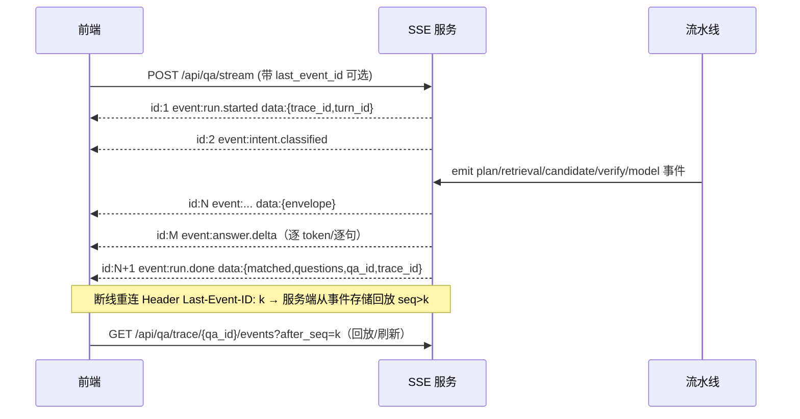

# 04 · SSE 事件流与前端可观测性现状

> 分析对象：/home/adminroot/smart-help（基线 tag `baseline-20261106`，commit `0d20ef1`）
> 分析时间：2026-11-06 22:38–23:15；分析员：analyst-sse；本轮只读，未改任何生产文件。
> 证据来源：① src/ 代码（file:line）② runtime/logs/chain_trace-*.jsonl 真实链路 ③ Kingbase qa_log SELECT（503 行）④ src/static/ask.html 前端逻辑。
> 数据快照：qa_log 503 行（complete 481 / interrupted 22）；full-model complete 73 行，match_json 体积 min 1,035 / avg 27,958 / max 88,687 字节；最新 qa_id=605（28,280 字节）。

---

## 1 一句话结论

1. **后端每轮实际产生 76 个链路事件，SSE 只发 10 种 type，前端思考面板最终只渲染 14 行中文标签**——真实内部过程在传输层已丢失 60% 以上，在展示层又丢一半（trace 199f07a2 实证：76 事件 → 48 条 forward → 14 行 UI）。
2. **`chain_trace._progress_view` 是硬白名单，只放行 3 类事件**（`span_start`/`span_end`/`full_model.model_call`，chain_trace.py:46-68）；`model.meta`、`full_model.reasoning`、`full_model.retrieval`、`full_model.result`、`request_start`/`trace_summary` 等 28/76 条全部丢弃。同 `key` 覆盖又让 `stage:model.answer` 的 66 次 span 只留最后 1 行（ask.html:1369 upsertProgress）。
3. **没有 trace_id 贯通**：后端在响应头写了 `X-Trace-ID`（chain_trace.py:203-261），但 ask.html 全文无 `Trace` 字样、`qa_log` 无 `trace_id` 列，SSE 事件无 trace_id——用户/客服/运营看到一条回答，无法反查它对应的 76 条链路事件与 3 次模型调用记录。
4. **完整运行态其实已落库**：qa_log.match_json 含 `coverage`（23 键）、`diagnostics.calls`（每次模型调用 token/耗时/server_timings）、`decision_audit`、`hh.policy_core.facts`（29 条）、`export_rows`、`answer`；但前端历史回放只消费 5 类字段（sources/table_rows/cards/questions/answer，kb_rag.ui_meta_from_match_json），coverage/diagnostics/decision_audit 从不展示。
5. **协议缺 envelope / 持久化 / 重连 / token / 心跳**：`stream()` 只输出 `data: {json}\n\n`（conversations.py:582-588），无 `id:`、无 `event:`、无 `retry:`、无 Last-Event-ID；answer 在流水线结束后一次性整段下发（conversations.py:542），无 token 流；断线即 `interrupted` 且 `match_json=None`，前端把所有内容清空（ask.html:1428-1436）。

## 2 现状架构

### 2.1 全链路

```mermaid
flowchart LR
  A[ask.html send] -->|POST /api/qa/stream| B[conversations.prepare]
  B -->|QaLog status=generating, 先 commit| C[run_turn]
  C -->|yield session| A
  C -->|路由: refine / chat_only / match / consultation| D[worker 线程 _pipeline]
  D --> E[worker 内创建 _gen_maker()]
  E --> F[kb_rag.qa_match_stream → full_flow.run]
  F --> G[chain_trace._emit 每次阶段/模型调用]
  G --> H{TraceMiddleware state.subs}
  H -->|put_nowait maxsize=256| I[订阅队列]
  I -->|主线程 0.25s 轮询| C
  C -->|yield progress| A
  F --> J[meta: table_recs/cards/questions/sources/coverage/...]
  J --> K[freeze(meta, answer) → qa_log.match_json]
  K -->|commit 后才发| L[sources/analysis/table/cards/questions/answer/done]
  L --> A
```

### 2.2 关键代码位置

| 环节 | 位置 | 说明 |
|---|---|---|
| SSE 入口 | src/conversations.py:591 | POST /api/qa/stream → prepare(refine=False) |
| 轮次初始化 | src/conversations.py:259-311 | 写 QaLog(status=generating) 并**先 commit** 再进流水线 |
| 事件循环 | src/conversations.py:420-579 | run_turn：session→progress→结果事件→done/error |
| SSE 序列化 | src/conversations.py:582-588 | `data: json\n\n` + `text/event-stream` |
| 进度订阅 | src/conversations.py:475 | chain_trace.subscribe() → queue |
| 轮询插入 | src/conversations.py:498-515 | get(timeout=0.25)，done 后 drain |
| 链路事件 | src/chain_trace.py:71-91 | _emit 写 jsonl + 白名单转发订阅队列 |
| 白名单 | src/chain_trace.py:46-68 | 只 3 类事件进 progress |
| 订阅队列 | src/chain_trace.py:94-113 | maxsize=256，满则静默丢弃 |
| Trace 中间件 | src/chain_trace.py:203-261 | 仅 /api/*；X-Trace-ID；trace_summary |
| 前端消费 | src/static/ask.html:1441-1460 | fetch reader 手切 \n\n |
| 前端渲染 | src/static/ask.html:1397-1439 | handleEvent 处理 10 种 type |
| 思考面板 | src/static/ask.html:513-535 | 一行最新动作 + 展开列表 |
| 历史回放 | src/static/ask.html:1287-1304 | 只用 match_ui 重建 5 类内容 |
| 部署形态 | deploy/foreground.py:105-112,171 | gunicorn 1 worker × gthread 2 threads |

## 3 机制细节

### 3.1 时序：prepare → worker → SSE

```mermaid
sequenceDiagram
  participant U as 浏览器 ask.html
  participant C as conversations.run_turn
  participant W as worker 线程
  participant T as chain_trace
  participant DB as qa_log
  U->>C: POST /api/qa/stream
  C->>DB: INSERT QaLog(status=generating); COMMIT
  C-->>U: event session {session_id}
  Note over C: 路由判断（refine/chat_only/match/consultation）<br/>is_consultation 在 subscribe 之前 —— 其模型调用事件丢失
  C->>T: subscribe() → Queue(256)
  C->>W: start(); worker 内创建生成器并跑完整流水线
  loop 主线程每 0.25s
    W->>T: _emit(...) 每次阶段/模型调用
    T-->>C: put_nowait(progress_view)
    C-->>U: event progress {key,stage,purpose,done,ms,error}
  end
  W->>W: chunks 全部收齐，box.done=True
  C->>DB: UPDATE answer/match_json/matched/actual_model/status=complete; COMMIT
  C-->>U: sources → analysis → table → cards → questions → answer → done
  Note over U: 整段 answer 一次性到达；done 里带 progress={round,max_rounds} 但前端不消费
```

关键事实（证据）：
- 路由在订阅之前执行；非 reuse 场景会调 `is_consultation()`（conversations.py:462），full_model 分支内部可能调 `_llm_answer(purpose='core_intent')`，这次模型调用的 span 在 `subscribe()`（:475）之前 emit → 必然丢失。
- worker 内创建生成器是 2026-11-06 修复（audit_20261106.md:111-117）：否则流水线在 subscribe 前跑完，首版 e2e 0 条 progress。
- 结果事件在 **DB commit 之后**才下发（conversations.py:520-545）：用户看到卡片时必须已经落库，保证刷新可回放；代价是等待期间只有 14 行进度。

### 3.2 SSE 事件协议现状（10 种 type，逐字段）

| # | type | 触发点 | 字段（全部） | 前端是否消费 | 备注 |
|---|---|---|---|---|---|
| 1 | session | conversations.py:434 | session_id | 是 | 首帧，先于任何进度 |
| 2 | progress | conversations.py:498-515 | key, stage, purpose, done, ms, error | 是（标签+耗时） | key 去重覆盖；detail/evidence/metrics 均无 |
| 3 | sources | conversations.py:537 | items[]{policy_code,policy_name,excerpt} | 是 | commit 后才发 |
| 4 | analysis | conversations.py:538 | content | 是 | full-model 路径通常为空 |
| 5 | table | conversations.py:539 | rows[] | 是 | 政策明细表 |
| 6 | cards | conversations.py:540 | items[] | 是 | 政策卡（最大帧，未分片） |
| 7 | questions | conversations.py:541 | items[] | 是 | 智能追问 |
| 8 | answer | conversations.py:542 | content（整段字符串） | 是 | **无 token 流** |
| 9 | done | conversations.py:543-545 | matched, qa_id, model, status, will_missing, questions, progress={round,max_rounds}, flow_version | 部分（progress 被忽略） | 含 qa_id 可用于回查，但前端不展示 trace_id |
| 10 | error | conversations.py:555 | msg, status='interrupted' | 是（清空全部） | 无 error_code、无失败阶段、无部分结果 |

补充事实：
- `stream()`（conversations.py:582-588）无 `id:`、无 `event:`、无 `retry:`、无心跳；浏览器 EventSource 无法用（前端用 fetch reader 手写解析）。
- 事件帧未带 `turn_id`/`trace_id`/`seq`；错误无 `code`（只有中文 msg）。
- 所有 progress 事件与最终结果事件在时间上互斥：progress 只在流水线运行期出现，结果事件在流水线结束后一次性连发。

### 3.3 真实轮次事件统计（trace 199f07a2…，chain_trace-361755.jsonl）

时间 2026-11-06T22:22:53 → 22:23:41（48s），共 76 条：

| 事件族 | 条数 | 是否进 progress | 说明 |
|---|---|---|---|
| request_start / route | 2 | 否 | 无请求体、无用户/会话 ID |
| span_start + span_end（stage） | 36 | 部分（仅 18 个阶段，同 key 覆盖后更少） | stage=model.answer 最多，policy.load/vector.load/model.embed 等 |
| model.meta | 14 | 否 | 每次模型调用一条，含 tokens/chars |
| full_model.model_call | 14 | 是 | 与 model.meta 重复记录同一次调用 |
| full_model.reasoning | 2 | 否 | 推理中间结果，仅计数 |
| full_model.retrieval_plan/retrieval/evidence_load/source_rerank_backend/rerank/lexical_rerank/questions/result | 8 | 否 | 检索/重排/建议领域事件 |
| trace_summary / request_end | 2 | 否 | 汇总（spans/noisy_agg/decisions/duration_ms） |

→ `_progress_view` 放行 48 条，丢弃 28 条；前端去重后 **14 行**。用户看到「已完成 14 步分析」，实际 76 事件、14 次模型调用。

### 3.4 `_progress_view` 过滤矩阵（白名单只有 3 类）

| 源事件 | 关键字段 | 进 progress？ | 前端可见信息 |
|---|---|---|---|
| span_start / span_end（有 stage） | stage, duration_ms, error_type | ✅ | 阶段中文名 + 耗时 + 成败图标 |
| span_start / span_end（stage 为 noisy：graph.load / eligibility.verify） | — | ⚠️ 不写 span，仅 _agg 聚合 | 几乎不可见 |
| full_model.model_call | purpose, seconds/duration_ms, tokens, input_chars, output_chars, error | ✅ | 仅 purpose 中文名 + 耗时；tokens/chars 全丢 |
| model.meta | model_id, purpose, input_chars, output_chars, prompt_tokens, completion_tokens, total_tokens, retries | ❌ | 无 |
| full_model.reasoning / retrieval / rerank / evidence_load / result | rows/candidates/verdict_counts… | ❌ | 无 |
| request_start / route / trace_summary / request_end | method, endpoint, status, duration_ms | ❌ | 无 |
| policy_core.result / household.result | advice_status/coverage 计数 | ❌ | 无 |

补充：span 行**本身不带 purpose 字段**（model.meta 与 full_model.model_call 才有）；stage 映射表 STAGE_ZH 只有 15 键（ask.html:1328-1332），而代码里 stage 实际有 `policy_core.questions` 等未映射项（真实日志出现 6 次），前端落「后台处理中」；PURPOSE_ZH 49 键（ask.html:1333-1356）仍有 3 个真实 purpose 落兜底：「模型自检修复」「逐条核验政策条件（自动修复）」「模型分析中」。

### 3.5 订阅队列与轮询：丢事件的三个面

| 面 | 机制 | 证据 | 后果 |
|---|---|---|---|
| 队列满 | Queue(maxsize=256)；put_nowait 异常被 `except: pass` | chain_trace.py:99, 83-88 | 长轮次（96 次调用预算）可静默丢进度，前端无「事件不完整」标识 |
| 轮询抽样 | 主线程 `get(timeout=0.25)` 每轮只取 1 条即 yield；done 后 drain | conversations.py:498-515 | 事件密集时 yield 节奏受前端消费速度约束，实际到达顺序被压缩/合并 |
| 订阅窗口 | subscribe 在路由判断之后；脚本/无请求态返回 None | chain_trace.py:94-102；conversations.py:475 | is_consultation 的模型调用事件必丢；非 SSE 调用（同步 /api/qa）恒无 progress |

另：`_emit` 整体 try/except 静默（chain_trace.py:89-91）；jsonl 落盘与转发没有背压、没有 seq，事件无法判别缺失。

### 3.6 前端 ask.html 消费与渲染

- 消费：fetch + reader + TextDecoder，按 `\n\n` 切帧，只取以 `data: ` 开头的行，`JSON.parse` 失败静默吞（ask.html:1441-1460）；无 EventSource/无 Last-Event-ID/无重连/无退避；流结束若仍 `asking` 抛「连接中断，回答未确认保存，请刷新历史记录查看状态」（ask.html:1458）。
- 思考面板（ask.html:513-535）：流式中一行 spinner + latestProgress（如「已完成：核对口径冲突（19.0s）」）；结束后「✓ 已完成 14 步分析，用时约 48s」；展开列表每项只有 图标 + label + 秒，**无 detail / evidence / metrics / 原始 key**。
- 渲染顺序：cards → analysisMd → 正文 → willMissing → questions → table → sources → 导出按钮（ask.html:537-616）。历史消息重建顺序相同但**无思考面板**（progress 不持久化）。
- 未消费字段：done.progress（轮次 {round,max_rounds}）、done.flow_version、done.model（只显示不解释）、match_ui 之外的 match_json 全部字段。
- 失败态：error 到达即清空 content/sources/cards/table/questions/analysis（ask.html:1428-1436）——部分结果全丢，用户无法判断卡在哪一步。

### 3.7 用户实际看到的 14 行 vs 真实事件（trace 199f07a2）

| # | 前端行（中文 label） | 耗时 | 对应真实事件 | 丢失的内部信息 |
|---|---|---|---|---|
| 1 | 加载政策库 | 0.6s | stage:policy.load | 加载条数、命中版本、耗时占比 |
| 2 | 模型推理 | 1.7s | stage:model.answer（**66 次覆盖**） | 每次调用 purpose/tokens/输入输出长度 |
| 3 | 规划检索方向 | 4.2s | call:core_full_retrieval_plan | 检索计划 JSON、意图数 |
| 4 | 加载语义索引 | 0.9s | stage:vector.load | 向量条数、索引版本 |
| 5 | 语义向量化 | 0.4s | stage:model.embed | 向量维度、batch 大小 |
| 6 | 逐条核验政策条件 | 9.2s | call:core_full_reason | 每条政策 verdict/失败维度 |
| 7 | 模型自检修复 | 8.2s | call:core_full_reason_binding_repair | 修复了什么、重试次数 |
| 8 | 核对口径冲突 | 19.0s | call:core_full_conflict_scope | 冲突政策对、scope 判定 |
| 9 | 复核核验结论 | 2.2s | call:core_full_reason_audit | 审计结论、被打回条数 |
| 10 | 逐条核验政策条件（自动修复） | 6.4s | call:core_full_reason_repair | 修复前后差异 |
| 11 | 核对政策分支 | 2.0s | call:core_full_branches_match | 分支命中/未命中 |
| 12 | 组织追问问题 | 2.4s | call:core_full_question_bind | 问了什么、为什么问（why/gain） |
| 13 | 模型分析中 | 1.2s | call:core_question_decide（未映射） | 决策 JSON、need_more 判断 |
| 14 | 整理政策建议 | 1.7s | call:core_full_advice | 建议正文、被拒收原因 |

注：「模型推理」这一行的时间来自最后一次 model.answer span，不代表 14 次调用的总和；「加载政策库」首次显示 `645.7s`（span 未结束时 ms 为历史包累计值），结束时被覆盖为 0.6s——**用户可能在流式早期看到 645.7s 的错误耗时**。

### 3.8 信息资产 vs 当前展示

| 信息资产 | 产生位置 | 已落库？ | SSE 已发？ | 前端展示？ |
|---|---|---|---|---|
| 阶段/模型调用进度（10 类 progress） | chain_trace._emit | 仅 jsonl | ✅（白名单 3 类） | 仅 label + 秒 |
| 模型调用详情（purpose/tokens/耗时/重试） | model.meta; full_model.model_call; diagnostics.calls | ✅ match_json.diagnostics.calls | ❌（progress 里只有 purpose/ms） | ❌ |
| 检索漏斗（unique_candidates/dropped/eligible/region_dropped/selected_sources） | full_flow coverage | ✅ match_json.coverage 23 键 | ❌ | ❌ |
| 规则/条件求值明细（verdict/failed_dimensions/decision_no） | eligibility.verify span；table_recs | ✅ match_json.table_recs | ❌ | 卡片内部分字段 |
| 决策审计（decision_audit） | result_model.metadata | ✅（qa605 为 list len 2） | ❌ | ❌ |
| 事实清单（hh.policy_core.facts，qa605=29 条） | full_facts | ✅ | ❌ | ❌ |
| 被拒政策透明化（rejected_policies[:6]） | full_flow.rejected_summary | ✅ coverage | ❌ | ❌ |
| 原始链路（76 事件/轮） | chain_trace jsonl | 文件（10MB×5 轮转） | 部分 | ❌ |
| trace_id | TraceMiddleware 响应头 | ❌（qa_log 无列） | ❌ | ❌ |
| 导出明细（export_rows） | result_snapshot.freeze | ✅ | table 行 | 表格 |
| 回答正文 | full_advice / rule_flow | ✅ | ✅ answer | ✅ |
| 追问（questions，含 why/gain） | full_questions | ✅ | ✅ | ✅（部分） |

结论：**后端已产生、且大部分已持久化的可解释资产，前端只展示了约 1/5**；而链路级 jsonl 完全没有面向用户的出口。

## 4 「看不到真实实况」根因清单

### 4.1 协议缺口

| # | 根因 | 证据 | 用户可感知影响 |
|---|---|---|---|
| P1 | 无事件 envelope：无 trace_id/seq/step_id/parent_id/时间戳/状态机 | conversations.py:536-555 逐个手写 dict；SSE 帧无 id/event 字段（:582-588） | 无法判断事件属于哪一步、是否丢帧、能否拼成树 |
| P2 | progress 白名单只有 3 类 | chain_trace.py:46-68 | 检索、重排、证据加载、推理、决策、审计全不可见 |
| P3 | 同 key 覆盖 | ask.html:1369；chain_trace.py:52（key='stage:'+stage） | 66 次 model.answer 只显示 1 行；多轮同阶段历史被抹掉 |
| P4 | answer 整段下发、无 token 流 | conversations.py:542；无 token 事件（src 全文 grep 无 token 流式） | 40–70s 内正文区空白，只有 14 行标签 |
| P5 | done 携带的 progress={round,max_rounds} 未被消费、无 qa 结果摘要 | conversations.py:543-545；ask.html:1419-1430 不读 ev.progress | 用户不知道这是第几轮、轮数上限、还剩几次追问 |
| P6 | error 无 code、无 failed_step、无部分结果 | conversations.py:555 | 只知「内部错误」，不知卡在检索/核验/模型 |
| P7 | 无心跳、无重试、无 Last-Event-ID | conversations.py:582-588；ask.html:1441-1460 | 长连接 600s 超时/代理断流即中断，不能续传 |

### 4.2 信息缺口

| # | 根因 | 证据 | 影响 |
|---|---|---|---|
| I1 | 检索漏斗不算「事件」，只进 coverage，且只在结束时落库 | full_flow.coverage；full_model.retrieval_plan/retrieval 落 jsonl 但不进 progress | 用户看不到「候选 160 → 可核验 12 → 出卡 1」这一步，误以为系统没在干活 |
| I2 | 规则/条件求值明细埋在 span 字段与 table_recs | chain_trace.py:155-167（eligibility.verify verdict/failed_dimensions） | 「为什么这条政策没通过」无法在过程中解释 |
| I3 | 决策审计（decision_audit）与事实清单（facts）只在 match_json | qa605：decision_audit list len 2；facts 29 条 | 刷新后也看不到「模型做了哪些判断」 |
| I4 | 模型调用输入输出长度/tokens/重试进 jsonl 与 diagnostics.calls，不进 SSE | kb_rag.py:478；diagnostics.calls | 无法感知「模型被调用了几次、烧了多少 token」 |
| I5 | 被拒政策名单（rejected_policies[:6]）不展示 | coverage.rejected_policies | 用户只看到 1 张卡，不知其余为何被拒 |

### 4.3 前端缺口

| # | 根因 | 证据 | 影响 |
|---|---|---|---|
| F1 | 思考面板只有 label+ms，无展开详情 | ask.html:513-535 | 用户无法点开某一步看证据/JSON/候选，所谓「思考」只有 14 个词 |
| F2 | 历史消息不重建思考面板（progress 未持久化） | ask.html:1287-1304；qa_log 无 progress 列 | 刷新/回看即失去过程，只能看到结果 |
| F3 | 错误清空全部内容 | ask.html:1428-1436 | 部分卡片/正文被一并抹掉 |
| F4 | JSON 解析失败静默吞 | ask.html:1452-1454 | 协议升级时前端会静默少渲染，无告警 |
| F5 | 未展示 qa_id/trace_id/model 版本/耗时/成本 | ask.html:1419-1430 | 无法反馈具体是哪轮、无法做客服定位 |

### 4.4 持久化缺口

| # | 根因 | 证据 | 影响 |
|---|---|---|---|
| S1 | qa_log 无 trace_id 列 | src/models.py:103-118（qa_dict 同样不返回 trace_id） | 回答↔链路日志无法关联 |
| S2 | progress 事件不落库 | match_json 无 progress 字段（qa605 顶层键实查） | 历史回放无过程 |
| S3 | jsonl 按 pid 分文件轮转 10MB×5，无索引/无留存策略 | chain_trace.py:264-309 | 一次请求的日志可能被滚动覆盖；无查询入口（src 下无页面展示 chain_trace） |
| S4 | 中断轮次 match_json=None | conversations.py finally（:560-577） | 断线后连「跑过哪些步骤」都不留 |

### 4.5 时序缺口

| # | 根因 | 证据 | 影响 |
|---|---|---|---|
| T1 | 结果事件在 commit 后连发，此前只有 progress | conversations.py:520-545 | 两段式体验：先 14 行标签，再瞬间全部内容 |
| T2 | worker 与主线程解耦，事件顺序按 _emit 时刻，但 HTTP 消费按 0.25s 抽样 | conversations.py:498-515 | 到达顺序与真实因果可能错位，无法做时间线复现 |
| T3 | gunicorn 1 worker × 2 threads | deploy/foreground.py:171 | 1 条 SSE 占 1 线程；第 2 条流并发时其它 API（历史、预览、取消）排队，进一步拖慢事件到达 |
| T4 | 取消/断线语义为「整轮作废」 | conversations.py:512-515；finally :560-577 | 用户刷新后无法从断点继续，只能重跑整轮（重烧模型） |

## 5 与智枢的差距（按当前代码事实）

| 维度 | 本系统现状（证据） | 智枢类目标形态 | 差距性质 |
|---|---|---|---|
| 事件粒度 | 10 种 type；progress 仅 3 类白名单（chain_trace.py:46-68） | 意图/规划/工具/检索/候选/核验/决策/事实/回答/token/usage 全量事件 | 协议级 |
| 步骤层次 | 扁平列表，无 parent_id，无 step_id | 树/时间线，父子可折叠 | 数据模型级 |
| 实时 token | answer 整段（conversations.py:542） | token 级流式渲染 | 传输级 |
| 证据可展开 | 面板只有 label+ms（ask.html:513-535） | 每步可展开证据、JSON、候选、政策依据 | 前端+协议 |
| 指标/成本 | tokens 在 jsonl/diagnostics，不进前端 | 每步/整轮 token、耗时、成本、重试 | 数据暴露级 |
| 持久化回放 | progress 不落库；jsonl 按 pid 轮转 | 事件表 + 按 trace_id 回放 | 存储级 |
| trace 关联 | X-Trace-ID 响应头，前端不读，qa_log 无列 | 回答卡带 trace_id，可跳转全链路 | 关联级 |
| 断线续传 | 无 id/Last-Event-ID；断线整轮作废 | 断线重连按 seq 续传，已完成步骤可恢复 | 传输级 |
| 失败态 | error 清空全部、无 code | 失败步骤高亮 + 已完成部分保留 + 可重试该步 | 交互级 |
| 多轮可视化 | done.progress 未消费；无轮次轴 | 轮次时间线、每轮补信息与结论变化 | 展示级 |

说明：智枢的具体实现细节由 05-zhishu-reference.md 负责；本表只列「本系统代码事实 vs 用户诉求（可看到真实内部实况）」。

## 6 目标事件协议草案

### 6.1 设计原则

1. **一事件一事实**：每个事件对应一个可验证的内部动作（阶段/模型调用/检索/核验/决策/工具），不合并、不推测。
2. **统一 envelope**：所有事件同一外壳，新增字段不破坏旧消费者；前端按 `kind` 分支渲染。
3. **可回放**：事件持久化，SSE 带 `seq`，断线用 Last-Event-ID 续传。
4. **可脱敏**：detail/evidence 只放结构化摘要与引用（policy_code/detail_id/字段名），不放 prompt 原文与模型原始输出全文。
5. **失败可解释**：error 事件带 `code`、`step_id`、`retryable`，并保留已完成事件。
6. **兼容期双发**：v1 的 10 种 type 保留，新增事件用 `event:` 名区分，前端灰度开关。

### 6.2 统一 envelope

| 字段 | 类型 | 必填 | 说明 |
|---|---|---|---|
| trace_id | string(32) | ✅ | 与 X-Trace-ID、qa_log.trace_id 一致 |
| turn_id | string | ✅ | 会话内轮次 ID（= qa_id 或 UUID） |
| seq | int | ✅ | 单调递增，SSE `id:` 直接用 |
| step_id | string | ✅ | 本次事件所属步骤（同一 step 的 started/finished 同 ID） |
| parent_step_id | string? |  | 树形父步骤 |
| ts | ISO8601 ms | ✅ | 事件发生时刻（非到达时刻） |
| phase | enum | ✅ | intent/plan/tool/retrieval/candidate/verification/decision/fact/answer/usage |
| kind | enum | ✅ | 见 6.3 |
| status | enum | ✅ | started/ok/error/skipped/cancelled |
| title | string | ✅ | 中文短标题（≤20 字，服务端生成，前端不再维护映射） |
| detail | object |  | 结构化明细（≤4KB，脱敏） |
| evidence | array |  | [{type:'policy'\|'detail'\|'rule'\|'doc', ref, label, snippet≤120}] |
| metrics | object |  | {duration_ms, model, purpose, prompt_tokens, completion_tokens, chars_in, chars_out, retries, rows, candidates} |
| error | object? |  | {code, message, retryable} |
| version | string | ✅ | 'evt-v1' |

示例（模型调用完成）：

```json
{"trace_id":"199f07a20fe040ac8e56c9d19a8b2fe4","turn_id":"qa605","seq":17,
 "step_id":"model:core_full_reason:3","parent_step_id":"stage:reasoning",
 "ts":"2026-11-06T22:23:12.417+0800","phase":"verification","kind":"model.finished",
 "status":"ok","title":"逐条核验政策条件（第3批）",
 "metrics":{"duration_ms":9220,"model":"qwen3.6-35b","purpose":"core_full_reason",
            "prompt_tokens":5825,"completion_tokens":449,"chars_in":13173,"chars_out":991},
 "detail":{"policies":["S-ZB-090","S-QJ-008"],"verdicts":{"S-ZB-090":"unknown","S-QJ-008":"pass"}},
 "evidence":[{"type":"policy","ref":"S-ZB-090","label":"困难残疾人生活补贴"}]}
```

### 6.3 事件分类与清单

| 分类 | 事件 kind | 关键字段 | 是否默认展示 |
|---|---|---|---|
| 生命周期 | run.started / run.finished / run.cancelled | qa_id, trace_id, model_mode | 是（头部） |
| 意图 | intent.classified | intent(consultation/eligibility/chat), confidence, reason | 是 |
| 规划 | plan.updated | round, max_rounds, missing_fields[], next_action | 是 |
| 工具 | tool.called / tool.finished / tool.failed | tool, args_summary, result_summary, error_code | 是 |
| 检索 | retrieval.planned / retrieval.finished | intents[], chunks, candidates, budget, truncated | 是（漏斗） |
| 候选 | candidate.retrieved / candidate.filtered / candidate.dropped | policy_code, reason(region/scope/name_gate/…), rank, sim | 是（可展开） |
| 核验 | verify.started / verify.policy / verify.finished | policy_code, verdict, failed_dimensions[], decision_no | 是（明细抽屉） |
| 决策 | decision.made | action(card/question/none), reason, policy_codes | 是 |
| 事实 | fact.extracted / fact.updated / fact.unclear | field, value, source, confidence | 是（事实清单） |
| 回答 | answer.delta | text 片段 | 是（正文流） |
| 用量 | usage.updated | calls, prompt_tokens, completion_tokens, budget_left | 是（角标） |
| 错误 | error | code, message, step_id, retryable | 是（高亮该步） |
| 心跳 | heartbeat | ts | 否（保活） |
| 完成 | run.done | matched[], cards, questions, qa_id, trace_id | 是 |
| 兼容旧事件 | session/progress/sources/table/cards/questions/answer/done/error | 同现状 | 是（过渡期） |

### 6.4 目标时序



### 6.5 传输与重连

- SSE 帧格式：`id: <seq>` / `event: <kind>` / `data: {envelope}` / `retry: 3000`；每 15s 发注释心跳 `: ping`。
- 断线：服务端保留本 turn 的内存 ring buffer（建议 4096 事件）；客户端重连带 `Last-Event-ID`（或查询参数 `last_event_id`），服务端回放缺失 seq；若被淘汰则返回 `replay_gap` 事件 + 拉取持久化事件。
- 取消：`POST /api/qa/cancel` → 发 `run.cancelled`，保留已完成事件与部分结果（不写 `match_json=None`，改存 `partial=true` + 事件引用）。
- 多 worker：事件存储按 trace_id 落 DB/jsonl，任何 worker 可回放；ring buffer 只是加速。

### 6.6 持久化与回放

| 层 | 方案 | 说明 |
|---|---|---|
| 即时 | 每事件写 `runtime/logs/trace_events-YYYYMMDD.jsonl`（按 trace_id 可 grep） | 现有 chain_trace jsonl 可复用 |
| 关联 | qa_log 增列 `trace_id`（或新建 qa_trace 表） | 回答↔事件直连；历史接口返回 match_ui 时带 trace_id |
| 回放 | 事件表 `trace_event(trace_id, seq, ts, phase, kind, status, payload jsonb)` | 支持 `GET /api/qa/trace/<qa_id>/events` 与前端刷新恢复思考面板 |
| 保留 | 事件表按天分区/保留 90 天；jsonl 10MB×10 轮转 | 兼顾审计与磁盘 |

### 6.7 脱敏与安全

- 不落 prompt/completion 原文；`detail` 只放结构化摘要（字段名、policy_code、verdict、条数、截断片段 ≤120 字）。
- 家庭成员姓名/身份证/电话在 `detail` 中打码（`张*`、`****1234`）；事实事件只给字段名+值类型+来源，不给原文句子。
- `evidence.snippet` 来自政策原文（公开数据），可保留；用户输入引用仅 120 字摘要。
- 错误 `message` 对用户显示中文可读文案，`code` + 堆栈只进服务端日志；`X-Trace-ID` 可复制给客服。
- 权限：`/api/qa/trace/*` 需登录且只能看自己的 qa；管理端看全量需角色校验。

### 6.8 前端展示形态

| 区域 | 形态 | 数据来源 |
|---|---|---|
| 思考时间线 | 默认一行「正在进行：逐条核验政策条件（第 3/8 批）」；展开为**树**：阶段 → 模型调用/检索/核验 → 子步骤 | 全部事件 |
| 步骤卡片 | 每步标题 + 状态图标 + 耗时 + tokens + 重试；点开看 detail/evidence/metrics | envelope |
| 证据抽屉 | 政策 code/名称/条款/原文 snippet；核验字段明细分「已满足/不满足/未知」 | verify/candidate 事件 |
| 检索漏斗 | 候选 N → 过滤规则 → 可核验 M → 出卡 K；被拒政策可点开看原因 | retrieval/candidate 事件 |
| 实时正文 | token/句子增量渲染 + 光标；可中断 | answer.delta |
| 用量角标 | 第 r/4 轮 · 14 次模型调用 · 12.3k tokens · 48s | usage 事件 |
| 失败态 | 高亮失败步骤 + 已完成步骤保留 + 「从该步重试」；错误码可复制 | error 事件 |
| 刷新/历史 | 用 trace_id 拉事件表重建完整时间线与证据，和实时一致 | 回放 API |

### 6.9 迁移与兼容

1. 第一阶段（不破坏）：后端在现 10 种 type 之外**双发**新事件（`event:` 名不同），前端加 feature flag `SSE_EVENTS_V2`。
2. 第二阶段：前端切换到新 envelope 渲染，旧 type 作为降级路径保留一个发布周期。
3. 第三阶段：删除旧 progress 白名单，`_progress_view` 改为「所有登记事件默认透传 + 三档曝光等级（user/summary/debug）」。
4. 版本：envelope 带 `version`，未知 kind 前端忽略并计数上报；SSE 帧 `event` 名不要复用旧名。
5. 回填：qa_log 增列 trace_id 后，历史 73 条 full-model 记录无法补 trace_id（jsonl 可能已轮转），标注 `trace_missing=true` 并在 UI 提示「该历史回答无链路回放」。

## 7 改造切入点

### 7.1 可复用资产

| 资产 | 位置 | 复用方式 |
|---|---|---|
| chain_trace 事件发射器与 jsonl | src/chain_trace.py | 直接作为事件总线：把 `_emit` 改成统一 envelope 产出，保留落盘 |
| TraceMiddleware trace_id / 响应头 | chain_trace.py:203-261 | 补 qa_log.trace_id 落库，X-Trace-ID 前端读取 |
| 订阅/轮询骨架 | conversations.py:475-515 | 换成「事件存储 + ring buffer」即可，前端协议升级 |
| match_json 富快照 | result_snapshot.freeze | 直接拆成回放事件（coverage/diagnostics/decision_audit/facts 各成事件） |
| STAGE_ZH/PURPOSE_ZH 中文标签 | ask.html:1328-1356 | 迁移到服务端 title 生成，前端不再维护映射 |
| 前端思考面板/卡片/预览抽屉 | ask.html:513-535, 1739 行单文件 | 面板骨架可复用，扩展树形与详情抽屉 |

### 7.2 必须替换

1. **SSE 协议层**：手写 `data:` → 标准 SSE（id/event/retry/心跳）+ envelope + Last-Event-ID。
2. **progress 白名单**：3 类 → 全事件分类 + 曝光等级（user/summary/debug）。
3. **前端事件处理**：10 分支 if/else → 事件 reducer（按 phase/kind 归并成树 + 增量更新）。
4. **持久化与关联**：qa_log 增 trace_id、事件表/事件文件、回放 API；中断轮次保留部分结果与事件引用。
5. **模型调用元数据出口**：tokens/retries/耗时从 jsonl 提升为 `usage.updated` 事件。

### 7.3 风险

| 风险 | 说明 | 缓解 |
|---|---|---|
| 事件量放大 | 96 次模型调用 + 每次检索/核验会产生数百事件，SSE 帧与存储压力上升 | 事件分级：user 级全量、summary 级聚合、debug 级采样；单事件 detail ≤4KB |
| 泄露用户隐私 | detail 若放原文/事实值 | 服务端统一脱敏器 + 单测断言禁止敏感键 |
| 前端复杂度 | 树形时间线 + 实时增量渲染 | 先做「回放 + 树形查看」再做 token 流；灰度开关 |
| 与现有 10 种 type 冲突 | 双发期顺序错乱 | 新事件 event 名独立；旧 progress 保留 key 去重行为 |
| trace_id 回填缺失 | 历史 73 行无 trace_id | UI 标 trace_missing，不假装可回放 |

## 附录 A 证据索引

| 结论 | 证据 |
|---|---|
| 10 种 SSE type | src/conversations.py:434, 498-515, 536-545, 555 |
| SSE 帧无 id/event/retry | src/conversations.py:582-588 |
| 白名单 3 类 | src/chain_trace.py:46-68 |
| 队列 256 + 静默丢 | src/chain_trace.py:83-88, 94-102 |
| 0.25s 轮询 | src/conversations.py:498-515 |
| X-Trace-ID 无消费 | src/chain_trace.py:203-261；ask.html 全文 grep Trace 为空 |
| qa_log 无 trace_id | src/models.py:103-118 |
| match_json 富快照 | qa_log SELECT：full-model complete 73 行，avg 27,958 字节；qa_id=605 含 coverage 23 键、diagnostics.calls、decision_audit、facts 29 条 |
| 76 事件→48 转发→14 行 | runtime/logs/chain_trace-361755.jsonl trace 199f07a2…（22:22:53–22:23:41） |
| 前端只显 label+ms | src/static/ask.html:513-535 |
| 历史无思考面板 | src/static/ask.html:1287-1304；qa_log 无 progress 字段 |
| 错误清空全部 | src/static/ask.html:1428-1436 |
| 1 worker × 2 threads | deploy/foreground.py:105-112, 171 |

## 附录 B 复现命令（只读）

```bash
# 1) 统计单轮事件构成（只读 jsonl）
python3 - <<'PY'
import json,collections
rows=[json.loads(l) for l in open('runtime/logs/chain_trace-361755.jsonl') if l.strip()]
tid='199f07a20fe040ac8e56c9d19a8b2fe4'
print(collections.Counter(r['event'] for r in rows if r.get('trace_id')==tid))
PY

# 2) 查 qa_log 快照（psycopg2 绕过 SQLAlchemy 的 Kingbase 版本断言）
python3 - <<'PY'
import os,psycopg2,json
url=os.environ['SMART_HELP_AUTH_DATABASE_URL'].replace('postgresql+psycopg2://','postgresql://')
c=psycopg2.connect(url).cursor()
c.execute("select count(*),avg(length(match_json)),max(length(match_json)) from qa_log where status='complete' and match_json like '%full-model-v1%'")
print(c.fetchone())
PY
```

（完）
