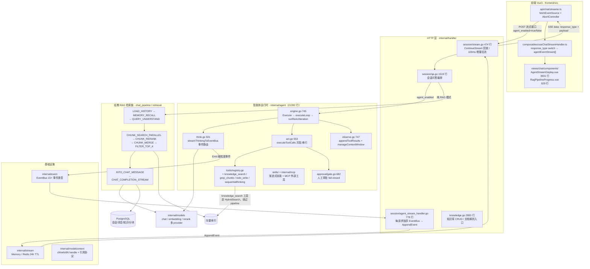
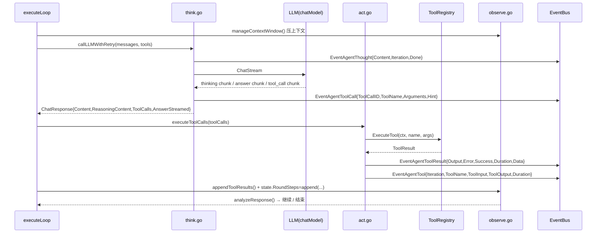

# 05 · 智枢文渊（WeKnora）参考架构：会思考的智能体 + 内部实况可观测

> **参考仓库**：`/home/adminroot/projectfiles/caichang/project/ZhuSuRag-maiin/ZhiSuRag-main`（Go module `github.com/Tencent/WeKnora`，即腾讯开源的 WeKnora；Go 后端 + Vue3 前端，`.git` 可查历史）
> **对照基线**：`/home/adminroot/smart-help` @ `baseline-20261106`（commit 0d20ef1）
> **本文性质**：只读研读产出的"可移植设计参考"。不写代码、不改资产，只回答三个问题：智枢凭什么"会思考"？它的"内部实况"是怎么流到屏幕上的？哪些机制能搬到政策匹配域、需要改什么？

---

## 0. 一句话结论

1. **"会思考"不是 prompt 花活，而是一个显式 ReAct 运行时**：`AgentEngine.Execute` 每轮做 Think（流式 LLM）→ Act（工具，可并行）→ Observe（结果回填 + 上下文压缩），最多 `MaxIterations` 轮（`internal/agent/engine.go:206-317`、`:362-444`、`:468-674`）。模型每一轮都能"看见"上一轮工具的真实输出，所以它的规划是被事实驱动的，而非一次性拼装。
2. **"实时实况"是事件总线的副产品，不是额外埋点**：agent 内部原生只发**细粒度事件**（thought / tool_call / tool_result / reflection / final_answer / references…，`internal/event/event.go:16-82`）；HTTP 层 `AgentStreamHandler` 每个 chunk 立刻 `AppendEvent` 追加到流（不攒批），SSE 端 100ms 拉增量（`internal/handler/session/agent_stream_handler.go:163-176`、`stream.go:330-474`）。所以屏幕上的"正在进行"与模型真实 token 同频。
3. **答案可信靠"同源 + 可重建"两条**：流式期间被后文证伪的前言会被标 `superseded` 并从最终答案中剔除（`agent_stream_handler.go:54-81`、`useChatStreamHandler.ts:269-283`）；历史回放用**同一套事件数据模型**从持久化 `agent_steps` 反推时间线（`useChatStreamHandler.ts:285-377`）——即"当时看到的"和"三天后看到的"渲染路径一致。
4. **RAG 是可编排的责任链**：14 个阶段 EventType + 17 个插件，装配顺序在 `session_knowledge_qa.go:192-207` 动态决定（纯聊天 3 段 / RAG 11 段）；检索是向量+关键词混合、重排按阈值过滤，切片用父子块（parent 4096 / child 384）（`internal/types/knowledgebase.go:246-269`）。
5. **智枢的"引用"是模型不可见的临时 handle**：知识块 `cN`、网页 `wN`、文档 `dN`、issues `iN`，由 `internal/modelcontext` 在模型调用前后编码/解码，前端只拿结构化引用（`modelcontext/citations.go:21-30`、`registry.go:57-91`）。**这一条对"禁止资格结论 + 依据原文"的政策域最有借鉴价值**，但也最需要改造（见 §7.1）。

---

## 1. 总体架构

### 1.1 分层图



### 1.2 两条问答路径（关键区分）

| 路径 | 触发 | 编排者 | 事件粒度 | smart-help 现状 |
|---|---|---|---|---|
| **智能体模式** | 请求体 `agent_enabled=true`（`streame.ts:86-141`） | `AgentEngine` ReAct 循环 | thought/tool_call/tool_result/answer 逐 token | **无**（只有固定流水线） |
| **经典 RAG 模式** | `agent_enabled=false` | `chat_pipeline` 插件责任链（14 阶段） | 阶段事件（retrieval.start/rerank.complete…） | smart-help 走的就是这条，但阶段数更少 |

两条路径共用同一套 `EventBus`、同一套 stream 持久化、同一套前端渲染容器——这是智枢能"两种形态一套 UI"的原因。**证据**：经典 RAG 的流式插件 `chat_completion_stream.go:84` 调 `chatModel.ChatStream`，然后 `:121-235` 直接 `Emit` 的仍是 `EventAgentThought` / `EventAgentFinalAnswer` / `EventError` 三个 agent 事件——即**没有第二套事件词汇表**，前端一套 `useChatStreamHandler` 覆盖两种模式（`useChatStreamHandler.ts:504-882`）。

### 1.3 关键目录说明

| 目录 | 行数量级 | 职责 | 对 smart-help 的价值 |
|---|---|---|---|
| `internal/agent/**` | 21392 | ReAct 运行时、工具、skills、审批、记忆 | ★★★ 智能体骨架 |
| `internal/event` | 742 | 事件类型与 EventData 契约 | ★★★ 事件词汇表 |
| `internal/stream` | 294 | 流事件持久化 + 回放 | ★★★ 断线续传 |
| `internal/modelcontext` | 2742 | 模型可见/不可见 handle 与引用协议 | ★★ 证据引用 |
| `internal/handler/session` | ~4000 | 事件 → SSE 翻译层 | ★★★ 关键胶水 |
| `internal/application/service/chat_pipeline` | — | 插件化 RAG 阶段 | ★★ 政策链编排 |
| `internal/infrastructure/chunker` | — | 父子块切片 | ★★ 政策条文切片 |
| `frontend/src/api/chat/streame.ts` | 235 | SSE 客户端 | ★★★ |
| `frontend/src/composables/useChatStreamHandler.ts` | 1081 | 事件 → 时间线数据模型 | ★★★ |
| `frontend/src/views/chat/components/AgentStreamDisplay.vue` | 3931 | 思考/工具/阶段渲染 | ★★★ |

---

## 2. 智能体运行机制

### 2.1 引擎形态：无状态引擎 + 外部重建历史

`AgentEngine` 结构体见 `engine.go:35-55`，字段含 `config / toolRegistry / chatModel / eventBus / knowledgeBasesInfo / selectedDocs / pinnedMCPServices / pinnedSkills / sessionID / systemPromptTemplate / memoryPrompt / skillsManager / memoryConsolidator / modelContext`。

关键设计（`engine.go:28-34` 注释）：**引擎本身跨轮无状态**，历史每轮由调用方 `service.LoadAgentHistory` 从 DB 重建后经 `llmContext []chat.Message` 传入。好处是多实例无粘性、进程重启不丢会话；代价是每轮要重建上下文（对应 smart-help 的 `history=history` 参数，但智枢做到了"重建后压缩"）。

```go
// engine.go:206
func (e *AgentEngine) Execute(ctx context.Context, sessionID, messageID, query string,
    llmContext []chat.Message, imageURLs ...[]string) (*types.AgentState, error)

// 流程：Cleanup → Langfuse span "agent.execute"
//   → state := &types.AgentState{RoundSteps, KnowledgeRefs, IsComplete, CurrentRound}
//   → buildSystemPrompt → buildMessagesWithLLMContext → buildToolsForLLM → executeLoop
```

System prompt 拼装（`engine.go:123-134`）= `BuildSystemPromptWithOptions(...)` + `e.memoryPrompt` + `e.modelContext.ProtocolPrompt()`。注释解释 memory 必须进 system prompt，因为 `buildMessagesWithLLMContext` 会丢弃历史中的 system 消息（`engine.go:28-34`）——**这是"重建历史"架构的必然补丁**，值得记录。

### 2.2 主循环

```go
// engine.go:362-444 executeLoop
for state.CurrentRound < e.config.MaxIterations {
    select {
    case <-ctx.Done():
        // 若已有工具结果：抢救式产出答案（streamFinalAnswerToEventBus），再返回 ctx.Err()
    default:
    }
    outcome := e.runReActIteration(ctx, state, &messages, tools)
    switch outcome {
    case iterOutcomeNext:     state.CurrentRound++
    case iterOutcomeContinue: /* 空内容重试，不推进轮次 */
    case iterOutcomeBreak:    return state, nil
    }
}
defer emitCompletion() // 保证恰好一次 EventAgentComplete，用 context.WithoutCancel 让取消路径也能发
```

`iterOutcome` 三态定义在 `engine.go:449-459`。**"Continue 不推进轮次"**这个细节很重要：模型返回空内容属于可重试抖动，不应吃掉迭代预算。

### 2.3 单轮 ReAct：Think → Act → Observe



`runReActIteration`（`engine.go:468-674`）七步：

| 步 | 动作 | 代码位置 |
|---|---|---|
| 1 | Langfuse span `agent.round.N` | `engine.go:468-490` |
| 2 | `manageContextWindow` 压上下文 | `observe.go:29-63` |
| 3 | Think：`callLLMWithRetry`（流式） | `think.go:378-501` |
| 4 | **卡死检测**：连续 `maxRepeatedResponseRounds` 次无工具调用且 content 相同 → 置 FinalAnswer 并 break | `engine.go:568-587` |
| 5 | 构造 `types.AgentStep{Iteration,Thought,ReasoningContent,ToolCalls}` | `engine.go:590-620` |
| 6 | Act：`executeToolCalls` | `act.go:217-238` |
| 7 | Observe：`RoundSteps=append` + `appendToolResults` 写回 tool 消息 | `observe.go:602-658` |

### 2.4 终止条件（5 条，缺一不可）

| 终止条件 | 判定位置 | 行为 |
|---|---|---|
| 模型自然停止（`stop`/`end_turn`/`stop_sequence`）且无 tool_call | `observe.go:259-316` | `analyzeResponse` 返回 finalAnswer；**没有专门的 final_answer 工具**（`observe.go:206-210` 注释） |
| `finish_reason=="content_filter"` | `observe.go:218-257` | 终止并发 FinalAnswer 事件（安全兜底） |
| 连续重复响应 | `engine.go:568-587` | 强制收尾，防死循环烧钱 |
| 达到 `MaxIterations` | `engine.go:362` | 退出循环（靠 `defer emitCompletion` 保证仍发 complete） |
| `ctx.Done()`（用户点停止） | `engine.go:370-390` | 有工具结果则抢救式合成答案，再返回 `ctx.Err()` |

### 2.5 上下文与记忆管理（对 smart-help 最实用的一节）

| 机制 | 参数/常量 | 位置 | 作用 |
|---|---|---|---|
| 本轮工具结果预算 | `minCurrentTurnToolTokens=8*1024`、`maxCurrentTurnToolTokens=32*1024`、`currentTurnToolTokenFraction=5`（即上下文 20%） | `observe.go:20-24` | 工具输出不能吃光上下文 |
| 超预算压缩 | 头 1/4 尾 3/4 预览 + 标记 `[Tool result compacted: original_bytes=N. Re-run the tool with narrower filters or a smaller range if more detail is needed.]` | `observe.go:83-181` | **把"压缩"变成给模型的可执行提示**，而非静默截断 |
| 历史记忆固化 | `memoryConsolidator.ShouldConsolidate` → `Consolidate`（LLM 摘要） | `observe.go:29-63` 内 | 长会话把旧轮次压成记忆条目 |
| Token 级压缩 | `agenttoken.CompressContext` | 同上 | 最后一道裁剪 |
| 跨轮检索结果失效 | kb 类工具结果替换为 `[Previous retrieval result omitted — knowledge base may have changed. Please perform a fresh search.]` | `observe.go:686-701` | **强制重新检索，避免拿陈旧证据回答**；可由 `config.RetainRetrievalHistory` 关 |
| 运行时上下文块 | `<runtime_context scope="this_turn">`：current_time(RFC3339)、session、`<bound_knowledge_bases>`、`<pinned_documents scope="authoritative_for_this_turn">` | `observe.go:363-417` | 每轮注入"这一轮用哪些库/文档是权威的" |
| 通信纪律 | `<communication_instruction>`：不得暴露内部工具名/ID（说"关键词检索"而非 grep_chunks），绝不暴露 chunk_id/knowledge_id，用标题指代文档 | `observe.go:363-417` | 把工程细节挡在用户视野外 |
| 答案纪律 | `<answer_instruction>`：证据够了就用完整答案回复并停止；在此之前继续用工具、不要中途给残缺答案 | 同上 | 抑制"半成品答案" |

> **对 smart-help 的直接启示**：智枢的 `redactHistoryKBResults`（强制重检）与"压缩标记转成模型指令"这两条，恰好可以治 smart-help 的两个老问题——跨轮拿旧政策证据、以及上下文被 34MB 证据包片段撑爆。

### 2.6 工具调用执行链

`executeToolCalls`（`act.go:217-238`）：`config.ParallelToolCalls && n>=2` 时走 `executeToolCallsParallel`（errgroup 并发、结果按原顺序回填、单个失败不取消兄弟，`act.go:242-307`），否则串行。

`runToolCall`（`act.go:356-553`）的防御链（**每一环都值得抄**）：

| 顺序 | 防御 | 位置 |
|---|---|---|
| 1 | `NormalizeToolCallID` | `act.go:356-366` |
| 2 | 参数 JSON 解析失败 → `agenttools.RepairJSON` 修复 | `act.go:367-408` |
| 3 | 发 `EventAgentToolCall{ToolCallID,ToolName,Arguments,Iteration,Hint}`（Hint = `formatToolHint` 的人话，如 `搜索网页("query text")`） | `act.go:416-427`、`:192-212` |
| 4 | 构造 `WithToolExecContext{SessionID,AssistantMessageID,EventBus,ToolCallID,UserID,ApprovalCtx,ExecTimeout}` | `act.go:430-460` |
| 5 | **幻觉 handle 检查**：带 `UnresolvedHandles` 的调用直接失败，防止假 ID 进持久化/外部服务 | `act.go:478-482` |
| 6 | `toolRegistry.ExecuteTool`（自带 timeout）+ `finishToolSpan` | `act.go:485-553` |

`ToolRegistry`（`tools/registry.go:19-208`）内部还有四层：

```text
CastParams("true"→true 等类型纠正)  :135
  → ValidateParams(JSON Schema 校验，失败不执行直接回错误) :139-149
  → 输出预算 maxOutput（工具可实现 outputLimitProvider 抬高） :151-158
  → Execute(WithOutputBudget(ctx,maxOutput)) :159
  → 按 rune 截断 result.Output :164-166
  → 失败时 result.Error += toolErrorHint（引导模型换法重试） :181-186
```

工具名 → 用户可见中文的映射在 `act.go:164-184`（`ToolThinking=深度思考`、`ToolTodoWrite=制定计划`、`ToolGrepChunks=关键词搜索`、`ToolKnowledgeSearch=知识搜索`、`ToolListKnowledgeChunks=查看文档分块`、`ToolQueryKnowledgeGraph=查询知识图谱`、`ToolGetDocumentInfo=获取文档信息`、`ToolSearchConversations=回顾历史对话`、`ToolSearchMemory=查询长期记忆`、`ToolDatabaseQuery=查询数据`、`ToolDataAnalysis=数据分析`、`ToolWebSearch=搜索网页`、`ToolWebFetch=获取网页`…）。**前端不拿工具名做展示，拿的是后端算好的 displayName + Hint**，这是"技术细节不外泄"的落地方式。

### 2.7 规划工具与思考工具分离

智枢没有让模型"自己想想就动手"，而是给了两个显式工具：

| 工具 | 定位 | 证据 |
|---|---|---|
| `todo_write` | 只登记**检索任务**（WHAT to retrieve），明确禁止写"总结/综合"类任务 | `tools/todo_write.go:18-20、48、56、130-132` |
| `sequentialthinking`（`ToolThinking`） | 动态反思式思考：thought / next_thought_needed / thought_number / total_thoughts / is_revision / revises_thought / branch_from_thought / branch_id（**可分支、可回溯、可修订**） | `tools/sequentialthinking.go:12-90` |

工具描述里写死了一条关键纪律（`sequentialthinking.go:40`）："思考完成后，用普通回复把答案写出来并停止（不再调工具）。**绝不把最终答案塞进 thought**"。这是"思考过程"与"最终答案"两个通道不混淆的根。

同时前端对思考有专门渲染：`tool_name==='thinking'` 的 tool_call 会带 `thought_number/total_thoughts` 徽标（`AgentStreamDisplay.vue:73-93`）。

### 2.8 skills 与 MCP：能力按需披露

| 机制 | 关键函数 | 位置 |
|---|---|---|
| Skills 发现 | `discoverAllSkills` / `Initialize` / `filterAllowedSkills` | `skills/manager.go:147、156、179` |
| 元数据列表（只给模型看摘要） | `GetAllMetadata` | `:200` |
| 按需加载正文（渐进式披露） | `LoadSkill` / `ReadSkillFile` / `ListSkillFiles` | `:215、:242、:260` |
| 脚本执行（走沙箱） | `ExecuteScript` | `:273` |
| 产物目录 | `SkillOutputDir` / `ArtifactOutputDir` | `:69、:59` |
| MCP 外部工具 | `internal/mcp/{client.go 567, manager.go 261}` + `agent/tools/mcp_tool.go 602` | — |

一个 skill = 目录 + `SKILL.md` 元数据 + 脚本。**先给模型看元数据，模型决定要用了再 `LoadSkill` 读正文**——这是上下文成本控制的关键设计。

### 2.9 人工审批门（fail-closed）

`approval/gate.go`（682 行）：

- `Gate` 结构 `:135`，默认超时 **10 分钟**，可由 `cfg.Agent.ToolApprovalTimeoutSeconds` 覆盖（`:189-200`）。
- `NeedsApproval` `:289` 判定哪些工具/参数需要人工确认。
- `RequestAndWait` `:308-`：先发 `EventToolApprovalRequired`（payload 含 `TimeoutSeconds`，`:347-367`），再**阻塞等待**；超时返回 `Decision{Approved:false, Reason:"approval timeout", TimedOut:true}`（`:407`）——**默认拒绝，即 fail-closed**。
- `RequestOAuthAndWait` `:428-518` 同理（Reason `"authorization timeout"`）。
- 跨实例用 Redis pubsub 同步决策（`pubsubChannel()` `:63`，`Resolve` `:539` / `resolveCrossInstance` `:565` / `deliverLocal` `:638`）。

> **政策匹配可直接复用这个形状**：把"人工审批"换成"机器证据门"——工具（或最终答案）返回前必须过闸，闸门不放行就 fail-closed 降级为"待补齐"。见 §7.1。

### 2.10 模型上下文协议（modelcontext）：模型永远看不到真 ID

| Handle | 含义 | 证据 |
|---|---|---|
| `cN` | 知识块 chunk | `citations.go:22-23` |
| `wN` | 网页 | 同上 |
| `dN` | 文档 | `citations.go:23`（"Never cite dN/bN"） |
| `bN` | 内部 bookkeeping | 同上 |
| `iN` | issues | `registry.go:53` |

协议 prompt（`citations.go:21-26`）：引用必须写成 `<ref id="cN"/>`；只能引用"出现过的"handle；禁止自己输出 `<kb>/<web>` 标签（系统生成后展开）；引用要贴在论断同一行、不许堆在末尾；**这些规则覆盖一切历史/自定义 prompt**。

`Registry`（`registry.go:42-91`）职责：`ProtocolPrompt()` 拼协议 + `EncodeMessages()` 把真 ID 编码成 handle 后送模型 + `DecodeToolCalls()` 把模型吐的 handle 解回真 ID。`CompactPublicCitations`（`citations.go:85-109`）还把**历史轮里的公开引用折回本轮私有 handle**，防止"上一轮泄露的 chunk ID 变成下一轮模型可见内容"。

---

## 3. 事件流与 SSE

### 3.1 三层结构

```text
agent 代码内 emit(Event)                ← 只关心"发生了什么"
   ↓  internal/event/event.go EventBus（按 EventType 注册多 handler，panic 有 recover）
AgentStreamHandler（每请求一个独立 EventBus，避免 SessionID 过滤）
   ↓  streamManager.AppendEvent（每条 chunk 一条 StreamEvent，不攒批）
internal/stream（Memory / Redis，key = stream:events:<sessionID>:<messageID>）
   ↓  SSE 端点 100ms ticker 拉增量
浏览器 fetchEventSource
```

### 3.2 事件类型表（按用途分组）

**流式 agent 事件（前端直接渲染）**——`event.go:16-82` 定义 EventType，payload 见 `event_data.go:149-206`：

| EventType 值 | Go 结构体 | 字段 | 发送时机 |
|---|---|---|---|
| `thought` | `AgentThoughtData` | Content, Iteration, Done | 每段思考 chunk（含 `<think>` 内联推理被拆分出来的部分） |
| `tool_call` | `AgentToolCallData` | ToolCallID, ToolName, Arguments, Iteration, Hint | 模型决定调工具、执行之前 |
| `tool_result` | `AgentToolResultData` | ToolCallID, ToolName, Output, Error, Success, Duration, Iteration, Data | 工具执行完 |
| `reflection` | `AgentReflectionData` | ToolCallID, Content, Iteration, Done | 反思（thinking_tool 通道） |
| `references` | `AgentReferencesData` | References, Iteration | 检索到引用 |
| `final_answer` | `AgentFinalAnswerData` | Content, Done, IsFallback | 答案逐 token；`IsFallback` 标记抢救式兜底答案 |
| `tool_approval_required/resolved` | `ToolApprovalRequiredData` | …TimeoutSeconds | 审批门阻塞/放行 |
| `mcp_oauth_required/resolved` | `MCPOAuthRequiredData` | — | OAuth 授权 |
| `memory_recalled` | `MemoryRecalledData` | Memories | 召回长期记忆 |
| `session_title` | `SessionTitleData` | Title | 首轮生成会话标题 |
| `stop` | `StopData` | — | 用户停止 |
| `error` | `ErrorData` | Error, ErrorCode, Stage, SessionID, Query | 阶段失败 |

**经典 RAG 阶段事件**：`query.received/validated/preprocess/rewrite/rewritten`、`retrieval.start/vector/keyword/entity/complete`、`rerank.start/complete`、`merge.start/complete`、`chat.start/complete/stream`（`event.go:16-82`）。

**聚合事件**：`agent.complete` → `AgentCompleteData{SessionID,TotalSteps,FinalAnswer,KnowledgeRefs,AgentSteps,Usage,TotalDurationMs,MessageID,RequestID}`——一次给全"步数、总耗时、完整步骤、token 用量"，**前端历史回放就靠它**。

### 3.3 发送时机与"恰好一次"

| 约束 | 实现 |
|---|---|
| `complete` 恰好一次 | `executeLoop` 的 `defer emitCompletion()`，且用 `context.WithoutCancel` 保证取消路径也能发（`engine.go:362-444`） |
| 思考卡"进行中→完成"的翻转 | 首个 answer chunk 前先发 `thought{Done:true}`（`think.go:215-223` `closeThinking`） |
| 答案不重复渲染 | 若本轮流式已发过 answer（`AnswerStreamed=true`），自然结束只补 `Done`，否则补发完整内容 + Done（`observe.go:259-316`） |
| 空 chunk 抑制 | 首字前的纯空白 answer chunk 不推（`think.go:224-250`） |
| 错误可归因 | `EventError{Stage:"agent_execution"}` / 工具失败转 `ResponseTypeError` 且带 `tool_name/success/error/duration_ms` |

### 3.4 翻译层：EventBus → SSE（agent_stream_handler.go）

- 每个 HTTP 请求**新建一个 EventBus**（`agent_stream_handler.go:23-47`），因此不需要按 SessionID 过滤事件，订阅关系简单可靠。
- `Subscribe()`（`:112-128`）注册 15 个 handler：Thought/ToolCall/ToolResult/References/MemoryRecalled/FinalAnswer/Reflection/Error/SessionTitle/AgentComplete/ToolApprovalRequired/ToolApprovalResolved/MCPOAuthRequired/MCPOAuthResolved。
- **handler 不累积内容**，只把单个 chunk 转成 `StreamEvent` 追加（注释 "Just this chunk - frontend will accumulate"，`:163-176`）。累积交给前端——这样后端无状态、断线可回放。
- `answerSegment{id, content, superseded}`（`:54-58`）+ `composeFinalAnswer`（`:73-81`）：流式期间若某轮先流了"让我查一下…"然后又调工具，该 segment 被标 `superseded`，**不进入持久化答案**（`:188-201`）。
- `handleToolResult`（`:226-286`）：内容由 `agenttools.StreamContentForToolResult` 生成，失败时响应类型改为 `ResponseTypeError`，metadata 带 `tool_name/success/error/duration_ms/tool_call_id`，并合并 `SanitizeToolResultForClient` 的结构化 `data` 供前端富渲染。
- `handleComplete`（`:614-757`）：置 `IsCompleted`、`AgentDurationMs`；`Content += data.FinalAnswer`；保存 `SanitizeAgentStepsForStorage`；保存 Usage；收集沙箱 artifacts；**若 finalAnswer 为空则补发 fallback answer**（防御"模型自然停止但内容走了 thought 通道"）；最后推 `ResponseTypeComplete{total_steps,total_duration_ms,artifacts,usage}`。
- TTFB 日志：首个 answer chunk 时打印 `TTFB:first_answer_chunk request_id=... ttfb_ms=...`（`:474-483`），与前端 `[TTFB] response:first_answer` 打点对齐（`streame.ts:181-183`）。

### 3.5 持久化与回放

| 实现 | 存储 | 读取 | 证据 |
|---|---|---|---|
| `MemoryStreamManager` | `map[sessionID]map[messageID]*data{events []StreamEvent}` | 按 offset 切片返回副本 | `stream/memory_manager.go:18-118` |
| `RedisStreamManager` | `RPush` 到 `stream:events:<sessionID>:<messageID>`，每次刷新 TTL | `LRange(fromOffset,-1)`，`nextOffset=fromOffset+len` | `stream/redis_manager.go:14-139` |
| 选择 | `STREAM_MANAGER_TYPE=redis` 否则内存 | `stream/factory.go:18-37` | — |

**回放端点** `ContinueStream`（`handler/session/stream.go:35-204`）：`GET /sessions/continue-stream/{session_id}?message_id=...` → 校验归属 → `GetEvents(0)` → 设 SSE 头 → **先回放全部历史事件**（内含 `complete` 则直接收尾）→ 之后 100ms ticker 拉增量直到 `complete`。这就是"刷新页面/断线重连不丢过程"的实现。

**实时拉流** `handleAgentEventsForSSE`（`stream.go:330-474`）：同样 100ms ticker + `lastOffset` 增量；检测到 `stop` 事件时向 EventBus 发 `EventStop` 触发 context 取消、flush 缓冲、发 SSE `stop` 后返回；检测到 `complete` 后（若等会话标题最多 3 秒）发收尾事件。

**停止** `StopSession`（`stream.go:219-324`）：`POST /sessions/{session_id}/stop` **不是直接 kill**，而是往 streamManager 追加一条 `Type=EventStop` 的 StreamEvent（id=`stop-<unixnano>`），由拉流端感知后触发取消——用户态与执行态通过同一条事件流解耦。

SSE 头在 `session/helpers.go:183`（`Content-Type: text/event-stream`）。

---

## 4. 前端：如何把"实况"渲染成可读的时间线

### 4.1 SSE 客户端（`frontend/src/api/chat/streame.ts`，235 行）

| 关注点 | 实现 | 位置 |
|---|---|---|
| 传输 | `@microsoft/fetch-event-source` 的 `fetchEventSource`（支持 POST + 自定义头，原生 EventSource 做不到） | `:1、:151` |
| 头 | `Authorization`(Bearer/Embed)、`Accept-Language`、`X-Request-ID`、`X-Tenant-ID`、`X-Embed-Session/Visitor` | `:151-166` |
| 后台继续 | `openWhenHidden: true` | `:167` |
| 解析 | `JSON.parse(ev.data)` → push 缓冲 → `chunkHandler` | `:175-190` |
| 停止 | `AbortController.abort()` + `streamGeneration` 递增做"代际隔离"（旧流回调不会污染新流） | `:214-220` |
| TTFB | `[TTFB] request:start / response:headers / response:first_answer` | `:73、:82、:171、:181-183` |
| 请求体 | `query, agent_enabled, knowledge_base_ids, knowledge_ids, agent_id, web_search_enabled, mcp_service_ids, skill_names, tag_ids, mentioned_items, images, attachment_ids, channel` | `:86-141` |

### 4.2 事件 → 时间线数据模型（`composables/useChatStreamHandler.ts`，1081 行）

核心：所有 chunk 都追加进 `message.agentEventStream`（数组），渲染层只认这个数组。`handleAgentChunk`（`:504`）按 `response_type` 分派（`:551-882`）：

| response_type | 前端动作 | 位置 |
|---|---|---|
| `thinking` | 以 `event_id` 为 key 存 `_eventMap`；未 done 时拼接 content；done 时写 `duration_ms`（优先后端值）、`completed_at` | `:555-599` |
| `tool_call` | **先把已流出的、未 superseded 的前言标 `superseded=true`**，再 `recomposeAgentAnswer` 重算正文；以 `tool_call_id` 建 pending 工具卡 | `:668-731` |
| `tool_result` / `error` | 按 `tool_call_id`/`tool_name` 找 pending 卡，置 `pending=false`、`success`、`output/error`、`duration_ms`、`display_type`、`tool_data`（整包 dataPayload，供富渲染） | `:732-799` |
| `answer` | 按 `event_id` 累加；`message.content = recomposeAgentAnswer(message)`；done 时收尾 | `:801-837` |
| `complete` | `is_completed=true`，push `{type:'agent_complete', total_duration_ms, total_steps}` | `:839-865` |
| `stop` / `tool_approval_*` / `mcp_oauth_*` / `references` / `memory_recalled` / `agent_query` | 各自入时间线或状态位 | `:601-667、:867-881、:899、:982、:988` |

**"前言撤回"**（`:269-283` `recomposeAgentAnswer`）：只拼 `type==='answer' && !superseded` 的段。效果是——模型说"让我查一下"，随后真去查了，这句话就自动从最终答案里消失；但它仍然留在时间线里作为"思考过程"可见。**这解决了"流式答案与最终答案不一致"的经典难题，且不牺牲透明度。**

### 4.3 历史回放用同一数据模型（对 smart-help 最有价值）

`reconstructEventStreamFromSteps(agentSteps, messageContent, isCompleted, isFallback, agentDurationMs)`（`:285-377`）：

1. `reasoning_content` → `thinking` 事件；
2. `step.thought` 且该轮有 `tool_calls` → `answer` 事件并标 `superseded=true`（前言撤回）；
3. 每个 tool_call 生成 `tool_call` 事件（跳过 `name==='final_answer'`，`:330`）；
4. 末尾按 `agentDurationMs` 生成 `agent_complete`；
5. 最后追加 `messageContent` 的 `answer` 事件。

**意义**：数据库里只存 `agent_steps` + 最终 `content`，却能完整还原"当时的时间线"——不需要额外存事件日志（事件流是运行时的，回放是靠步骤反推的）。这是省钱又耐用的设计。

### 4.4 渲染组件（`views/chat/components/AgentStreamDisplay.vue`，3931 行）

| 交互 | 行为 | 位置 |
|---|---|---|
| 树根折叠卡 | 对话结束后中间步骤收进一张折叠卡：条件 `非 ragMode && intermediateStepsCount>0 && isConversationDone` | `:1688-1692` |
| 展开 | 点击 `toggleIntermediateSteps` 展开 `tree-children` 时间线 | `:5-33` |
| 折叠摘要 | `intermediateStepsSummary` = "思考 N 轮 · 调用 N 次工具 · 耗时 N" | `:1650-1677`；i18n `zh-CN.ts:5785-5789` |
| 事件分支渲染 | `plan_task_change`(:35)、`thinking`(:46-70，两级折叠：title=被撤回前言、body=推理正文)、`tool_name==='thinking'`(:73-93，`thought_number/total_thoughts` 徽标)、`tool_approval_required`(:96)、`mcp_oauth_required`(:105)、普通 `tool_call`(:115-，action-card 带 pending/error 态) | 同左 |
| 结束判定 | `isConversationDone` = 见 stop 事件 或 agent_complete 事件 或 存在 `done=true` 且未 superseded 的 answer | `:1407-1434` |
| 权威耗时 | 优先 `agent_complete.total_duration_ms`，不用前端计时 | `:1392-1403` |
| 流式观感 | 思考卡自动展开，被后续非思考事件顶掉后自动收起（watch eventStream） | `:1304-1330` |
| 打字机 | 答案正文 `useTypewriter`（`activeAnswerMarkdown`） | `:1440-1446` |
| RAG 模式 | 另一套 `RagPipelineProgress.vue`（829 行）渲染阶段进度 | 组件文件 |

**设计要点三条**：①过程默认折叠、结束才收起，避免打扰；②所有耗时都以后端权威值为准；③"思考"与"答案"在组件层是两个视觉层级，思考可两级折叠。

---

## 5. 知识库与 RAG 机制

### 5.1 插件化 pipeline

```go
// chat_pipeline.go:9-24
type Plugin interface {
    ActivationEvents() []types.EventType
    OnEvent(ctx context.Context, eventType types.EventType,
            chatManage *types.ChatManage, next func() *PluginError) *PluginError
}
```

`EventManager` 用 `listeners map[EventType][]Plugin` 把同事件插件串成责任链（`chat_pipeline.go:54-77`），`PluginError` 归一化错误（`ErrSearchNothing/ErrRerank/ErrGetRerankModel` 等，`:89-121`）。

**装配**（`session_knowledge_qa.go:192-207`）：

| 模式 | 链路 |
|---|---|
| 纯聊天 | `AddIf(hasHistory, LOAD_HISTORY) → MEMORY_RECALL → CHAT_COMPLETION_STREAM` |
| RAG | `AddIf(hasHistory,LOAD_HISTORY) → MEMORY_RECALL → QUERY_UNDERSTAND → CHUNK_SEARCH_PARALLEL → CHUNK_RERANK → AddIf(WebSearchEnabled,WEB_FETCH) → CHUNK_MERGE → FILTER_TOP_K → AddIf(DataAnalysisEnabled,DATA_ANALYSIS) → INTO_CHAT_MESSAGE → CHAT_COMPLETION_STREAM` |

注册顺序在 DI 容器（`internal/container/container.go:362-379`，17 个 `container.Invoke`）。**链路是数据，不是代码**——这是智枢能同时支持"纯聊天/知识库问答/联网/数据分析"四种形态的原因。

### 5.2 检索 → 重排 → 引用

| 阶段 | 做法 | 证据 |
|---|---|---|
| 检索 | `knowledgeBaseService.HybridSearch`：`EmbeddingTopK/VectorThreshold/KeywordThreshold/MatchCount/DisableVectorMatch`；按 KB 元数据 `IsKeywordEnabled/IsVectorEnabled` 决定走向量/关键词/两路 | `chat_pipeline/search.go:479、:561、:473-477、:337-340` |
| 查询扩展 | 结果数 < `EmbeddingTopK` 时扩写重查 | `search.go:141` |
| 去重 | 0.85 重叠阈值 | `search.go:227` |
| 重排 | 为每条候选构造 `getEnrichedPassage`（空段落跳过）→ rerank 模型 → 按 `RerankThreshold` 过滤；Langfuse span 记录 candidate_count/threshold/top_k/passages_preview | `chat_pipeline/rerank.go:38-120` |
| 精排后截断 | `FILTER_TOP_K` 插件 | `filter_top_k.go:21-22` |
| 切片 | 父子块：`ParentChunkSize=4096`（给 LLM 读）、`ChildChunkSize=384`（做 embedding） | `types/knowledgebase.go:246-269` |
| 切片器 | heading_hierarchy / heading_splitter / heuristic_splitter / validator / tokens | `internal/infrastructure/chunker` |
| 引用 | 只暴露 `cN/wN` handle，系统生成后展开为真实引用卡 | `modelcontext/citations.go:21-30` |

### 5.3 与 smart-help 的差异对照

| 维度 | 智枢 | smart-help（基线） | 差距判定 |
|---|---|---|---|
| 编排 | 插件责任链，链路可动态装配 | 固定函数链（geo→facts→rule_flow→kb_rag→reasoning→result_model），见 README.md:190-206 | ★★ 中 |
| 智能体参与 | ReAct 多轮，工具自主选择 | 主模型只做抽取/核验/渲染，无自主工具选择 | ★★★ 高（用户核心诉求） |
| 检索 | 向量+关键词混合 + rerank 阈值 | 金仓向量表 10424 条×2560 维 + KG + 重排（README.md:284-298） | ★ 低（资产够，缺编排） |
| 切片 | 父子块 4096/384，按标题层级 | 政策按条/章节（bundle 34MB，82 字段字典） | ★ 低 |
| 引用 | 临时 handle + 行内 `<ref/>` + 展开 | 强制"原始措辞"证据（full_facts.ingest source_text） | ★ 智枢在"防伪造"上更强，smart-help 在"原文保真"上更强 |
| 事件粒度 | 15+ 细粒度流式事件 | 10 种 type，其中 progress 只是阶段白名单（chain_trace.py:46-68） | ★★★ 高 |
| 答案推送 | 逐 token（chat_completion_stream） | worker 线程全量拼好一次性 push（conversations.py:479-496、520-542） | ★★★ 高 |
| 回放 | stream 持久化 + offset 续传 + steps 反推 | 无（JSONL trace 事后可查，SSE 无续传） | ★★ 中 |
| 停止 | 事件流传递 stop，执行端感知取消 | `GeneratorExit` → `kb_rag.request_cancel`（conversations.py:512-515） | ★ 已够用 |

---

## 6. 可移植清单（高 / 中 / 低价值）

> 每条格式：**智枢怎么做（证据）→ smart-help 对应模块/限制 → 建议改造方式（只写设计，不写代码）**

### 6.1 高价值（直接决定"会思考"与"看得见"）

**H1. ReAct 循环替掉一次性流水线**
- 智枢：`executeLoop` 最多 `MaxIterations` 轮，每轮 Think→Act→Observe，模型看到真实工具结果再决策（`engine.go:362-444、468-674`）。
- smart-help：`conversations.py:479-496` 里流水线是固定顺序函数调用，模型只在"抽取/核验/渲染"三个固定槽位被调用；`kb_rag.qa_stream` 生成器一次性跑完，中间无模型自主决策点（README.md:190-206）。
- 建议：把 C4 规则引擎作为**前置确定性快路**保留（它是智枢没有的优势），未命中再进"政策智能体"循环。工具集设计为：`搜索政策`、`读取条文`、`比对用户事实`、`查覆盖区域`、`查规则库`、`申请补充信息`。循环设置**硬预算**（轮次 ≤6、工具调用 ≤12、wall-clock ≤90s），因为 smart-help 已有"21 次调用/84-153s"的实测教训（audit_20261106.md:14-20）。

**H2. 细粒度事件 + 事件总线**
- 智枢：`event.go:16-82` 定义 15+ 流式事件；agent 代码只 `Emit`，HTTP 层翻译成 SSE。
- smart-help：`chain_trace.py:46-68` `_progress_view` 白名单只放行 `span_start/span_end` 与 `full_model.model_call`；`conversations.py:498-511` 0.25s 轮询队列插 SSE——只有阶段名+耗时，没有思考文本/工具参数/工具结果。
- 建议：定义 smart-help 事件词汇表（见 §6.4 建议表），在 `chain_trace` 增加 `thinking`/`tool_call`/`tool_result`/`claim_evidence` 四类事件；进度通道从"轮询 0.25s"改为"事件直推 + 立即 flush"。

**H3. 断线续传与回放**
- 智枢：`stream/redis_manager.go:14-139`（`stream:events:<sid>:<mid>`，LRange 增量）+ `ContinueStream` 先回放再增量（`stream.go:35-204`）。
- smart-help：SSE 无 offset 语义、无回放；客户端断开即取消（`conversations.py:512-515`），刷新后只能看 DB 里最终答案。
- 建议：新增 `qa_events` 内存/Redis 流（TTL 1-24h），SSE 支持 `?from_offset=`；页面刷新走"回放 + 续接"。

**H4. 答案同源 + 前言撤回**
- 智枢：`superseded` 标记 + `composeFinalAnswer`（`agent_stream_handler.go:54-81、:188-201`）+ 前端 `recomposeAgentAnswer`（`useChatStreamHandler.ts:269-283`）。
- smart-help：答案整段后置生成（`conversations.py:520-523`），不存在"流式前言"问题，但**一旦改成流式就必须立刻具备**，否则会出现"卡片说一套、正文说另一套"。
- 建议：答案段落带 `segment_id + superseded`；最终答案由"未撤回段"拼装；持久化与屏幕永远用同一个拼装函数。

**H5. 证据引用协议（政策域加强版）**
- 智枢：`cN/wN` handle，模型不碰真 ID；`<ref id="cN"/>` 行内引用；`UnresolvedHandles` 直接拒执行（`citations.go:21-30`、`act.go:478-482`）。
- smart-help：已有 `full_facts.ingest(source_text=...)` 的原文措辞约束（README.md:208-215），但 SSE 只给 `sources` 列表（`conversations.py:537`），卡片与原文 span 没有强绑定。
- 建议：引用载荷改为 `{handle, doc_title, article_no, quote_span, source_url}`；硬规则：**任何"已满足"断言必须带 quote_span，否则降级为"待补齐"**（机器可校验，见 §7.1）。

**H6. 工具注册表 + 输出契约**
- 智枢：`registry.go:19-208` 六层防御（CastParams→ValidateParams→输出预算→执行→截断→错误引导）；工具结果带结构化 `Data` 与 `display_type` 供前端富渲染（`agent_stream_handler.go:226-286`）。
- smart-help：工具/阶段是 Python 函数，返回值无统一 schema；前端只能渲染后端拼好的 HTML 片段。
- 建议：所有"工具"返回 `{ok, display_name, hint, duration_ms, data:{...}, error}`；前端按 `display_type` 选卡片模板。

### 6.2 中价值（提升稳定性与可维护性）

| # | 智枢做法（证据） | smart-help 对应/限制 | 建议 |
|---|---|---|---|
| M1 | 上下文预算裁剪：8K/32K/20% + 压缩标记文本（`observe.go:20-24、83-181`） | prompt 5.4-5.8k、ctx 16384（README.md:208-215）；`full_settings.py:23` 每轮 8 条来源、batch_size=2 | 工具/来源结果按本轮预算动态分配；超限用"头 1/4 尾 3/4 + 请缩小范围重试"标记，而不是静默丢 |
| M2 | 跨轮检索结果失效重检（`observe.go:686-701`） | `full_flow.py:113` `state!='known'` 反而跳过检索（audit:26） | 每轮政策证据默认失效，必须用本轮检索结果出卡 |
| M3 | 并行工具调用（`act.go:242-307`） | 串行链，核验 batch_size=2 吞吐不足（audit:28） | 证据核验、多政策比对天然可并行；设并发上限与顺序回填 |
| M4 | 卡死检测：连续重复响应终止（`engine.go:568-587`） | 无（曾有 42 次调用/170.5s 的个例，audit:14-20） | 相同工具+相同参数重复 N 次 → 强制收尾并说明原因 |
| M5 | 错误恢复：transient 重试+退避、`RepairJSON`、有证据时抢救式合成答案（`think.go:378-501`、`engine.go:370-390`） | 异常直接 `yield error`（`conversations.py:546-555`） | 已有工具结果时输出"部分结论 + 未完成说明"，而非整段失败 |
| M6 | 审批门 fail-closed（`approval/gate.go:407`） | 无审批概念 | 换成"证据门/口径门"，见 §7.1 |
| M7 | modelcontext 让模型不接触真 ID（`registry.go:57-91`） | 模型可直接吐 `policy_id`，历史上出过 62 岁出"残疾儿童康复救助"（audit:27） | 模型只吐 handle，ID 由后端解；未知 handle 直接判失败 |
| M8 | Skills 渐进式披露（`skills/manager.go:147-273`） | 口径/字段字典写死在 prompt 与 fields.json 82 字段 | 把"莲花/万安/吉安经办口径"做成 skill 元数据，命中区域再加载正文，省 prompt |
| M9 | 阶段插件责任链（`chat_manage.go:287-349`） | 固定函数链 | 中期把 smart-help 六段链改造成可装配阶段，便于 RULE_ENGINE=off 等开关 |
| M10 | Langfuse span 全链路（`engine.go:468-490`、`rerank.go`） | 已有 JSONL chain_trace（audit:111-117） | 保持本地 JSONL，但补上 span 父子关系与 duration 权威值 |

### 6.3 低价值（可选，注意成本）

| # | 做法 | 为什么不急 |
|---|---|---|
| L1 | 多 provider embedding/rerank 工厂（`internal/models`） | smart-help 已锁定 Qwen3 全家桶，单 provider 足够 |
| L2 | MCP 外部工具、Web 搜索/抓取 | 政策域不需要联网取证（且引入不可控来源） |
| L3 | 沙箱脚本执行（skills `ExecuteScript`） | 只读分析阶段不引入执行面 |
| L4 | OAuth / 多租户 embed 渠道 | 内部系统无此需求 |
| L5 | FAQ 加权、wiki boost、entity 检索 | 政策检索以条文为主，实体图已有 KG |
| L6 | 打字机、i18n、Artifacts 预览 | 体验优化，优先级低于"看得见的真实过程" |
| L7 | 会话标题自动生成事件 | 可后续补，不阻塞主链路 |

### 6.4 建议的 smart-help 事件词汇表（移植产物，落地用）

| 事件 type | 字段 | 触发点 | 前端呈现 |
|---|---|---|---|
| `stage` | stage, purpose, done, ms, error | 现有 span_start/span_end | 时间线一条（保留现有） |
| `thinking` | content(逐块), iteration, done, ms | 模型输出推理/规划时 | 可折叠思考卡 |
| `tool_call` | tool_call_id, display_name, hint, args(脱敏), iteration | 调用检索/规则/核验前 | 工具卡（进行中） |
| `tool_result` | tool_call_id, success, duration_ms, display_type, data | 工具返回 | 工具卡（完成/失败，可展开原始命中） |
| `claim` | claim_id, text, status(满足/待补齐/不适用), evidence[{handle,quote,article}] | 逐条结论形成时 | **政策域新增：结论-证据对照表** |
| `gate` | gate_name, passed, reason, blocked_claims[] | 证据门/口径门校验 | 红色"被拦截"提示 + 原因 |
| `answer` | content(逐块), segment_id, done | 最终答案流式 | 正文（打字机） |
| `done` | matched, qa_id, model, progress, flow_version | 收尾 | 折叠摘要"分析 N 步·耗时 Ns" |

---

## 7. 政策匹配域移植约束（必须适配，不能照抄）

> 智枢是**通用知识管理**：它默认"证据够了就给完整答案"，允许模型自由归纳。smart-help 是**政策资格预判**：默认"证据不足就不能给结论"，且不允许模型下资格结论。以下五条是硬约束。

### 7.1 零误放行 → 把"人工审批门"改造成"机器证据门"

| 智枢 | smart-help 改造 |
|---|---|
| `RequestAndWait`：不确定就阻塞等人（`gate.go:308-`），超时默认拒绝（`:407`） | 不需要人，需要**可判定的机器规则**：出卡前逐条校验 ①每个"已满足"断言必须有 `quote_span` 且来自本轮检索；②规则命中必须来自 `policy_rule` 且区域匹配；③任一条不满足 → 该卡降级为"待补齐"或整卡不出。默认拒绝 = 宁可少出卡，不可错出卡。 |
| 审批结果通过事件推给前端 | 拦截结果同样要推 `gate` 事件给前端，**让用户看见"为什么这张卡没出"**（这正是"看不到内部实况"的一半答案） |

### 7.2 禁止资格结论 → 不能照搬 `<answer_instruction>`

智枢的答案纪律是"证据够了就用完整答案回复并停止"（`observe.go:363-417`）。政策域必须改成：

```text
结论口径模板：只输出"已满足 M 项 / 待补齐 N 项"，禁止出现"您符合/不符合/可以领取/不能领取"。
每条已满足项后必须紧跟 <ref handle="..."/>；无引用即视为未满足。
若关键字段缺失，输出"待补齐：<字段名>"并停止，不得推测。
```

并配一个**后置校验器**（智枢没有的部件）：答案文本里出现资格性词表（符合/不符合/可以申请/能领/资格）即判失败重写或降级。这比 prompt 约束可靠。

### 7.3 依据原文 → 引用必须携带 quote 而非仅 chunk_id

智枢的 `cN` 只保证"指向某个 chunk"（`citations.go:22-26`）。政策域要求"依据原文"，所以 handle 解析后必须展开为：

```json
{"handle":"c7","doc_title":"…","article_no":"第十二条","quote":"…原文…","source_url":"…"}
```

且 `quote` 必须能在原始文档中**逐字定位**（子串校验），否则判为伪造证据。smart-help 已有 `full_facts.ingest(source_text=...)` 的原文保留机制（README.md:208-215），应把这套"原文措辞"直接升级为引用 payload。

### 7.4 上下文预算：智枢的 8K/32K 对 smart-help 太大

智枢 `minCurrentTurnToolTokens=8*1024`、`maxCurrentTurnToolTokens=32*1024`（`observe.go:20-24`）建立在长上下文模型上。smart-help 单请求 = `ctx-size ÷ parallel`，实测 prompt 5.4-5.8k、必须 `65536÷4=16384`（README.md:208-215）。**若照搬 32K 工具预算，会直接把唯一作答模型撑爆**。建议：本轮工具/证据预算 ≈ 4-6K token，超出用"头 1/4 + 尾 3/4 + 请缩小检索范围"标记。

### 7.5 延迟预算：智枢没有确定性快路，smart-help 有

智枢纯 agent 路径每次问答都是多轮 LLM（6 轮=6+ 次调用）。smart-help 的 C4 规则引擎命中时 2-4 次调用/6-10s，未命中回退旧链 21 次/84-153s（README.md:190-206、audit:14-20）。移植时必须保留**规则引擎前置短路**，agent 只在规则未命中时启动；且给 agent 设三重预算：轮次 ≤6、工具调用 ≤12、wall-clock ≤90s，超预算走"已验证部分 + 未完成说明"降级输出（对应智枢的 `iterOutcome` 抢救式收尾，`engine.go:370-390`）。

---

## 8. 附录：智枢关键文件索引（实现时直接查）

| 用途 | 文件 | 关键位置 |
|---|---|---|
| agent 引擎主循环 | `internal/agent/engine.go` | 结构体 :35-55、Execute :206-317、executeLoop :362-444、iterOutcome :449-459、runReActIteration :468-674 |
| 流式思考与事件路由 | `internal/agent/think.go` | streamLLMToEventBus :29-158、streamThinkingToEventBus :161-372、callLLMWithRetry :378-501 |
| 工具执行 | `internal/agent/act.go` | 工具中文名 :164-184、formatToolHint :192-212、executeToolCalls :217-238、并行 :242-307、runToolCall :356-553 |
| 上下文与记忆 | `internal/agent/observe.go` | 预算常量 :20-24、manageContextWindow :29-63、trim :83-181、analyzeResponse :211-322、runtime context :363-417、appendToolResults :602-658、redactHistoryKBResults :686-701 |
| 工具注册表 | `internal/agent/tools/registry.go` | :19-208（ExecuteTool :112-192） |
| 规划工具 | `internal/agent/tools/todo_write.go` | :140-240 |
| 思考工具 | `internal/agent/tools/sequentialthinking.go` | :12-90 |
| 知识检索工具 | `internal/agent/tools/knowledge_search.go`（1666 行） | — |
| skills | `internal/agent/skills/manager.go`（472）、`loader.go`（308） | :103-273 |
| 审批门 | `internal/agent/approval/gate.go`（682） | :135、:289、:308-407、:428-518 |
| 后端事件定义 | `internal/event/event.go`、`event_data.go` | EventType :16-82、Event :85-92、EventBus :98-102、流式 data :149-206 |
| SSE 翻译层 | `internal/handler/session/agent_stream_handler.go`（778） | :23-47、:54-81、Subscribe :112-128、handleToolResult :226-286、TTFB :474-483、handleComplete :614-757 |
| SSE 端点/回放 | `internal/handler/session/stream.go`（474） | ContinueStream :35-204、StopSession :219-324、handleAgentEventsForSSE :330-474 |
| 流存储 | `internal/stream/memory_manager.go`、`redis_manager.go`、`factory.go` | :18-118、:14-139、:18-37 |
| 模型上下文协议 | `internal/modelcontext/citations.go`、`registry.go`、`sources.go` | 引用协议 :21-30、HandleTable :42-63、编解码 :65-110 |
| RAG 编排 | `internal/types/chat_manage.go`、`internal/application/service/session_knowledge_qa.go` | 阶段枚举 :267-285、PipelineBuilder :287-349、装配 :192-207 |
| 插件链 | `internal/application/service/chat_pipeline/chat_pipeline.go` | Plugin :9-24、EventManager :54-77、PluginError :89-121 |
| 检索/重排 | `chat_pipeline/search.go`、`rerank.go`、`filter_top_k.go` | 检索 :337-561、重排 :38-120 |
| 切片 | `internal/infrastructure/chunker/*`、`internal/types/knowledgebase.go` | ChunkingConfig :246-269 |
| 前端 SSE 客户端 | `frontend/src/api/chat/streame.ts`（235） | :73-220 |
| 前端事件模型 | `frontend/src/composables/useChatStreamHandler.ts`（1081） | recompose :269-283、回放重建 :285-377、handleAgentChunk :504-882 |
| 前端渲染 | `frontend/src/views/chat/components/AgentStreamDisplay.vue`（3931） | 时间线 :5-160、折叠摘要 :1650-1692、结束判定 :1407-1434 |
| RAG 进度组件 | `frontend/src/views/chat/components/RagPipelineProgress.vue`（829） | — |
| 文案 | `frontend/src/i18n/locales/zh-CN.ts` | :1560、:5772、:5785-5789 |

---

## 9. 结论：移植的"最小可信闭环"

若只能搬三件事，按此顺序：

1. **事件词汇表 + 事件直推 SSE**（H2/H1）：先把"模型在想什么、调了什么、拿到什么"变成 6 类事件，用现有 `chain_trace` 通道直推前端——这是用户"看不到内部实况"的直接解药，成本最低。
2. **ReAct 循环 + 硬预算**（H1/H4）：在规则引擎未命中后启动，工具白名单只读，三重预算兜底，答案按"未撤回段"拼装。
3. **证据门 + 原文引用载荷**（H5/§7.1-7.3）：出卡前机器校验"每条已满足断言都有可逐字定位的原文"，不过闸就降级。这条保住"零误放行"这条底线，也是智枢架构与政策域之间**必须做的适配层**。

智枢值得学的不是它的代码量，而是它把"模型的每一步"建模成**一等公民事件**，再让前端只做"事件的排列组合"。smart-help 现有 chain_trace 已经完成了 30%（阶段事件已通），剩下的是把粒度从"阶段"下沉到"思考/工具/断言"，并把推送从"0.25s 轮询"改成"即时事件"。
