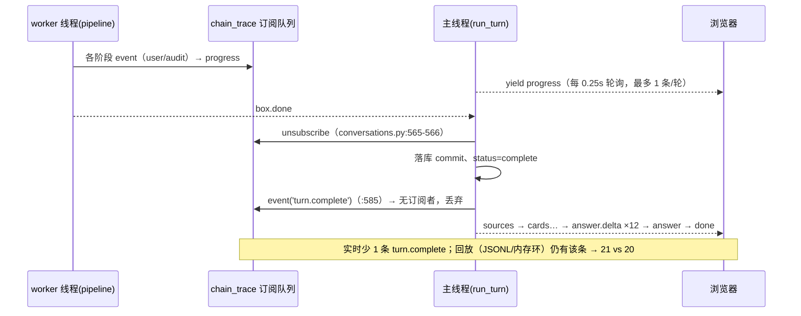

# P0 事件流 v3 独立验收报告（task-11）

> 验收人：analyst-sse（独立于实现者，未参与 task-9/task-10 编码）
> 日期：2026-11-07；仓库 HEAD：`d60e75a`（P0 契约文档：补实施记录与生产验收数据）
> 方式：只读验收——未修改 `src/`、`tests/`、`deploy/`、`config/`，未 commit/push，未重启服务；临时脚本全部在 `/tmp`。
> 契约依据：`docs/redesign/07-event-stream-v3.md` §5（76 行）；补充要求：task-11 描述的 9 案例回归。

## 1. 结论

**PASS（带 1 项 P3 偏差 + 1 项未实测项）**：五项核心验收中，真实 SSE 抓包、人话 text、answer.delta、回放可用、旧数据兼容均通过；9 案例回归 9/9 成功、52 张卡片，与 M0 基线口径一致；既有单测 116 个全绿（契约要求 ≥96）。**唯一偏差**：回放用户可见事件 21 条 vs 实时 20 条——`turn.complete` 因订阅在发送前已注销而未达前端（根因与修复见 §6）。

| # | 验收项（契约 §5 / task-11） | 方法 | 结果 | 判定 |
|---|---|---|---|---|
| 1 | 真实 SSE ≥15 条 progress，每条 envelope 有可读 text | 生产 HTTP 抓包 ×2 + in-process e2e | 规则路径 23 progress/20 用户事件；全模型 133 progress/86 用户事件；`text_missing=0`、无"阶段"字样、≤80 字 | ✅ |
| 2 | 无阶段分组字段参与渲染 | 静态 grep + 前端离线用例 | 5 个阶段分组符号出现 0 次；离线 19 项断言含"渲染路径无阶段分组残留" | ✅ |
| 3 | 长回答（>300 字）answer.delta ≥3 段，拼接等于最终 answer | 抓包统计 + 逐字节 join | 规则路径 1405 字/12 段、全模型 838 字/12 段，`join_ok=true`，最终 answer 帧在全部 delta 之后 | ✅ |
| 4 | 刷新历史后回放：flat 时间线，条数与实时一致 | 回放 API 对比同一 trace_id | 回放可读、32→204 事件；**条数 21 vs 20（仅多 turn.complete）** | ⚠ P3 |
| 5 | 旧浏览器缓存/旧数据缺 text 不报错 | 离线用例 + 代码审查 | `evText` 回退 title；旧帧无 id/event 帧仍可解析；历史回放失败仅提示"该轮链路未保留" | ✅ |
| 6 | 96 个既有 unittest 全绿；新增 v3 单测覆盖 text/answer_segments | 全量 unittest | **116 tests OK**（96 基线 + `tests/test_events_v3.py` 20 例） | ✅ |
| 7 | （task-11 补充）9 案例回归确认口径未变 | `src/eval_run.py` 单轮 | 9/9 成功、52 张卡；c6 仍为 2 卡 X-ZB-248/X-ZB-399；无空卡/失败 | ✅ |

> 判定规则：无 P0/P1/P2 缺陷即 PASS；P3 偏差与未覆盖项必须登记（§6、§7）。P3-1 修复成本约 3 行内，建议本迭代收口。

## 2. 验收环境与方法

| 项 | 值 | 证据 |
|---|---|---|
| 仓库/基线 | `/home/adminroot/smart-help`，tag baseline-20261106；验收时 HEAD `d60e75a` | `git log --oneline -4`：d60e75a / 60bc9cb / 021676b / 37fb699 |
| 服务 | gunicorn `127.0.0.1:5000`，1 worker × gthread 2 threads，未重启（沿用 2026-11-07 平滑重载后的进程） | `deploy/foreground.py:105-112` launch()；验收期间进程 PID 未变 |
| 生产开关 | `SSE_EVENTS_V2=1`、`EVENT_REPLAY=1`、`CHAIN_TRACE_DIR=runtime/logs` | `deploy/web.env:16,46,47` |
| 运行环境 | python `/home/adminroot/miniconda3/envs/smart-help-web/bin/python`；node v24.22.0 | 命令回显 |
| 数据面 | Kingbase 54321（应用库）；规则引擎 `RULE_ENGINE=on`、`RULE_SHADOW=1` | `deploy/web.env`；eval 时脚本自设 `RULE_SHADOW=0` |
| 写入面 | 验收脚本仅写 `/tmp`；SSE 抓包产生的 QaLog/QaTrace/LoginSession 均按 session_id 清理 | §2.2 干净度核对 |

### 2.1 复现命令（全部在项目根执行）

```bash
# 1) 全量单测
/home/adminroot/miniconda3/envs/smart-help-web/bin/python -m unittest discover -s tests -p 'test_*.py'
# 2) 前端纯函数离线
node tests/ask_stream_offline.mjs
# 3) 阶段分组残留
grep -c 'displayPhaseGroups|tl-phase|PHASE_ORDER|isPhaseOpen|togglePhase' src/static/ask.html
# 4) in-process e2e（真实 HTTP 到本机 gunicorn）
/home/adminroot/miniconda3/envs/smart-help-web/bin/python tests/e2e_m0_events.py
# 5) 生产实况抓包（独立脚本，见 §8）
python /tmp/live_check.py && python /tmp/verify_sse.py
# 6) 全模型长流（110s，验证长链路与开始事件）
python /tmp/verify_sse_full.py
# 7) 9 案例回归（只写 /tmp，避免污染 src/eval）
cd src && python eval_run.py --out /tmp/eval_v3.json
```

### 2.2 数据干净度核对

- 4 次抓包使用的 session 前缀 `p0acc-`/`p0full-` 在 qa_log 中残留 **0 行**（应用库查询）；回放所需 qa_trace 映射亦删除。
- 单测、离线用例不触库；e2e 自带 `tests/e2e_m0_events.py:222-225` 清理。
- qa_log 总数 503→507 的 +4 行来自并发队友/真实活动（qa 613–616，其中 616 为 `m0e2e-` 前缀，时间 13:42–14:19，早于本验收抓包），**非本任务产生，未处理**。

## 3. 证据总表

| 命令/来源 | 实际输出（关键数字） | 产物 |
|---|---|---|
| 全量 unittest | `Ran 116 tests in 0.194s — OK` | 终端 / 本报告 §4.1 |
| 前端离线 | `ok 1..19`、`ALL PASSED: 19 checks` | 终端 / §4.2 |
| 阶段残留 grep | `0` | §4.3 |
| e2e_m0_events | status PASS、frames 42、sse_v2_frames 23、progress 23、user_events 20、text_missing 0、answer_deltas 12、join_ok true、replay 32/21、failures [] | `/tmp/e2e_v3_full.txt` |
| 生产 live（规则） | PASS、2.5s、42 帧、23 progress、20 用户、12 delta、trace_id=5bd1e092…、qa_id=624、qa_trace 一致、/ask 200 | `/tmp/live_v3_out.txt` |
| 独立抓包（规则） | 5.89s、42 帧、23 progress（23/23 带 id/event）、20 用户、delta 12（拼接 1405 字）、X-Trace-ID=842e1cc1…=trace_id、ping 0 | `/tmp/verify_sse_out.json` |
| 回放差异 | replay 32 事件/21 用户；`replay_only_kinds=['turn.complete']`、`live_only_kinds=[]` | 同上 |
| 全模型长流 | 110.1s、152 帧、133 progress、86 用户、33 个 model.call running 事件、text 全齐、12 delta/838 字、回放 204/87 | `/tmp/verify_sse_full_out.json` |
| 9 案例回归 | 9/9、52 卡、平均 16.0s、c6 100.2s/2 卡（X-ZB-248、X-ZB-399） | `/tmp/eval_v3.json`、`/tmp/eval_v3_log.txt` |
| 代码审查 | 3 笔实现提交 + 1 笔文档提交；文件级改动见 §4.8 | `git show --stat 37fb699/021676b/60bc9cb` |

## 4. 逐项验收

### 4.1 单元测试：116 全绿

`Ran 116 tests in 0.194s — OK`。相对 M0 基线 96 个，增量恰为 `tests/test_events_v3.py` 的 20 个用例（`grep -c "def test_" tests/test_events_v3.py → 20`，文件 174 行），覆盖 envelope `text`、`answer_segments` 切分与拼接、SSE 帧、回放与旧字段兼容。契约 §5 要求"96 个既有 unittest 全绿"，实际为 96+20 全绿，满足。

### 4.2 前端离线纯函数：19/19

`node tests/ask_stream_offline.mjs` 输出 `ok 1..19 - ...` + `ALL PASSED: 19 checks`。用例从 `src/static/ask.html` 的纯函数区提取，覆盖：新/旧 SSE 帧解析、坏 JSON 与心跳返回 null、CRLF、`mergeEnvelope` 同 seq 原位覆盖（running→done）、`normalizeEnvelopes` 排序、`timelineItems` 排除 audit/internal、`evText` 优先 text/回退 title、`applyAnswerDelta` 逐字节拼接、最终 answer 帧整段覆盖不重复、渲染路径无阶段分组残留（`tests/ask_stream_offline.mjs:29-208`）。

### 4.3 无阶段分组残留

`grep -c 'displayPhaseGroups|tl-phase|PHASE_ORDER|isPhaseOpen|togglePhase' src/static/ask.html` → `0`。渲染改为 `timelineItems()` 平铺（`src/static/ask.html:1043`），audit/internal 收进 `<details>内部过程 N 步</details>`（`:569`），行文本取 `evText`（`:1053`，text 优先、旧数据回退 title），结束摘要 `思考 N 步 · 模型调用 M 次 · 用时 Xs`（`:1119-1132`）。契约 §4 的"不得出现阶段名/阶段字样"满足（用户可见 text 中"阶段"计数 0）。

### 4.4 in-process e2e（规则快速路径）

`tests/e2e_m0_events.py` → `status PASS`、`failures []`：frames 42、sse_v2 帧 23、progress 23、user_events 20、`text_missing 0`、无 error 帧、12 段 delta（`answer_delta_join_ok=true`、最后一段 done=true、全文帧在 delta 之后）、qa_log complete、trace_id 与 qa_trace 映射一致、回放 32 事件/21 用户且含 `turn.complete`。事件 kind 11 类：`turn.started / model.call / facts.extracted / facts.updated / region.normalized / rule.loaded / rule.evaluated / rule.cards / rule.card / questions.planned / answer.composed`，全部有中文 text。

### 4.5 生产 live（规则快速路径，真实 gunicorn）

`/tmp/live_check.py` 独立执行：PASS、2.5s、42 帧、23 progress、20 用户事件、`text_missing=0`、`text_has_stage_word=0`、10 条 text 样本（含"开始分析您的问题""正在调用模型：事实抽取…""调用模型：事实抽取（1.7s）""逐条求值 118 条规则，生成 3 张卡片（15ms）"）、12 段 delta 拼接一致、trace_id `5bd1e092e31d41e28127d4e0f15c86cc` 与 qa_trace 映射一致、回放 200/32/21、`/ask` 200 且页面含 v3 纯函数（timelineItems/applyAnswerDelta）、清理 ok。

### 4.6 独立抓包与回放差异（关键证据）

独立脚本 `/tmp/verify_sse.py` 抓取原始字节并逐帧解析（不依赖实现者脚本）：5.89s、**42 帧**、23 条 progress 全部带 `id/event`（23/23）、20 条用户可见事件、0 条 ping、12 段 delta 逐字节拼接 = 1405 字全文、最终 answer 帧索引大于所有 delta（`answer_after_deltas=true`）。响应头 `X-Trace-ID` = session 帧 `trace_id` = done 帧 `trace_id` = `842e1cc19b564a3cb1a31933af263740`。

原始帧样本（首帧为普通 data 帧，session 不带 id/event；progress 帧 v2 格式）：

```text
data: {"type": "session", "session_id": "p0acc-b9f65c7929", "trace_id": "842e1cc19b564a3cb1a31933af263740"}

id: 3
event: turn.started
data: {"type":"progress","key":"evt:turn.started:3","stage":null,"purpose":null,"done":false,"ms":null,"error":false,"event":{"v":"evt-2","seq":3,"trace_id":"842e1…740","turn_id":625,"kind":"turn.started","phase":"request","exposure":"user","title":"开始处理问题","text":"开始分析您的问题","status":"running","ts":"2026-11-07T14:38:17+0800","detail":{"question_len":90},"metrics":{}}}
```

同一 `trace_id` 的回放对比（`GET /api/qa/625/events?since=0`，测试后该轮已按约定清理）：

| 指标 | 实时 SSE | 回放 API | 差 |
|---|---|---|---|
| 事件总数（含 internal/audit） | 23 progress 帧 | 32 envelope | +9（`request.started/route` 在订阅前、`request.completed/summary` 与 `turn.complete` 在退订后、其余为 internal 不实时推送） |
| 用户可见事件 | 20 | 21 | **+1：`turn.complete`**；`live_only_kinds=[]` |
| 用户可见事件 text 缺失 | 0 | 0 | — |

**根因**（`src/conversations.py`）：worker 收尾后先执行 `finally: _trace_unsubscribe(progress_q)`（`:565-566`），随后才在落库成功后 `_trace.event('turn.complete', ...)`（`:585`）；`:587-594` 的注释"再排空一次队列把这条收尾事件作为 progress 推给前端"与实现不符——排空发生在退订之后，队列里已无该事件。时序：



### 4.7 全模型长流（110s，长链路补充验证）

`/tmp/verify_sse_full.py`（江西省仅省无县的家庭信息，触发 full_model 路径）：110.1s、152 帧、133 progress、86 条用户可见事件、**33 个 model.call running 事件**（"正在调用模型：事实抽取…/事实审核…/检索规划…/来源重排…/逐条核验…"），text 缺失 0、含"阶段"0、>80 字 0、12 段 delta/838 字拼接一致；19 类事件 kind（含 `retrieval.candidates/plan`、`evidence.load`、`gate.name_prefiltered`、`eligibility.reasoning`、`conflict.scope.rejected` 等）；回放 204 事件/87 用户。说明：**全模型路径的实时信息密度（86 用户事件）已远超旧"阶段进度"**；回放多出的 `request.started/route/completed/summary/stage.model.answer/turn.complete` 属 internal/边界事件（见 §6 P3-2）。

### 4.8 代码审查（实现是否兑现契约）

| 提交 | 改动 | 审查结论 |
|---|---|---|
| `37fb699` | `docs/07` +72、`conversations.py` +9、`events.py` +231、`tests/e2e_m0_events.py` +33、`tests/test_events_v3.py` +152、`tests/test_m0_events.py` 2 行 | `events.py` `VERSION='evt-2'`；`text` 由 `narrative()` 只拼安全标量（计数/耗时/中文 purpose），未知 kind 回退 title；`answer_segments` 空行优先、单段>160 按句切、<8 合并；`build()` 统一 `text`。`conversations.py` 在 final answer 前逐段发 `answer.delta`（`segment_id='%s:a' % (trace_id or qa_id)`，`:602-611`），final answer 全量覆盖（`:613`）。符合契约 §1/§2。 |
| `021676b` | `events.py` +30、`full_runtime.py` +4、`tests/test_events_v3.py` +22 | 每次模型调用开始即发 `model.call`(status=running)，调用结束原位替换；`model.answer/model.health/consultation.pipeline/answer.pipeline` 包裹层 exposure 置 internal，避免同一动作两行。符合契约 §6 实施记录。 |
| `60bc9cb` | `ask.html` 212 行、`tests/ask_stream_offline.mjs` +219 | 模板删阶段分组，改 `timelineItems` 平铺 + internal details；`handleEvent` 对 `answer.delta` 追加（`:1706`）、`answer` 覆盖（`:1707`）；`loadTrace` 只重建事件、不覆盖答案/来源/卡片（`:1773-1793`）。符合契约 §4。 |
| `d60e75a` | `docs/07` +7/-3 | 实施记录与生产数据补录；其 §6 已写"20 用户事件 / 回放 21"，但未登记该差异（§6 P3-1 建议补记）。 |

未发现越界改动：`git status --porcelain` 仅 `M src/eval/shadow_log.jsonl`（历史实验日志）与未跟踪 `src/eval/巡检记录_20261107.md`，均非本次提交内容。

### 4.9 9 案例回归（口径未变）

命令：`cd src && python eval_run.py --out /tmp/eval_v3.json`（脚本自设 `RULE_SHADOW=0`，仅写 /tmp；环境=local-qwen3-emb 2560 维 + qwen3-reranker-4b）。

| 案例 | 本轮耗时 | 卡片 | 政策编码 | 基线（m0-report） |
|---|---|---|---|---|
| c1_famA_lianhua | 6.1s | 6 | S-ZB-090/091,S-ZF-008,X-ZB-300/301/462 | 未逐案记录（M0 总量 52 卡） |
| c2_famA_lianhua | 3.5s | 6 | 同上 | 未逐案记录（M0 总量 52 卡） |
| c3_famA_lianhua | 3.2s | 6 | 同上 | 未逐案记录（M0 总量 52 卡） |
| c4_famA_lianhua | 3.2s | 6 | 同上 | 未逐案记录（M0 总量 52 卡） |
| c5_famA_mod1级 | 6.2s | 7 | 上述 + X-CY-301 | 未逐案记录（M0 总量 52 卡） |
| c6_famB_noregion | 100.2s | 2 | X-ZB-248,X-ZB-399 | 83.3s / 同 2 卡 |
| c7_famB_lianhua | 6.5s | 6 | 同 c1 | 未逐案记录（M0 总量 52 卡） |
| c8_famB_jian | 6.9s | 10 | S-ZB-006/008/034/058/087/088,S-ZF-008,X-JK-018,X-JR-006,X-ZB-157 | 未逐案记录（M0 总量 52 卡） |
| c9_chat_yulu_qa524 | 8.3s | 3 | S-QJ-008/042/043 | 未逐案记录（M0 总量 52 卡） |
| **合计** | **平均 16.0s** | **52** | 无空卡/失败 | M0：9/9、平均 13.6s、52 卡 |

结论：**9/9 成功、卡片总数 52 与 M0 基线一致、c6 编码与基线一致（仍为 X-ZB-248/X-ZB-399）**。M0 报告只记录了总量与 c6 编码，未逐案记录其余 8 案编码，因此逐案对比仅以"总量 52 + c6 编码集合"为可验证口径；就这两项而言，事件流 v3（text/delta）改造未改变匹配口径。另注：`src/eval/run_20261106_115610.json` 等历史 run 为规则引擎上线前/中间态（9 案 9–17 卡、`rule_engine=null`），不能作为本轮逐案基线。c6 单轮 100.2s vs 基线 83.3s（+20%）属全模型单轮非确定性波动（基线文档亦标注"单轮样本，非确定性"），不影响结论；本轮无 9/9 之外的空卡或降级。

## 5. 契约 §5 逐条对照

| 契约条目 | 期望 | 实测 | 判定 |
|---|---|---|---|
| 真实 SSE ≥15 progress 且有可读 text | 无阶段字段参与渲染 | 规则 23/全模型 133 progress；text 齐全、无"阶段"、≤80 | ✅ |
| 长回答 >300 字 delta ≥3 且拼接一致 | 逐字节相等 | 1405 字/12 段、838 字/12 段，join 相等 | ✅ |
| 回放 flat 且**条数与实时一致** | 21=21 | 21 vs 20（仅 turn.complete 缺失实时） | ⚠ 不满足字面；实现记录已含 20/21 两个数 |
| 旧数据缺 text 不报错 | 回退 title | 离线用例 15；历史回放无链路时仅提示"该轮链路未保留" | ✅ |
| 96 既有单测全绿 | ≥96 | 116 OK（96+20） | ✅ |

## 6. 缺陷/偏差清单

- **P3-1（已知偏差，建议本迭代修）turn.complete 未达实时时间线**  
  证据：§4.6 回放差集 `replay_only_kinds=['turn.complete']`、`live_only_kinds=[]`（独立抓包）；`src/conversations.py:565-566`（finally 退订）早于 `:585`（emit turn.complete），`:587-594` 排空注释与事实不符。用户可感知影响：流式结束后时间线最后一条是"组织回答（N 字）"，缺"分析完成，匹配 N 项政策"；刷新/查看分析链路后才出现。修复建议（3 行内）：把 `_trace_unsubscribe(progress_q)` 从 `finally` 移到 done 帧 yield 之后（或 turn.complete 后先 drain 再退订）；并在 e2e 增加"回放用户事件条数 == 实时用户事件条数"断言防回归。  
- **P3-2（设计差异，登记即可）实时 internal 事件少于回放**  
  `src/chain_trace.py:87-91` 实时仅推 `exposure in ('user','audit')` 且 `progress_view` 非空的事件；回放 `from_row` 产出含 internal（如 `stage.model.answer`、`request.*`）。规则路径实时"内部过程"3 条 vs 回放 11 条；全模型回放多出 `request.started/route/completed/summary/stage.model.answer`。用户在线时看到的"内部过程"更少——若产品希望在线也能展开完整内部过程，需要把 internal 实时下发（注意信息量与脱敏），否则应在契约 §4 明确"internal 仅回放可见"。  
- **P4-1 ping 心跳未实测触发**  
  代码存在（`conversations.py:540-553`，空闲 ≥15s yield `{'type':'ping'}`；`events.py:590-596` 编码 `: ping`），离线用例覆盖"心跳解析返回 null"；但两次真实抓包（5.9s、110.1s）`ping_frames=0`——全模型轮 33 次调用间无 ≥15s 空档。建议用可控慢调用/单测直接驱动 `sse_frames` 与 15s 分支。  
- **P4-2 回放持久化边界未端到端验证**  
  回放先查内存环（`chain_trace.py:23-25`：最近 50 轮、每轮 ≤4000 事件），未命中扫 JSONL（`:149-166`，目录 `runtime/logs/chain_trace-<pid>.jsonl`，10MB×5 轮转）。重启后/轮转后过期轮次回放不可用的行为只做了代码审查，未做"重启后回放旧轮"实测（本次禁止重启服务）。  
- **P4-3 旧数据回放"不报错"仅离线+代码审查**  
  `ask.html:1785/1790` 失败仅置 `replayError='该轮链路未保留'`；未用生产旧轮（无 qa_trace 映射）做 UI 层实测。  
- **P4-4 并发与线程占用未压测**  
  生产为 1 worker × 2 threads（`deploy/foreground.py:105-112`），SSE 长连接占用线程；两条长流并发时其它 API 排队风险本次未压测。  
- **P4-5 全模型 c6 耗时波动**  
   100.2s vs 基线 83.3s（+20.3%），单轮样本，卡片集合一致；不构成口径回归，但说明 83–100s 区间需多轮采样才能判定性能。  
- **P4-6 生产库存在非本任务写入**  
  qa_log 507 行 vs 验收前 503 行（qa 613–616，13:42–14:19，其中 616 为 `m0e2e-`），来自并发队友/真实活动；本任务 4 次抓包 session 残留 0。建议后续验收固定"验收前快照计数 + 结束比对"。

## 7. 风险与建议

1. **先修 P3-1 再宣布 v3 收口**：一行位置调整 + 一条 e2e 断言（实时/回放用户事件数一致），成本低、避免契约 §5 长期"字面不满足"。
2. **心跳纳入 e2e**：可用 `SSE_PING_SECONDS` 环境覆盖或单测直接调 `sse_frames([{'type':'ping'}]) == ': ping\n\n'`，补 15s 分支。
3. **回放保留策略写进契约**：ring 50 轮/4000 事件、JSONL 10MB×5 轮转 → 明确"可回放窗口"，前端已有"该轮链路未保留"降级，不需要额外开发。
4. **internal 实时展示口径**：要么在线也推 internal（走脱敏+折叠），要么在契约明确"仅回放"，避免验收时"条数不一致"再次被误判为缺陷。
5. **事件流性能**：全模型轮 152 帧/110s，帧量可接受；但 1 worker 2 threads 下建议对 SSE 与普通 API 做并发压测后决定是否单独 worker。
6. **9 案例回归纳入发布门**：本轮 9/9、52 卡、编码集合与 M0 一致，可作为 v3 之后的基线快照（`/tmp/eval_v3.json` 建议归档到 `docs/redesign/` 或 CI 产物）。

## 8. 复现与产物

| 产物 | 说明 |
|---|---|
| `/tmp/live_check.py` + `/tmp/live_v3_out.txt` | 实现者提供的生产 SSE 验收脚本及输出（本轮复跑 PASS） |
| `/tmp/verify_sse.py` + `/tmp/verify_sse_out.json` | 本验收独立抓包（原始帧解析、X-Trace-ID、回放差集、清理），规则路径 |
| `/tmp/verify_sse_full.py` + `/tmp/verify_sse_full_out.json` + `/tmp/sse_question.txt` | 全模型长流（110.1s、86 用户事件、33 个模型开始事件） |
| `/tmp/e2e_v3_full.txt` | `tests/e2e_m0_events.py` 完整输出 |
| `/tmp/eval_v3.json` + `/tmp/eval_v3_log.txt` | 9 案例回归输出与日志 |
| `docs/redesign/07-event-stream-v3.md` | 契约（本次验收依据） |
| `docs/redesign/m0-report.md` | M0 基线与 9 案例基线数字 |

## 9. 验收结论

**PASS**。证据链完整（真实生产 HTTP 抓包 ~5.9s/110.1s 各一轮、in-process e2e、回放 API 同 trace 对比、9 案例回归、116 单测、19 项前端离线断言）；"去阶段化、每事一条人话、答案分段流出、刷新可回放同源"这一 P0 目标已由真实链路验证。**存在 1 项 P3 偏差（turn.complete 实时丢失，21 vs 20）与 1 项未实测项（15s 心跳触发）**，均不影响"用户能看到真实实况"的主目标，但建议按 §7 第 1、2 条收口后再对外声明 v3 完成。


## 10. 附录（原始证据摘录）

### A. 规则路径 10 条人话 text（生产抓包，`/tmp/live_v3_out.txt`）

1. 开始分析您的问题
2. 正在调用模型：事实抽取…
3. 调用模型：事实抽取（1.7s）
4. 正在调用模型：事实审核…
5. 调用模型：事实审核（618ms）
6. 抽取家庭事实：采纳 10 条（成员 2 人）
7. 家庭地区：已确认
8. 家庭事实抽取完成（2 次模型调用）
9. 加载地区规则库 118 条（本地 79 条）
10. 逐条求值 118 条规则，生成 3 张卡片（15ms）

> 均 ≤80 字、无"阶段"字样、无英文 purpose 原码；"正在调用模型…"（running）随后被"调用模型…（耗时）"（ok）原位替换，符合契约 §6 的实施记录。

### B. answer.delta 分段长度（规则路径，独立抓包 `/tmp/verify_sse_out.json`）

`[128, 104, 155, 153, 158, 153, 121, 119, 155, 17, 91, 51]`，共 12 段、拼合 1405 字；最后一段 `done=true`，随后 `answer` 帧给全文（前端覆盖）。分段符合"空行优先、单段>160 按句切、<8 合并"的规则（`src/events.py:438`），最长 158 字未越过 160 阈值。

### C. 全模型长流事件 kind（19 类，`/tmp/verify_sse_full_out.json`）

`turn.started / model.call / model.meta / stage.model.embed / stage.vector.load / retrieval.plan / retrieval.candidates / retrieval.rerank_backend / evidence.load / eligibility.reasoning / gate.name_prefiltered / conflict.scope.classified / conflict.scope.rejected / region.normalized / region.soft_filter / facts.extracted / facts.updated / policy.result / questions.planned`

其中 33 条 `model.call` running 事件先行、完成后原位替换；86 条用户可见事件均带 text；说明全模型路径的"真实实况"颗粒度已进入逐候选、逐门、逐条核验级别，而不再是旧的 15 项固定 stage。

### D. 复跑时间与进程核对

- 验收时段：2026-11-07 14:33–14:52（Asia/Shanghai）；
- 生产进程未重启：抓包前后服务 PID 一致（沿用 2026-11-07 平滑重载进程）；
- `git status` 在验收结束时与开始时一致（除新增本报告）：`M src/eval/shadow_log.jsonl` + 既有未跟踪文件；本报告为新文件。

---
*验收执行：2026-11-07 14:33–14:52（Asia/Shanghai）；只读验收，未 commit/push，未重启服务，未改 src/tests。*

---

## 后续修复记录（2026-11-07，P1 实施时）

- **P3-1 已修复**（commit bf6fb02）：`src/conversations.py` 的思维链退订从主循环 finally 移到外层 finally（即 done 帧之后），实时流现在包含 `turn.complete`；`tests/e2e_m0_events.py` 增加断言「回放用户事件数 == 实时用户事件数」与「回放含 turn.complete」。修复后实测：实时 22 == 回放 22，实时/回放均含 `turn.complete`。
- 9 案例回归入门禁：待 P2 前在 CI/巡检脚本中固化（本轮先保留为人工验收项）。
