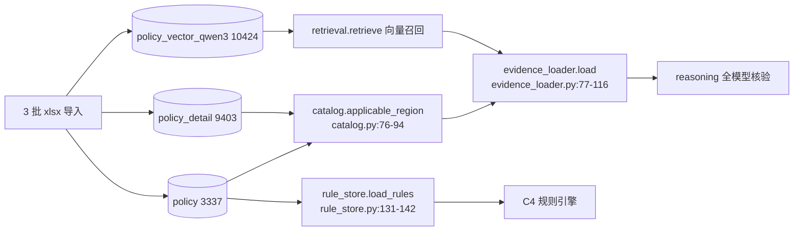
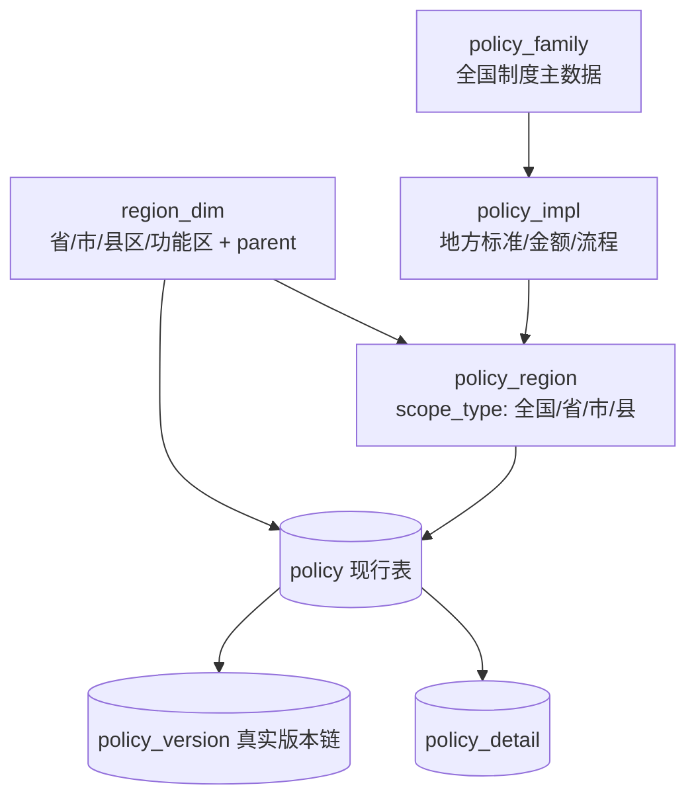

# 政策数据地区覆盖量审计：当前库能否支撑全国服务

> 状态：只读审计（2026-11-08），未修改任何数据、代码或环境；临时脚本只写 `/tmp`。
> 数据源：Kingbase ES `policy_db`（72 张表）。所有查询均在 `SET SESSION CHARACTERISTICS AS TRANSACTION READ ONLY` 事务内执行。
> 基线：git tag `baseline-20261106`（commit 0d20ef1）+ 11-07/11-08 已上线改造（见 13、14 号文档）。
> 复现脚本：`/tmp/pa_main.py`、`/tmp/pa2.py`～`/tmp/pa5.py`；原始结果 `/tmp/pa_main.json`、`/tmp/pa2.json`～`/tmp/pa5.json`。
> 先读结论：**当前库不能支撑全国服务；它是一套"江西省县级政策工具箱"，不是全国政策库。**

## 1 一句话结论

1. **不能支撑全国服务，缺口是"数据模型里没有全国这一层"，不是"少收了一些文件"**：3337 行 `policy` 只有 `X`（3057）和 `S`（280）两个 level，0 行 `C`、0 行市级、0 行 NULL level；9403 行 `policy_detail` 的 109 个 `region` 全部落在江西境内（95 个县区 + 13 个功能区 + `江西省全省`），无外省、无全国、无市级。
2. **"只能匹配江西"是三层锁死**：数据层 0 外省/0 全国 → 归一检索层 `geo.JIANGXI_COUNTY` 只枚举 100 个江西县区、`kg_retrieval` 的 REGION 节点全为江西且外省直接判"不适" → 编排层 `service_scope_check` 把外省家庭判 blocked、`full_flow.py:226` 直接 0 检索 0 卡。
3. **江西本地覆盖尚可但不均衡**：100 个标准县区中 95 个有政策明细，缺 5 个（南昌东湖/西湖/青云谱/青山湖、九江浔阳）；13 个功能区全覆盖；11 个设区市都有县级明细，但市级层 0 行。每县明细 42–165 行（中位 87），每县唯一政策名 11–112 个（中位 54）。
4. **"9403 行明细"有相当大的重复水分**：同一 `(region, conditions, target)` 完全相同的组 917 个、覆盖 3430 行、冗余 2513 行（26.7%）；唯一 `policy_name` 只有 1831 个（对应 3337 行）；359 个名称对应多个 `policy_code`（覆盖 1865 行，55.9%）；145 个名称同时存在于 X 和 S 两级（961 行，28.8%）。
5. **省级层只有 14 个政策、13 条"江西省全省"明细**；226 条 S 级"多县合并"条目（`level_note` 标注"启发式判定……待人工确认"）承载了 3610 条明细（38.4%），合并粒度从 3 个县到 46 个县不等——这不是行政层级，是 AI 启发式合并产物。
6. **全国性政策没有"全国行"**：名称含"国家/全国"的 70 行 policy 全部落在 X/S 两级按县/省收录；13 条省级通用条目只覆盖部分全国制度；其余同名制度散落在县级条目里（如"困难残疾人生活补贴" S 级 4 个 code + X 级 10 个 code），甚至只以空壳存在（如全国制度"生源地信用助学贷款"对应 S-QJ-042，0 条明细）。
7. **时效数据不可用**：`policy`、`policy_detail`、`policy_version` 的 `effect_date`、`expire_date` 非空数均为 0；`policy` 无 `created_at` 列，`updated_at` 仅 18/3337 行有值（0.54%）；`policy_version` 3339 行 `version_no` 全为 v1（`cur_version=v2` 的 2 个政策靠 `policy` 表表达）。系统无法判断政策是否过期、是否更新。
8. **40 条 S 级空壳**（`regions` NULL、无明细、仅有策略级向量）来自 2026 汇总批次，其中 10 个名称与 13 条省级条目重复，属于旧代残留；它们仍占 policy 行与 53 条策略级向量中的 40 条，可能进入召回后被 `evidence_loader` 以 `missing_detail` 丢弃，浪费召回预算并制造同名重复候选。

## 2 现状架构：三批导入 → 三张表 → 两条读取路径

### 2.1 数据从哪来

| 来源文件（`policy.source`） | policy 行数 | level | 说明 |
| --- | ---: | --- | --- |
| `县级帮扶工具箱_更新至9月22日.xlsx` | 3284 | X 3057 + S 227 | 县级政策主体；S 部分是跨县启发式合并条目 |
| `2026年帮扶政策汇总.xlsx` | 41 | S | 2026 汇总批次，策略级文本为主 |
| `2026年帮扶政策汇总_入库格式.xlsx` | 12 | S | 同上 |
| 合计 | 3337 | X 3057 / S 280 | 无 C、无市级 |

`level_note` 可直接证明 level 不是严格的行政级别：X 级 3057 行**全部**是"县级工具箱收录"；S 级 280 行 = 40 条"省级明白纸条目" + 226 条"启发式判定：跨3个以上县区且文号含赣/省，待人工确认" + 14 条较长的 AI 说明。

### 2.2 三张主表与读取路径



两条链读同一份地区文本，但地区判定逻辑不同：C4 规则链的"地区可见性"只由 `policy_rule.region_scope`（县名或 `*`）决定；全模型链的可见性由 `policy.regions` / `policy_detail.region` 经 `catalog.applicable_region` 决定。

### 2.3 地区语义分别落在哪

| 位置 | 作用 | 当前语义 |
| --- | --- | --- |
| `src/config.py:39` | `DEFAULT_POLICY_REGIONS = {'C': '全国', 'S': '江西省全省'}` | 库内 0 个 C，C 默认规则永不触发；S 默认"江西省全省"被当成省级继承 |
| `src/kg_retrieval.py:38` | `_SPLIT_RE` 按 `，、;；/` 分段 | 地区自由文本的主要解析方式 |
| `src/kg_retrieval.py:243-267` | `_region_apply`："全国"直接适用、"全省"按省份比对 | 家庭无"省"字时靠 REGION 节点判在江西；未限定省份的"全省"→未知 |
| `src/kg_retrieval.py:268-273` | 家庭省份明确非江西 → 不适 | 外省在代码层被"明确拒绝"而非"待扩展" |
| `src/kg_retrieval.py:274-304` | REGION 节点精确/后缀/前缀匹配 + 双向子串启发式 | 节点清单全为江西 100 县区；启发式只作地区线索 |
| `src/kg_retrieval.py:315-342` | 政策级 + 明细级组合 → 适用/不适/冲突/地区待细化 | 无地区信息的政策不默认"无限制"，而是"待细化" |
| `src/policy_core/region.py:24,27` | `_NATION_WORDS` / `_OTHER_PROVINCE_FULL`（29 个省级全称） | 全国词只有 4 个且没有数据落点；外省全称只用于判"不适用" |
| `src/policy_core/region.py:91,145,354` | `soft_filter_enabled`、`canonical_levels`、`policy_region_verdict` | 11-07 新增的确定性归一层，补丁性质，不是数据模型 |
| `src/policy_core/geo.py:14-34,39-53,56` | 100 个江西县区、13 个功能区、11 个设区市 | 唯一的行政区枚举，硬编码 |
| `src/policy_core/catalog.py:76-94` | `applicable_region`：双方都空→None；软过滤先确定性判决；否则 `kg_retrieval.region_judge` | False 才丢，None 保留候选并标注 unconfirmed |
| `src/policy_core/evidence_loader.py:77-116` | 逐候选过滤 inactive / stale_index / missing_detail / date / region | 地区过滤真正执行处；scope False → `region_dropped` |
| `src/policy_core/full_flow.py:176-197,213,225-226` | region 事实、`service_scope_check`、C4 闸门、全模型闸门 | blocked → `coverage['scope_blocked']`，不检索、不出卡 |
| `src/policy_core/rule_store.py:131-142` | `load_rules` SQL：`region_scope = :county OR region_scope = '*'` | 规则可见性唯一开关 |

## 3 机制细节

### 3.1 三张表结构与关键字段

| 表 | 行数 | 主键 | 关键字段（本次核对） |
| --- | ---: | --- | --- |
| `policy` | 3337 | `policy_id` | `policy_code`、`policy_name`、`level`(X/S)、`category1/2/3`、`regions`(自由文本)、`target`、`conditions`、`benefit`、`process`、`contact`、`effect_date`、`expire_date`、`status`、`cur_version`、`doc_ref`、`source`、`level_note`、`updated_at`；**无 `created_at`、无 `extra`** |
| `policy_detail` | 9403 | `detail_id` | `policy_id`、`region`、`category2/3`、`attr`、`benefit`、`benefit_unit`、`benefit_cycle`、`max_limit`、`target`、`conditions`、`process`、`contact`、`phone`、`effect_date`、`expire_date`、`source_row`、`extra` |
| `policy_vector`（旧） | 存在 | `id` | 旧向量表，当前不活跃 |
| `policy_vector_qwen3` | 10424 | `id` | `policy_code`、`policy_name`、`detail_id`(可 NULL)、`doc_text`、`vector`(BYTEA)、`status`、`policy_version`、`embed_model` |
| `policy_version` | 3339 | — | 版本快照；`version_no` 全为 v1 |
| `policy_draft` | 43 | — | 草稿：29 条待确认 / 14 条已确认 |

补充事实：`policy_detail.extra` 9403 行全为空/NULL；`policy_vector_qwen3.embed_model` 10424 行全部为 `qwen3-embedding-4b`。

### 3.2 行数与 level/status/version 分布

| level | policy 行数 | 占比 | level_note 语义 |
| --- | ---: | ---: | --- |
| X | 3057 | 91.6% | 全部"县级工具箱收录" |
| S | 280 | 8.4% | 40 条"省级明白纸条目" + 226 条"跨 3 个以上县区启发式合并，待人工确认" + 14 条 AI 说明 |
| C | 0 | 0 | 不存在 |
| NULL | 0 | 0 | 不存在 |

| 维度 | 分布 |
| --- | --- |
| `policy.status` | 在用 3333 / 停用 4 |
| `policy.cur_version` | v1 3335 / v2 2（`S-ZB-089`、`X-JY-038`） |
| `policy_detail` 按 policy level | X 5793（61.6%）/ S 3610（38.4%） |
| `policy_vector_qwen3.status` | 在用 10423 / 停用 1（`X-YS-040#d8736`） |
| `policy_vector_qwen3.detail_id` | NULL 53 / 非 NULL 10371；distinct detail_id 9387 |

`policy_code` 前缀与 level 不一致 1 例：`X-JY-038`（code 前缀 X，level=S，`regions='全省'`，`cur_version=v2`，2 条明细在红谷滩区/安义县）。`code` 前缀统计 X 3058 / S 279，与 level 统计各差 1，原因即此条。

### 3.3 地区取值分布与归类

`policy.regions` 去重 573 个非空取值：95 个县区名 + 13 个功能区名 + `江西省全省` + `全省`（仅 `X-JY-038`）+ 463 个以 `、` 连接的多地区串；另有 1 个 NULL 取值（40 行），合计 574 个不同取值。

| level | 单县区 | 单功能区 | 省/全省 | 多县串 | NULL | 合计 |
| --- | ---: | ---: | ---: | ---: | ---: | ---: |
| X | 2364 | 410 | 0 | 283 | 0 | 3057 |
| S | 0 | 0 | 14 | 226 | 40 | 280 |
| 合计 | 2364 | 410 | 14 | 509 | 40 | 3337 |

`policy_detail.region` 去重 109 个：95 个县区 + 13 个功能区 + `江西省全省`，全部在江西境内。明细行分布：县区 8412 行 + 功能区 978 行 + `江西省全省` 13 行 = 9403 行。

| 检查项 | 结果 |
| --- | --- |
| `policy.regions` 含"全国/国家/中央" | 0 行 |
| `policy_detail.region` 含"全国/国家/中央" | 0 行 |
| `policy.regions` 单值市级名 | 0（多县串由县区/功能区名拼接，例："龙南市、信丰县"） |
| `policy_detail.region` 市级值 | 0 |
| 江西省以外地名 | 0 |
| 含"全省/江西省" | policy 14 行（13 条 `江西省全省` + 1 条 `全省`）；detail 13 行 |

226 条 S 级多县串的段数分布：3 段最多（51 条），中位 7 段，最长 46 段（2 条）；这就是"跨 3 个以上县区"启发式合并的实际粒度。

### 3.4 level 语义核对（用样例佐证）

- **X = 县级收录层，不是"县级市/县"行政级别**：X 级 3057 行的 `level_note` 全部是"县级工具箱收录"，来源全部是县级帮扶工具箱；`regions` 为单县区（2364）、单功能区（410）或多县串（283），没有一行是市级/全国。
- **S = 省级条目 + 多县合并 + 空壳的混合层**：14 条真正省级（13 条 `江西省全省` + `X-JY-038` 的 `全省`）、226 条跨县合并、40 条 NULL 空壳。level=S 不能推出"适用于江西全省"。
- **没有市级层**：`policy.regions` 单值无市级，`policy_detail.region` 无市级，`policy.level` 无 M。
- **样例**：`S-ZB-089`（城乡居民养老保险代缴及待遇）level=S、regions=`江西省全省`、1 条明细、cur_version=v2；`X-JY-038`（江西省职业技能鉴定补贴管理办法）code 前缀 X 但 level=S、regions=`全省`、2 条县级明细，说明 level 由导入批次/汇总规则决定，而非严格按行政区层级标注。

### 3.5 一政策多 detail 的分布与"地区复制"

| 每政策明细数 | policy 数 | 每政策不同地区数 | policy 数 |
| --- | ---: | --- | ---: |
| 0 | 40 | 0 | 40 |
| 1 | 2429 | 1 | 2787 |
| 2–5 | 582 | 2–5 | 356 |
| 6–20 | 226 | 6–20 | 121 |
| 21–50 | 41 | 21–50 | 32 |
| 51–100 | 16 | >50 | 1 |
| >100 | 3 | — | — |

明细最多的政策：`S-YZ-007` 应急救助 251 条/44 个地区；`S-JK-002` 民生实事 149/36；`X-JK-018` 计划生育政策补助 130/44；`X-JK-019` 98/52；`S-QJ-001` 国家助学金 91/41。

县域纵向深度（95 个有数据的县区）：每县明细最少 42（彭泽县）、中位 87、最多 165（龙南市）；每县唯一政策名最少 11（全南县）、中位 54、最多 112。县域内**行数多但政策名少**非常普遍：龙南市 165 条明细只有 44 个政策名（单名最多 78 行）；全南县 108 条只有 11 个名；井冈山市 127/63；蓉江新区 95/55。

| 典型县 | 明细行 | 唯一政策名 | 单名最多行数 |
| --- | ---: | ---: | ---: |
| 龙南市 | 165 | 44 | 78 |
| 全南县 | 108 | 11 | 64 |
| 井冈山市 | 127 | 63 | 40 |
| 蓉江新区 | 95 | 55 | 40 |
| 信丰县 | 69 | 31 | 35 |

226 条 S 级合并条目：0 条零明细，明细最少 3 条、最多 251 条，平均约 16 条/政策，合计承载 3595 条明细（S 级 3610 条减去 15 条省级明细）。"一政策多地区"本质是把多个县的同类条目挂到同一个 S 级政策下，而不是建立市级/省级统一标准。

### 3.6 有效期与版本

| 字段/表 | 非空 | 总数 | 非空率 |
| --- | ---: | ---: | ---: |
| `policy.effect_date` | 0 | 3337 | 0% |
| `policy.expire_date` | 0 | 3337 | 0% |
| `policy_detail.effect_date` | 0 | 9403 | 0% |
| `policy_detail.expire_date` | 0 | 9403 | 0% |
| `policy_version.effect_date` | 0 | 3339 | 0% |
| `policy_version.expire_date` | 0 | 3339 | 0% |
| `policy.updated_at` | 18 | 3337 | 0.54% |

- `policy.updated_at` 最小 `2026-09-30 11:00:51`、最大 `2026-10-12T12:55:08`；其余 3319 行为 NULL。无 `created_at`。
- `policy_version` 3339 行 = 3337 个政策各 1 条 + 2 个政策各多 1 条快照（`S-ZB-089`、`X-JY-038`），但所有快照 `version_no` 都是 v1；两条 v2 政策靠 `policy.cur_version` 表达，版本链不闭合。更新说明分别为"上传江西省职业技能鉴定补贴管理办法(2026年修订).pdf更新 v1→v2"和"确认草稿 #46更新 v1→v2"。
- `policy_draft` 43 行（在用 42 / 停用 1）：29 条待确认、14 条已确认；说明入库审核流程存在未闭环草稿层。
- 直接后果：`evidence_loader.valid_dates` 对空日期字段是"跳过"（`evidence_loader.py:12-22`），所以当前 `date` 过滤恒不触发，过期政策不会被裁掉，也无法按"最近更新"排序。

### 3.7 重复与近重复（三个层次）

| 层次 | 口径 | 数量 | 覆盖/占比 |
| --- | --- | ---: | --- |
| 完全同文 | 同 `(region, conditions, target)` 的明细组 | 917 组 | 覆盖 3430 行，冗余 2513 行（26.7%） |
| 同政策同地区 | `(policy_id, region)` 多明细组 | 1035 组 | 冗余 3312 行 |
| 同名多 code | 同 `policy_name` 对应 >1 个 `policy_code` | 359 个名称 | 覆盖 1865 行（55.9%） |
| 跨级同名 | 同一名称同时存在于 X 与 S 两级 | 145 个名称 | 覆盖 961 行（28.8%） |
| `policy_code` 重复 | 同 code 多行 | 0 | — |

同名多 code 的头部：产业奖补 52 个 code（385 条明细）、先诊疗后付费 45、稻谷补贴 39、耕地地力保护补贴 37、种植业补助标准 35、一站式结算服务 30、高龄津贴 29、签约服务 28、危房改造补助 25、残疾儿童康复救助 25。按名称聚合明细行数 Top：产业奖补 385、计划生育政策补助 294、应急救助 255、种植业补助标准 192、养殖业补助标准 169、民生实事 153。

**全国性制度被拆到两级/多 code 的例子**（X 与 S 同名并存）：

| 制度名 | S 级 code 数 | X 级 code 数 |
| --- | ---: | ---: |
| 困难残疾人生活补贴 | 4 | 10 |
| 重度残疾人护理补贴 | 4 | 11 |
| 一次性创业补贴 | 4 | 10 |
| 学前教育资助 | 4 | 9 |
| 雨露计划 | 3 | 5 |
| 倾斜救助 | 2 | 6 |
| 职业技能鉴定补贴 | 4 | 4 |
| 省外务工交通补贴 | 3 | 2 |
| 中职免学费 | 1 | 3 |
| 到户产业奖补 | 2 | 1 |
| 帮扶小额信贷贴息 | 3 | 1 |
| 城乡居民养老保险代缴及待遇 | 1 | 0 |

同一制度被各地区分别收录，对检索是重复候选，对规则是重复编译，对用户是重复卡片；`result_model.dedupe_rows` 只能按 `(name, member)` 去重，掩盖不了不同 code 的条件差异。

### 3.8 省级与全国性政策在库内的实际形态

**13 条有明细的省级条目**（detail_id 9391–9403，region 均为 `江西省全省`）：

| code | 名称 | code | 名称 |
| --- | --- | --- | --- |
| S-CY-007 | 到户产业奖补 | S-QJ-044 | 学前教育资助 |
| S-JK-032 | 倾斜救助 | S-QJ-045 | 中职免学费 |
| S-JR-010 | 帮扶小额信贷贴息 | S-QJ-046 | 本专科国家助学金 |
| S-JY-056 | 省外务工交通补贴 | S-QJ-047 | 雨露计划 |
| S-JY-057 | 一次性创业补贴 | S-ZB-089 | 城乡居民养老保险代缴及待遇 |
| S-JY-058 | 职业技能鉴定补贴 | S-ZB-090 | 困难残疾人生活补贴 |
| — | — | S-ZB-091 | 重度残疾人护理补贴 |

这 13 条明细**都没有 detail 级向量**（16 条缺向量的明细 = 这 13 条 + 3398/3399/7529），只能靠 53 条 `detail_id IS NULL` 的"策略级"向量块召回。

**40 条 S 级空壳**（regions NULL、0 明细、每政策 1 条策略级向量）：`S-CY-006`；`S-JK-024`～`031`；`S-JR-009`；`S-JY-052`～`055`；`S-QJ-032`～`043`；`S-QT-001`；`S-ZB-079`～`088`；`S-ZF-007`～`009`。其中 10 个名称与上面 13 条省级条目重复：倾斜救助、学前教育资助、雨露计划、困难残疾人生活补贴、重度残疾人护理补贴、省外务工交通补贴、一次性创业补贴、职业技能鉴定补贴、帮扶小额信贷贴息、到户产业奖补——明显是旧代条目被 2026 汇总批次取代后未清理。特别地，全国性制度"生源地信用助学贷款"对应 `S-QJ-042`，只有空壳、无明细，系统实际上无法回答这项全国政策。

2026 汇总批次共 53 条 = 40 空壳 + 13 省级；`policy_vector_qwen3` 中 `detail_id IS NULL` 的 53 行正好一一对应这 53 个政策（每个政策 1 个策略级分块）。

**全国性政策的三种存在形态**：(a) 13 条省级通用条目；(b) 散落在 X 级 3057 行里的县级副本（同名多 code，见 3.7）；(c) 40 条空壳（有策略文本、无明细）。没有任何一条 level=C / region=全国 的行——即使代码支持"全国"判定，数据上也没有落点。

### 3.9 地区覆盖矩阵

| 设区市 | 有明细县区/标准县区 | 明细行数 | 不同政策名数 |
| --- | ---: | ---: | ---: |
| 南昌市 | 5/9 | 364 | 170 |
| 九江市 | 12/13 | 1034 | 209 |
| 上饶市 | 12/12 | 956 | 431 |
| 抚州市 | 11/11 | 946 | 308 |
| 宜春市 | 10/10 | 873 | 252 |
| 吉安市 | 13/13 | 1371 | 315 |
| 赣州市 | 18/18 | 1749 | 541 |
| 景德镇市 | 4/4 | 330 | 181 |
| 萍乡市 | 5/5 | 401 | 166 |
| 新余市 | 2/2 | 154 | 100 |
| 鹰潭市 | 3/3 | 234 | 81 |
| **合计** | **95/100** | **8412** | **2754（含跨市重名，不等于唯一政策数）** |

- 缺 5 个县区：东湖区、西湖区、青云谱区、青山湖区（南昌主城 4 区）、浔阳区（九江主城）。5 县区 `policy_detail` 均 0 行；13 号文档已确认属上游从未收录，不是入库/编译 bug。
- 13 个功能区全有明细（978 行）；例如赣州经济技术开发区 112 条（14 号文档实测，归一层已能判适用）。
- 主题分布（`policy.category1` 15 类）：综合保障 841、健康帮扶 651、产业帮扶 573、就业帮扶 368、其他教育帮扶 285、公益岗位帮扶 133、住房安全保障 101、义务教育保障 100、金融帮扶 84、因灾救助 81、生产生活条件改善 64、饮水安全保障 44、社会帮扶 6、搬迁 3、基础设施建设 3。产业/健康/保障类厚，饮水、搬迁、基础设施等薄。

### 3.10 数据完整性

| 对象 | 字段 | 空值数 | 占比 |
| --- | --- | ---: | ---: |
| `policy`（3337） | `name/category1/target/conditions/source/level_note` | 0 | 0% |
| `policy` | `category2` | 12 | 0.36% |
| `policy` | `category3` | 53 | 1.6% |
| `policy` | `benefit` | 7 | 0.21% |
| `policy` | `process` | 53 | 1.6% |
| `policy` | `doc_ref` | 12 | 0.36% |
| `policy_detail`（9403） | `target/conditions` | 0 | 0% |
| `policy_detail` | `benefit` | 32 | 0.34% |
| `policy_detail` | `benefit_unit/cycle/process/contact/phone/category2/source_row` | 各 13 | 0.14% |
| `policy_detail` | `max_limit` | 593 | 6.3% |

`policy_detail.conditions` 文本长度：空 0；<20 字 3448 行（36.7%）；20–200 字 5337 行（56.8%）；>200 字 618 行；最长 1398 字。**超过三分之一的条件文本不足 20 字**，这对规则编译/条件求值是硬上限——不是匹配引擎不想硬条件，而是原文常常只有一句话（例如"本县户籍"）。

## 4 问题与根因（机制级）

### 4.1 为什么系统"只能匹配江西"：三层锁 + 一个死配置

| 层 | 证据 | 后果 |
| --- | --- | --- |
| 数据层 | `policy` 0 行 level C、0 行外省；`policy_detail.region` 0 个外省值；`policy.regions` 0 个"全国/国家/中央" | 没有可召回的外省/全国政策 |
| 归一检索层 | `geo.py:14-34` 只枚举 100 个江西县区；`kg_retrieval.py:274-304` REGION 节点全为江西；`region.py:27` 29 个外省全称只用于判否；`kg_retrieval.py:268-273` 外省直接"不适" | 外省家庭即使有政策文本也判不适用 |
| 编排层 | `full_flow.py:185-197` `service_scope_check` 的 blocked/ask；`full_flow.py:213` 规则闸门要求 region known；`full_flow.py:225-226` blocked → 不检索，0 卡 | 外省/地区未确认 → 直接 0 检索 0 卡或先追问 |
| 配置层 | `config.py:39` `DEFAULT_POLICY_REGIONS={'C':'全国','S':'江西省全省'}` | C 默认值在库内永远用不上，是死规则 |

这不是模型"笨"或提示词问题：模型根本没有可推的外省政策；把它指向江西以外的地区，只能在"blocked"或"0 卡"之间选择。

### 4.2 为什么"库很大但匹配像没政策"：行数被重复放大，有效覆盖面小

- 9403 条明细里 26.7% 是同一 `(region, conditions, target)` 的完全重复；按 `(policy_id, region)` 还有 3312 行冗余。
- 唯一政策名 1831 个 vs 3337 行；每县唯一政策名中位仅 54 个。
- 359 个名称跨多个 code、145 个名称跨 X/S 两级：同一制度在检索里出现多次，候选池被"同制度不同地区副本"挤占。
- 36.7% 的明细条件文本不足 20 字，导致规则编译/条件求值只能得到粗条件（也解释了"硬条件多且呆板"的一部分：不是条件多，而是原文可结构化的条件少，系统只能退回名称/类目门）。
- 40 条空壳 + 13 条省级明细缺 detail 向量：召回预算会被空壳/策略块占用，但 `evidence_loader` 又以 `missing_detail` 丢弃空壳，形成"召回→丢弃"的无声损耗。

### 4.3 为什么全国性政策"在库里却用不上"：没有全国层，被拆成省级/县级碎片

- 全国性制度没有 level C / region=全国 的行；同名制度要么是 13 条省级通用条目，要么散落成 X 级县级副本，要么只剩空壳（如生源地信用助学贷款 S-QJ-042）。
- 对江西家庭，系统只能给"江西省条目 + 本县条目"；对省外家庭，全部被 4.1 的三层锁拦截。
- 由于没有"全国政策主数据"与"地方实现"的分层，地方金额/流程差异被当成不同政策（同名多 code），既不能复用全国条款，也不能解释"国家标准 + 地方标准"。

### 4.4 为什么时效/版本不可信

- effect/expire 全空 + updated_at 99.5% 为空 + version_no 全 v1：无法判断政策是否仍有效、是否被新版本替代，也无法在检索时按"最新/有效"排序。
- 40 条被取代的旧代空壳仍留在 policy 与向量表，说明替换流程没有"下线/标记 stale"环节。
- `policy_draft` 29 条待确认：入库审核未闭环，草稿与正式表之间缺状态机约束。

### 4.5 地区语义三套并存，是补丁而非模型

同一地区文本在三处被不同方式判定：`kg_retrieval` 的 REGION 节点/子串、`retrieval.source_keyword_hits` 的 SQL LIKE 白名单、`facts.record` 的字符串等价（11-06 已修 `%全省%` 与 `%全国%`，但仍是文本匹配）。数据层没有 `region_dim` 维表和关联表，`region.py` 的 11-07 归一层是代码补丁：能修正"赣州经开区/江西省全省"等写法，但无法解决"没有市级/全国层"的数据结构问题。

## 5 当前库能否支撑全国服务

### 5.1 直接回答：否

三个独立理由，任一成立都不够：(a) 数据模型没有全国/市级层（level 无 C/M）；(b) 数据内容只有江西 95 县区 + 13 功能区；(c) 代码层把非江西判 blocked/不适，且行政区枚举硬编码为江西 100 县区。

### 5.2 缺口量级

| 层级 | 当前 | 全国需求（大陆口径） | 缺口 |
| --- | ---: | ---: | --- |
| 全国适用政策（level C / region 全国） | 0 条 | 至少覆盖低保、医保、教育、残疾、养老、就业等数十项全国制度 | 从 0 建层 |
| 省级 | 1（江西） | 31 个省级（不含港澳台） | 30 个省级 |
| 市级 | 0 | 约 333 个地级 | 333 个市级层 |
| 县级 | 95 县区 + 13 功能区 | 约 2843 个县级 | 约 27–30 倍 |

按江西密度线性外推：3337 policy / 100 县区 ≈ 33.4 条/县区，9403 detail / 100 ≈ 94 条/县区 → 全国县级约需 **9.5 万 policy、26.7 万 detail**，约为当前的 **28 倍**；这还不含全国层与 333 个市级层。若按"每县唯一政策名中位 54"估算，全国约需 15.4 万个"县 × 唯一政策名"组合，但同名制度可跨省复用，不能简单线性外推——真正的工作量在"按省域制度重建 + 全国主数据分层"。

### 5.3 江西内部也要先补齐的缺口

- 5 个城区 0 明细（约缺 5 × 87 ≈ 435 条明细，按中位估），当前只能靠省级规则兜底（13 号文档的 `RULE_PROVINCE_ONLY`）。
- 40 条空壳未下线、13 条省级明细缺 detail 向量。
- 26.7% 的完全重复明细、359 个名称的多 code、145 个跨级同名未归并。

## 6 改造建议（数据层，按优先级）

### 6.1 数据模型（P0）



- 新增 `region_dim`（`region_code`、`name`、`level`(province/city/county/zone)、`parent_code`、别名）与 `policy_region` 关联表（`policy_id`、`region_code`、`scope_type`、`inherited`），替代 `regions` 自由文本当主键。
- `policy.level` 改为枚举 C/S/M/X，并增 `level_source`（national/province/city/county）；保留 `regions` 文本兼容期。
- **政策主数据与地方实现分离**：`policy_family`（全国制度名、依据、条件模板）+ `policy_impl`（地方金额/流程/地区）。这是解决"全国层缺失 + 同名多 code"的结构性前提。
- `effect_date`/`expire_date`/`version_no` 必填或显式写入 `unknown`，不再静默留空；`policy_vector.policy_version` 与真实版本绑定。

### 6.2 导入与去重（P0）

- 去重键改为 `(region_code, policy_family_id, version_no)`；同 `(region, conditions, target)` 完全重复自动合并（先消掉当前 26.7% 冗余）。
- 空壳/无明细政策不进检索候选；40 条旧代空壳标记 stale 并从活跃向量表隔离。
- 名称归一：359 个同名多 code 归并为 family；145 个跨级同名按"地区更具体 + 版本更新"保留一条。

### 6.3 覆盖补齐路线（P1）

- P1-a：补 5 个城区（东湖/西湖/青云谱/青山湖/浔阳）明细，优先解"永久回退"。
- P1-b：江西每县去重（87 → 约 64 行/县）并补薄弱主题（饮水 44、搬迁 3、基础设施 3、金融 84），目标每县唯一政策名 70+。
- P1-c：全国层先建 top 50 制度（低保/特困、医保、教育各学段、残疾、养老、就业、住房、救灾）；11 个市级层各建 1 个试点（市级统筹标准）。
- P2：其他省以"全国层 + 省级层"起步，按 33/94 密度估算每省约 1100 policy / 3100 detail（再按去重率折减）。

### 6.4 检索与排序改造（P1）

- 检索前按 `policy_family` 归并：同名多 code/跨级同名只保留"地区最具体 + 版本最新"一条，作为重排输入；`_row_weight` 已有 basis/证据完整度排序，但缺 family 概念。
- 向量索引按 family 建块，避免县级副本重复召回；空壳/无明细不进索引（当前 53 条 `detail_id IS NULL` 仍可被召回）。
- 地区走软过滤（`region.py` 已有 `soft_filter_enabled`），并在 coverage 里输出"地区覆盖事实"：命中多少全国/省/市/县条目、丢弃多少，供前端"真实实况"使用。

### 6.5 数据治理与验收（P1–P2）

- 时效治理：无法从原文确定有效期时写 `unknown` 而非空；`effect_date` 非空率、过期占比、`updated_at` 覆盖率纳入巡检。
- 版本链：`policy_version.version_no` 真实递增；`policy_draft` 的 29 条待确认走完审核才进正式表。
- 质量指标（上线门槛）：每县唯一政策名数、完全重复率 <5%、跨级同名归并率 100%、effect 非空率（或 unknown 标注率）100%、外省样例回放通过率。
- 回放集：10 条外省家庭样例（明确外省、只报市、只报省、全国政策需求）+ 5 个缺数据城区样例 + 同名多 code 的归并前后卡片数对比。

## 附录 A 证据索引与复现

| 结论 | 证据 | 位置/命令 |
| --- | --- | --- |
| 表结构、行数、level/status/version | information_schema + 聚合 SQL | `/tmp/pa_main.py`、`/tmp/pa2.py` |
| regions 全量取值与归类 | `policy.regions` / `policy_detail.region` distinct 全量 | `/tmp/pa_main.json` |
| 95/100 县区覆盖、11 市矩阵 | `geo.JIANGXI_COUNTY` 对照 | `/tmp/pa3.py`、`/tmp/pa3.json` |
| 重复/近重复、同名多 code | group by 查询 + Python 过滤 | `/tmp/pa_main.py` |
| 跨级同名 145、同名制度两级分布 | `policy_name` 按 level 聚合 | `/tmp/pa5.py`、`/tmp/pa5.json` |
| 空壳 40、省级 13、策略级向量 53 | `detail_id IS NULL` 与 source 对照 | `/tmp/pa2.json`、`/tmp/pa4.json` |
| 有效期/版本/草稿 | count(effect_date) 等 | `/tmp/pa2.py` |
| 代码侧地区语义 | `config.py:39`、`kg_retrieval.py:190/243/307`、`region.py:24/27/91/145/354`、`geo.py:14-56`、`catalog.py:76-94`、`evidence_loader.py:77-116`、`full_flow.py:176-226`、`rule_store.py:131-142` | 只读阅读 |

复现入口（示例，只读事务内）：

```sql
SELECT "level", status, count(*) FROM policy GROUP BY 1,2 ORDER BY 1,2;
SELECT count(*), count(effect_date), count(expire_date) FROM policy_detail;
SELECT policy_name, count(*) AS n, count(DISTINCT policy_code) AS codes
FROM policy GROUP BY 1 ORDER BY codes DESC, n DESC LIMIT 10;
SELECT count(*) FROM policy_detail
WHERE (region, conditions, target) IN (
  SELECT region, conditions, target FROM policy_detail
  GROUP BY 1,2,3 HAVING count(*) > 1
);
```

本机无法直接执行 `rule_store.stats()` 时的替代口径：`/usr/bin/python3` 缺 sqlalchemy，必须用 `/home/adminroot/miniconda3/envs/smart-help-web/bin/python` 并在 `cd /home/adminroot/smart-help && set -a && . deploy/web.env && set +a` 后运行；直接 `create_engine` 需先 `sys.path.insert(0,'src')` 触发 `config.py` 的金仓方言补丁。

**关联文档**：`docs/redesign/13-rule-readiness-province-only.md`（5 城区 0 政策、`RULE_PROVINCE_ONLY`）、`docs/redesign/14-m3-data-layer-step1.md`（13 功能区归一、109 个 region 中 14 个非民政县区）、`docs/redesign/02-kb-data-current.md`（知识库现状基线）。

**边界声明**：本次只做只读 SELECT 与代码阅读；未修改 `src/`、`deploy/`、`data/`、`config/`，未写数据库，未 commit。
