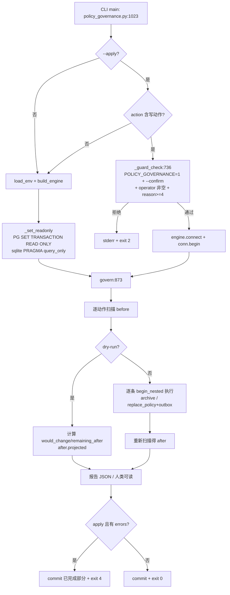

# 28 政策数据治理工具（policy_governance）设计·实现·实测

> 基线：工作区 HEAD `2df1bf5`（2026-11-08，T18–T22 已并入）。本工具的只读实测在 16:17 执行（当时 HEAD=1693c34），实测后再次复核生产库计数/schema 未变化（policy 3337、status 在用 3333/停用 4、outbox 仍不存在、deleted_at 仍不存在）。本文只记录新增工具与只读实测，不改任何生产代码/数据。
> 交付物：`deploy/policy_governance.py`（1101 行）、`tests/test_policy_governance.py`（412 行 / 25 用例）。
> 上游依据：`docs/redesign/24-policy-data-governance.md`（审计口径与 1111 条建议动作）、`docs/redesign/18-policy-lifecycle-code-audit.md`（生命周期/级联）、`docs/redesign/21-policy-lifecycle-implementation.md`（T18 实现与开关矩阵）。

## 1. 一句话结论

1. **审计到执行之间缺的那一层已补齐**：`deploy/policy_data_audit.py` 只出报告（"建议归档 40 条、重复 917 组"），本工具把其中**可确定性执行**的三类建议（归档空壳、回填范围、修复范围不一致）做成带护栏的 CLI，默认只读、写操作三重确认、逐条 SAVEPOINT 隔离失败。
2. **生产库真实只读实测与 doc24 完全对齐**：policy 3337 / detail 9403 / policy_scope 15493；空壳 40 条（全部 S 级、39 条在用、均无 scope 行）；重复组 917 组覆盖 3430 行冗余 2513 行；跨级同名 145 个覆盖 961 行；scope 不一致 **0 条**，仅 1 条口径差异（X-JY-038）。
3. **现网最值得做的写动作只有一个**：`archive-empty-shells` 的 40 条空壳（低风险、可回退）；`backfill-scope` 当前目标 40 条全部"无地区文本"（planned_rows=0，apply 会跳过），**现网无可回填项**；`fix-scope-mismatch` 无事可做。重复合并（917 组）仍必须人工，本工具只输出清单不合并。
4. **写安全不是靠"小心"，是靠代码结构**：`POLICY_GOVERNANCE=1` 开关默认关 + `--confirm` + operator/reason 校验（`policy_governance.py:736-748`）；dry-run 在 PG 上开 `SET TRANSACTION READ ONLY`、sqlite 开 `PRAGMA query_only`（:119-130）；apply 逐条 `begin_nested()`，单条失败只记 errors 不中断，退出码 4 提示部分完成。
5. **已知的第一次 apply 副作用必须提前知情**：生产 `outbox` 表不存在、`policy.deleted_at` 列不存在，首次 `--apply` 会经 `lifecycle.ensure_schema` 建表/加列（`src/policy_core/lifecycle.py:163`）——这是 T18 生命周期设计的一部分，不是本工具新增写路径。

## 2. 背景与边界

| 项 | 内容 |
|---|---|
| 上游问题 | doc24 §10 给出 1111 条建议动作（archive 40、merge 917、manual 145+、backfill 时效/缺县/scope），但审计脚本只读输出，无法执行；doc18 指出无删除/无级联/无 outbox 消费 |
| 本轮目标 | 把「可确定性执行」的建议落成运维可用的治理 CLI，且**默认不写库** |
| 硬约束 | 不写生产库（--apply 只在 sqlite 测试跑）、不 commit、不重启服务、不改 env、开关默认关闭 |
| 非目标 | 不合并重复政策、不改 regions 文本、不删政策记录、不修复时效字段、不做全国覆盖、不消费 outbox |
| 复用 API | `lifecycle.archive`（状态机+审计+级联事件）、`policy_scope.rows_for/replace_policy/ensure_schema`、`outbox.enqueue`（幂等） |
| 不手写 SQL 的范围 | 所有**写**均走 lifecycle / policy_scope / outbox 既有函数；手写 SQL 仅用于检测（SELECT 与聚合） |

## 3. 生产库真实快照（2026-11-08 只读实测）

命令（只读，ADMIN_DB_URL 来自 deploy/web.env）：

```bash
cd /home/adminroot/smart-help
set -a && . deploy/web.env && set +a
PYTHONPATH=src:. /home/adminroot/miniconda3/envs/smart-help-web/bin/python   deploy/policy_governance.py --report --json --action all > /tmp/govern_report.json
# exit=0，报告 237810 字节，mode=dry-run，dialect=postgresql
```

| 指标 | 实测值 | 取数方式 |
|---|---|---|
| policy 总数 | 3337（在用 3333 / 停用 4） | `SELECT COUNT(*) FROM policy`；报告 `archive.before.total_policies` |
| policy_detail 总数 | 9403 | 快照查询 + doc24 |
| policy_scope 行数 | 15493（policy 级 6090 行，覆盖 3297 个政策 code） | `SELECT COUNT(*)/COUNT(DISTINCT policy_code)` |
| 空壳政策 | **40**（S 级 40、在用 39、regions 空 40、scope 0 行、均有 1 个版本） | 报告 `archive.before` |
| 无 scope 行的政策 | 40（与空壳完全重合） | 报告 `backfill.before.targets` |
| 重复组（region+conditions+target 全同） | 917 组 / 覆盖 3430 行 / 冗余 2513 行 | 报告 `report-manual.counts` |
| 跨级同名 | 145 个政策名 / 覆盖 961 行 | 同上 |
| scope 不一致 | **0**；口径差异 1（X-JY-038，regions='全省'） | 报告 `fix-scope-mismatch.before` |
| policy 向量 | policy_vector_qwen3 10424 行 | `SELECT COUNT(*)` |
| outbox 表 | **不存在**（首次 apply 时由 lifecycle.ensure_schema 创建） | `to_regclass('public.outbox') IS NULL` |
| policy.deleted_at | **不存在**（首次 archive 时 ALTER 添加） | information_schema 查询 |
| audit_log | 存在，列为 log_id/action/target_code/target_name/detail/operator/created_at | information_schema 查询 |

> 关键读法：**"有 regions 文本的 3297 个政策都已有 scope 行"**（mismatch=0），所以剩余 40 条无 scope 行的政策正是那 40 条空壳——它们的问题不是"没回填"，而是"没有地区文本可回填"。数据治理的主战场因此从"范围"转向"空壳 + 重复 + 时效"。

## 4. 工具设计

### 4.1 动作表

| 动作 | 读/写 | 口径（检测函数:行） | apply 行为（写函数:行） | 跳过/转人工规则 |
|---|---|---|---|---|
| `report-manual` | 只读 | 重复组按 `(region, conditions, target)` 全同分组保留最小 detail_id；跨级同名按 policy_name 同时出现在 X 与 S 级（`scan_report_manual:565`） | 无（恒只读，`applied=0`） | 合并需人工确认版本/引用，工具不做 |
| `archive-empty-shells` | 写 | policy 无明细 + regions 空 + policy_scope 0 行 + 状态可归档（在用/停用）（`scan_empty_shells:254`） | 逐条 `lifecycle.archive(conn, code, reason, operator)`（`apply_archive:645`）：UPDATE status/updated_by + audit_log + outbox 4 类事件 | 有明细/有地区/有 scope/已归档/草稿 → 计数进 `skipped` |
| `backfill-scope` | 写 | 目标=--codes 指定或「policy_scope 无任何行」的政策；用 `rows_for(regions, details)` 计算计划行数（`scan_scope_backfill:372`） | `policy_scope.ensure_schema` → 每政策 `replace_policy` 全量重建 → `outbox.enqueue('policy.cache_invalidate')`（`apply_scope_change:681`） | regions 空 → planned_rows=0 → `no_regions` 跳过 |
| `fix-scope-mismatch` | 写 | policy 级 scope region_key 集合 vs `rows_for(regions, 无明细, default_province)` 期望集合，差异即 mismatch（`scan_scope_mismatch:477`） | 同 backfill，但只处理 `safe=True` 条目，并额外投递 cache_invalidate | 期望 0 行但实际有 scope 行（会删行）→ `would_clear_scope_rows` 跳过；裸「全省」口径差异只报 `audit_parity` 不写库 |

### 4.2 报告结构（JSON）

| 字段 | 含义 |
|---|---|
| `command/version/generated_at` | `policy-governance` / `policy-governance-1` / ISO 时间 |
| `mode` | `dry-run` 或 `apply` |
| `action/limit/operator/reason/default_province/codes/dialect` | 运行参数与连接方言 |
| `guards` | `{switch, switch_enabled, confirm, apply}`（`policy_governance.py:890-895`） |
| `actions.<name>.before` | 扫描计数（含 `eligible` / `skipped` / `counts`） |
| `actions.<name>.items[:2000]` | 明细清单（`SCAN_ITEMS_CAP=2000`；报告打印只取 `MAX_SAMPLE=20`） |
| `actions.<name>.applied/would_change/remaining_after/after` | apply 结果或 dry-run 投影（`after.projected=True`） |
| `actions.<name>.errors/skipped/notes/truncated` | 逐条失败、跳过原因、口径说明 |

### 4.3 编排流程



### 4.4 与 `policy_data_audit.py` 的口径对照

| 项 | policy_data_audit.py | policy_governance.py | 差异说明 |
|---|---|---|---|
| 空壳定义 | 无明细（`empty_shells:300`） | 无明细 + regions 空 + scope 0 行 + 可归档状态（`:254`） | 治理口径更严，避免把"待补明细"误归档 |
| 重复组 | `(region, conditions, target)` 全同（`:336`） | 同口径，但多输出 codes/levels/keep_detail_id（`:565`） | 一致（实测均 917 组/2513 冗余） |
| 跨级同名 | X 与 S 同名（`:377`） | 同口径，输出每级 code 列表 | 一致（145/961） |
| 范围不一致 | 不传 default_province，裸「全省」记 U:全省 → 报 X-JY-038（`scope_consistency:548`） | 按 `default_province=江西省` 归一到 P:江西省 → mismatch=0；口径差异单列 `audit_parity` | **有意差异**：写库统一用省口径，否则会产生 U: 残留键 |

## 5. 写安全设计

| 机制 | 实现 | 证据 |
|---|---|---|
| 写开关默认关 | `POLICY_GOVERNANCE` 默认 `0`；`apply_allowed()` 每次实时读 env，接受 1/true/yes/on | `policy_governance.py:49-51,109-111` |
| apply 三重护栏 | 开关 + `--confirm` + operator 非空 + reason ≥4 字符，任一不满足抛 `GovernanceRefused`，CLI exit 2 | `:736-748,1038-1042` |
| report 动作不可写 | `--action report-manual --apply` 时 `writes=False` → 主动降级为 dry-run | `:1036-1037`（测试 `test_main_report_manual_degrades_apply_to_readonly`） |
| dry-run 连接只读兜底 | PG `SET TRANSACTION READ ONLY`（失败退化 SET SESSION）；sqlite `PRAGMA query_only=ON` | `:119-130` |
| dry-run 不建表 | 所有检测只走 SELECT/inspect；`ensure_schema` 仅在 apply 分支调用 | 测试 `test_dry_run_creates_no_tables_and_no_rows` 断言 policy_scope/outbox 不存在 |
| 逐条隔离 | 每条 `with conn.begin_nested()`；`LifecycleError` 与普通异常都记 errors 继续 | `:645-678,681-727` |
| 部分失败可重试 | 有 errors 时整体仍 commit 已完成条目，exit 4 提示部分完成 | `:1096-1098` |
| 幂等 | archive 走状态机（已归档再归档报 409 并跳过）；policy_scope.replace_policy 先 DELETE 后 INSERT；outbox.enqueue 同事件+payload 幂等 | 测试 `test_apply_is_idempotent`（第二次 applied=0、outbox 仍 4 条） |
| 连接失败不写 | build/connect 失败 → stderr + exit 2，不进入写分支 | `:1044-1063`（测试 `test_main_connection_failure_exit_2`） |
| 退出码 | 0 成功 / 1 执行异常（已回滚）/ 2 护栏或连接拒绝 / 4 部分完成 | `:52` |

### 5.1 首次 apply 的 DDL 副作用（必须知情）

生产当前 `outbox` 表不存在、`policy.deleted_at` 列不存在。首次 `--apply archive-empty-shells` 会执行 `lifecycle.ensure_schema(conn)`（`src/policy_core/lifecycle.py:163`）：

1. `CREATE TABLE IF NOT EXISTS outbox (...)`（`src/policy_core/outbox.py` 的 8 列结构）；
2. `ALTER TABLE policy ADD COLUMN deleted_at`（PG 用 `IF NOT EXISTS` 容错）。

这是 T18 生命周期建表逻辑，不属于本工具新增写路径；但它意味着"第一次 apply 一定伴随 DDL"，运维需把它计入变更窗口。`audit_log` 已存在（`log_id` 为自增主键，与 lifecycle `_audit:202` 兼容）。

### 5.2 回退方式

| 场景 | 回退 |
|---|---|
| 误归档（active→archived） | `lifecycle.restore`（archived→active 合法，见 doc21 §4 状态机）或 `lifecycle.suspend` 转停用；**不要**直接 UPDATE status（会绕过 audit/outbox） |
| 误回填/重建 scope | 按 regions 文本重跑 `policy_scope.replace_policy` 即可覆盖（幂等）；需恢复历史值请用备份 |
| 只读报告有误 | 无写入，重跑即可 |
| 关闭写能力 | 不传 `--apply`，或把 env `POLICY_GOVERNANCE` 设回 `0` |

## 6. 测试

新增 `tests/test_policy_governance.py`（412 行 / **25 用例**），sqlite 临时文件库 + `importlib` 从 deploy 加载模块（与 `tests/test_policy_data_audit.py` 同风格）。

| 分组 | 用例数 | 覆盖点 |
|---|---|---|
| ReportTests | 4 | 四动作报告结构、guards、dry-run 不建表不写 audit、limit 截断、重复组+跨级同名只读 |
| ArchiveTests | 5 | dry-run 只列 eligible、apply 归档+4 类 outbox+audit、二次 apply 幂等、有 scope 行跳过、limit 只归档 2/3 |
| BackfillTests | 4 | dry-run 不建表、apply 生成 scope 行且 `match(新建区)=applicable/same`、--codes 限定、无地区跳过 reason=no_regions |
| MismatchTests | 3 | 错误 scope 检出并重建（东湖区→新建区）、全省口径 audit_parity 只报不写、would_clear_scope_rows 跳过 |
| GuardTests | 6 | 缺开关/缺 confirm/reason 过短拒绝（API 与 CLI 双路径）、CLI 退出码 2、连接失败 exit 2 |
| CliTests | 3 | CLI apply 归档成功+JSON 解析、report JSON 结构、report-manual + --apply 降级只读 |

实测：

```bash
cd /home/adminroot/smart-help
PYTHONPATH=src:. /home/adminroot/miniconda3/envs/smart-help-web/bin/python   -m unittest tests.test_policy_governance
# Ran 25 tests in 0.422s — OK
```

关键断言（不只数返回码，还查库）：
- apply 后 `SELECT status FROM policy WHERE policy_code='X-A-1'` = `archived`、`audit_log` 1 行且 operator='tester'、`outbox` 恰为 `outbox.EVENT_TYPES` 4 类；
- backfill 后用真实代码 `policy_scope.match(policy_scope.load_scopes(conn,['X-B-1'])['X-B-1'],'新建区')` 断言 `applicable=True, relation='same'`；
- mismatch 修复后 `region_key` 集合不含东湖区、含 `X:江西省/南昌市/新建区`；
- unsafe 条目断言 `skipped[0]['reason']=='would_clear_scope_rows'` 且 `policy_scope` 行数不变。

## 7. 真实只读报告详解（2026-11-08 实测）

### 7.1 report-manual（只读）

| 指标 | 值 | 样例 |
|---|---|---|
| 重复组 | 917 组 / 覆盖 3430 行 / 冗余 2513 行（26.7%） | 第一组：都昌县「须是当年新发展的产业。」+「防止返贫致贫对象,脱贫人口」→ 43 行，涉及 X-CY-564 / X-CY-566，保留 detail_id=9343 |
| 跨级同名 | 145 个名 / 961 行（28.8%） | 同名同时出现在 X 级与 S 级 |
| items | 345 条 = 重复组样本 200 条（`--limit` 默认 200 截断，分组按行数降序）+ 跨级同名全量 145 条 | 重复组含 kind/codes/levels/keep_detail_id；跨级名含 levels/codes/rows |

结论：合并动作风险高（要处理版本、引用、问答日志），**保持人工**，工具只提供机器可读清单。

### 7.2 archive-empty-shells（写，450→0 dry-run）

| before | 值 | 说明 |
|---|---|---|
| total_policies | 3337 | |
| no_detail | 40 | 与 doc24 完全一致 |
| eligible | **40** | 全部 S 级、39 条在用 + 1 条停用 |
| null_regions / zero_scope | 40 / 40 | 三条口径互相印证 |
| zero_versions | 0 | 40 条都有 1 个版本快照（归档不丢版本） |
| 向量 | 每条 2 张表各 1 行（policy_vector_qwen3 + policy_vector） | 归档后策略级向量仍保留，需 worker 或手工清理 |

dry-run 投影：`would_change=40, remaining_after=0, after={projected:True, eligible:0, archived:40}`。

### 7.3 backfill-scope（写，现网 0 目标）

| 指标 | 值 |
|---|---|
| targets | 40（即空壳） |
| with_rows | **0** |
| empty_rows | 40（全部 no_regions） |
| planned_rows | 0 |

原因链：mismatch=0 说明 3297 个有 regions 的政策都已有 scope 行 → "无 scope 行"的只剩 40 条空壳 → 它们 regions 为空 → planned_rows=0 → apply 会全部跳过并记 `no_regions`。**这不是故障，是数据现状**：范围回填的历史工作已经完成，工具在现网没有可执行目标；它仍有价值用于未来导入的新政策（新政策入库后 scope 可能缺失）。

### 7.4 fix-scope-mismatch（写，现网 0 条）

| 指标 | 值 |
|---|---|
| policies | 3337 |
| mismatch | **0** |
| safe_to_fix / unsafe | 0 / 0 |
| audit_parity | **1** |
| scope_policies | 3297 |

唯一口径差异：`X-JY-038`（regions='全省'）——`policy_data_audit.py` 不传 default_province，期望 `U:全省`，实际 `P:江西省`；本工具按省口径归一后视为一致，只在报告里单列 `audit_parity_items`。写库口径固定为"省口径"，避免产生 `U:` 残留键（doc24 的 0 残留结论）。

> 综合三节：现网真正可执行且低风险的只有 **archive 40 条空壳**；这与 doc24 §10「建议动作 1111 条中 merge 917 需人工、backfill 时效/缺县属另一任务」的判断一致。

## 8. 运维手册（runbook）

```bash
# 0) 环境（生产库只读账号 URL 来自 deploy/web.env）
cd /home/adminroot/smart-help && set -a && . deploy/web.env && set +a
PY=/home/adminroot/miniconda3/envs/smart-help-web/bin/python
export PYTHONPATH=src:.

# 1) 只读体检（不写库；可每天跑）
$PY deploy/policy_governance.py --report --json --action all > /tmp/govern_$(date +%F).json
# 人类可读：$PY deploy/policy_governance.py --report --action archive-empty-shells

# 2) 备份（apply 前必须）：逻辑备份 policy/policy_detail/policy_scope/audit_log
pg_dump "$ADMIN_DB_URL" -t policy -t policy_detail -t policy_scope -t audit_log   > /tmp/policy_before_govern_$(date +%F).sql

# 3) 小批量 apply（先 5 条验证，再放大；reason 写清批次）
POLICY_GOVERNANCE=1 $PY deploy/policy_governance.py --apply --confirm   --action archive-empty-shells --limit 5   --operator "ops:<姓名>" --reason "治理批次 2026-11-08：归档无明细空壳前 5 条"

# 4) 验证
$PY deploy/policy_governance.py --report --action archive-empty-shells   # eligible 应从 40 递减
# SQL 抽查：SELECT policy_code,status,updated_by,updated_at FROM policy WHERE status='archived';
# outbox：SELECT event_type,COUNT(*) FROM outbox GROUP BY event_type;（4 类各 40 条为预期）

# 5) 回退单条（需生命周期开关；生产默认关，见 doc21/26）
#   --action 无 restore 子命令；走 api 或 lifecycle.restore(conn, code, reason, operator)
```

执行顺序建议：**archive 40 空壳 → report-manual 清单交业务合并 → backfill 等新导入政策出现缺 scope 时再跑 → mismatch 常跑常清**. 不要 `--apply --action all`（会把回填动作也带上，虽当前 0 目标，但语义不清晰）。

## 9. 已知限制与未做项

| # | 限制 | 影响 | 后续 |
|---|---|---|---|
| L1 | 不合并重复组（917 组/2513 冗余行） | 检索仍会出重复卡片；合并需版本/引用决策 | 另立人工流程或用 `keep_detail_id` 依据做半自动合并（需设计） |
| L2 | 不删政策记录，归档只改 status | 空壳仍占 policy 行；向量保留 | 需 `delete` 状态机 + 级联清理（doc18 建议 R2/R5） |
| L3 | outbox 4 类事件无消费者（POLICY_WORKER=0，autopilot.outbox_drain 需 handler） | 归档后规则/向量/图谱不联动，事件堆积 | 等 T18/T19 worker 接线；运维可先手工处理策略级向量 |
| L4 | 现网 backfill/mismatch 0 目标 | 工具在这两项上"空转" | 未来导入新政策后自动生效；`--codes` 可定向 |
| L5 | 裸「全省」两种口径并存 | audit 报 1 条 parity | 报告单列，不写库；等统一地区口径（doc24 §4） |
| L6 | sqlite 与 Kingbase 差异 | 单测覆盖不到空串=NULL、保留字 `level`、DATE 文本比较 | 检测层用 `_blank_sql`（:170）与 `p."level"` 兼容；真实 PG 只读实测已覆盖 |
| L7 | 报告 limit 语义 | `--limit` 同时限制"扫描明细"与"apply 条数" | dry-run 的 `would_change` 已按 limit 计算，`remaining_after` 明确 |
| L8 | 首次 apply 有 DDL 副作用（outbox、deleted_at） | 变更窗口需知情 | 见 §5.1 |
| L9 | 未接 app.py / 未做后台线程 | 只能人工触发 | 与 doc21 开关矩阵一致（POLICY_AUTOPILOT 默认关） |

## 10. 文件与复现

| 文件 | 行数 | 内容 |
|---|---|---|
| `deploy/policy_governance.py` | 1101 | CLI + 检测（:254/:372/:477/:565）+ 写（:645/:681）+ 护栏（:736）+ 编排（:873）+ 报告（:928）+ main（:1023） |
| `tests/test_policy_governance.py` | 412 | 25 用例（6 组） |
| `docs/redesign/28-policy-governance.md` | 本文件 | 设计/口径/实测/runbook |

复现命令：

```bash
# 单文件测试
cd /home/adminroot/smart-help
PYTHONPATH=src:. /home/adminroot/miniconda3/envs/smart-help-web/bin/python   -m unittest tests.test_policy_governance -v

# 全量回归（2026-11-08 16:19 实测：Ran 904 tests — OK，含本工具 25 例；T18–T22 并入后基线已全绿）
set -a && . deploy/web.env && set +a
PYTHONPATH=src:. /home/adminroot/miniconda3/envs/smart-help-web/bin/python   -m unittest discover -s tests -p 'test_*.py'

# 真实只读报告（不写库）
PYTHONPATH=src:. /home/adminroot/miniconda3/envs/smart-help-web/bin/python   deploy/policy_governance.py --report --json --action all
```

### 证据索引

| 结论 | 证据 |
|---|---|
| 开关默认关/退出码 | `deploy/policy_governance.py:49-52` |
| 三重写护栏 | `:736-748,1036-1042` |
| dry-run 只读 | `:119-130` |
| 空壳口径 | `:254-348` |
| 回填/不一致/人工清单口径 | `:372-459, :477-560, :565-643` |
| 归档写路径 | `:645-678` + `src/policy_core/lifecycle.py:374`（archive）/`:334`（_transition）/`:163`（ensure_schema）/`:221`（_enqueue_cascade） |
| scope 写路径 | `:681-727` + `src/policy_core/policy_scope.py:97-200` |
| outbox 幂等/事件类型 | `src/policy_core/outbox.py:22`（EVENT_TYPES）/`:94`（enqueue 幂等） |
| 生产快照 | 本文 §3（2026-11-08 只读实测，报告 /tmp/govern_report.json） |
| 与 doc24 对齐 | doc24 §10（1111 建议：archive 40/merge 917/manual 145+） |
